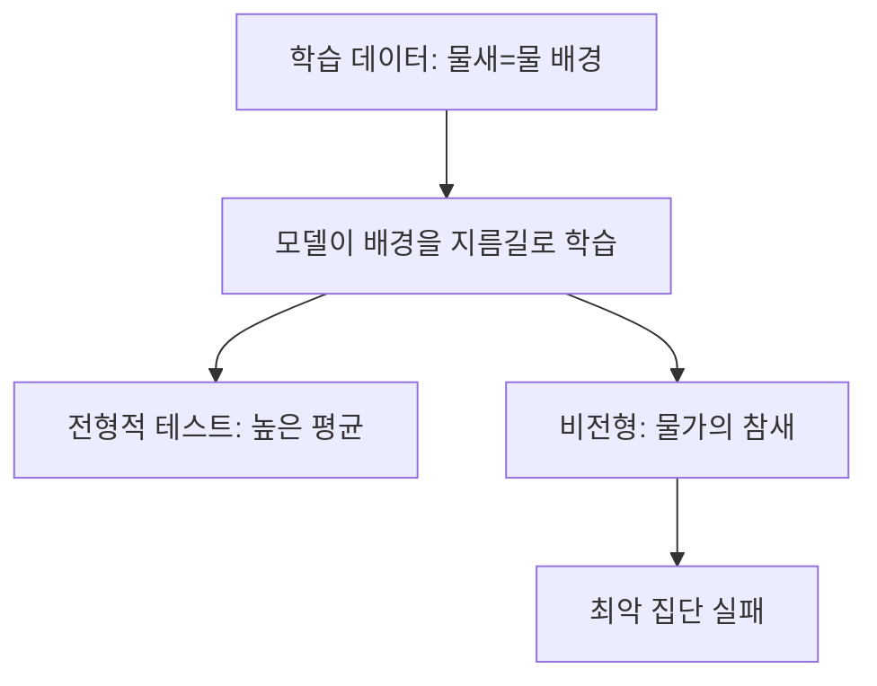
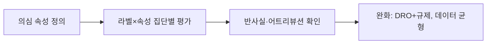

# 가짜 상관

> 학습 데이터에서는 정답과 함께 나타나지만 **정답의 원인은 아닌 단서**(배경, 워터마크, 촬영 장비 등)를 모델이 지름길로 배워, 평균 점수는 높아도 그 단서가 깨진 집단에서는 무너지는 현상.

## 쉽게 말하면
"물가 사진엔 물새, 숲 사진엔 육지 새"가 대부분인 사진집으로 새 이름 맞히기를 배운 학생은 새를 안 보고 배경만 본다. 물가에 있는 참새 사진에서는 물새라고 답한다. 평소 시험(대부분 전형적인 사진)에서는 높은 점수라 들키지 않는다.

## 자세히
- **정의**: 학습 분포에서는 라벨과 통계적으로 상관이 있지만 **인과적 근거가 아닌 특징**(spurious feature)을 모델이 사용. 평균(전형적 샘플)에서는 잘 맞고 비전형 집단(그 상관이 반대인 집단)에서 실패한다.
- **대표 벤치마크 Waterbirds**: 육지 새 vs 물새 분류에서 배경이 라벨과 가짜 상관. 검색 요약: 모델이 새를 무시하고 배경만 봐도 분포 내 정확도가 약 95%에 이를 수 있다.
- **Sagawa 외(ICLR 2020, arXiv 1911.08731, 초록 확인)**: 과매개 신경망은 평균 정확도가 높아도 평균에서는 성립하지만 특정 집단 안에서는 성립하지 않는 가짜 상관을 배워 비전형 집단에서 실패한다. 그룹 DRO(최악 집단 손실 최소화)를 그냥 적용하면 모델이 학습 데이터를 완벽히 맞춰 최악 학습 손실도 0이 되어 소용없지만, **더 강한 규제(큰 L2 또는 조기 종료)** 를 함께 쓰면 최악 집단 정확도가 자연어 추론 1개·이미지 2개 과제에서 **10~40%p** 향상되고 평균 정확도는 높게 유지된다.
- **발견법**
  1. **집단별 평가**: (라벨 × 의심 속성) 조합의 정확도를 따로 본다([평균이 약한 집단을 가리는 문제](#average-masking-weak-groups)).
  2. **슬라이스 자동 탐색**: [AttributionScanner](#attributionscanner)처럼 모델이 주목하는 영역이 비슷한 샘플 묶음을 찾아 사람이 확인.
  3. **반사실 테스트**: 배경만 바꾸거나 그 단서를 지워 예측이 바뀌는지.
  4. **어트리뷰션(GradCAM 등)**: 모델이 새가 아니라 배경을 보는지 시각화.
- **완화**: 최악 집단을 직접 최적화(Group DRO)+강한 규제, 데이터 균형화(비전형 집단 증강), 속성 제거·가림, 단서가 없는 평가 세트 확보. 집단 라벨(속성)이 필요한 방법이 많다는 한계가 있다.
- **LLM 맥락**: 프롬프트 형식·길이·특정 단어 같은 표면 단서, 벤치마크 오염도 지름길이 될 수 있다(일반 지식).

## 그림으로 보기

## 예시
- 흉부 X선 분류기가 병원별 촬영 마커·장비 특성으로 진단을 맞힌다면 다른 병원에서 성능이 급락한다.
- 점검 코드: `df.groupby(["label","background"]).apply(acc)`로 4칸 정확도를 비교, 비전형 칸이 낮으면 가짜 상관 의심.

## 헷갈리는 것과 비교
| 개념 | 설명 |
|---|---|
| 가짜 상관 | 비인과 단서에 의존 |
| 데이터 누수 | 정답 정보가 입력에 섞임 |
| 분포 이동 | 운영 분포가 바뀜(가짜 상관이 깨질 때 표면화) |
| 편향 | 집단 간 성능·결과 격차 |

## 더 읽을거리
- [Distributionally Robust Neural Networks for Group Shifts (arXiv 1911.08731)](https://arxiv.org/abs/1911.08731) — 가짜 상관·그룹 DRO·규제 효과(초록 열어 확인).
- Waterbirds 설정의 "95%" 서술은 검색 결과 요약 기준(논문 표 직접 미확인).
