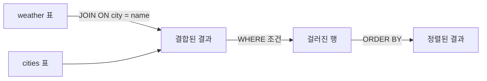
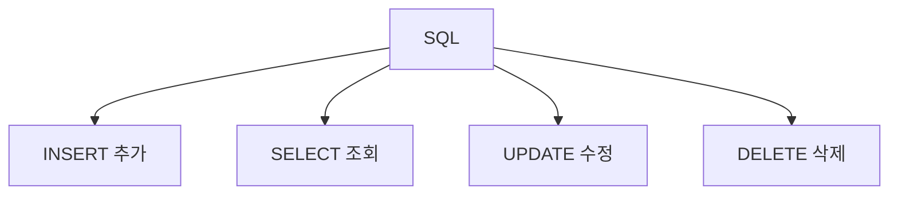

# SQL 기초

> SQL은 관계형 데이터베이스의 표(테이블)에 "무엇을 보여 줘·넣어 줘·바꿔 줘·지워 줘"라고 말하는 질의 언어다. 핵심 동사는 SELECT·INSERT·UPDATE·DELETE, 표를 잇는 도구는 JOIN이다.

## 쉽게 말하면
데이터베이스는 엑셀 시트 여러 장이 묶인 서류함이다. SQL은 서류함 담당자에게 건네는 주문서다. "고객 시트에서 서울 사는 사람 이름만 뽑아 줘"가 SELECT + WHERE. 시트가 둘이면(주문, 고객) 공통 번호로 이어 붙이라고 말하는 게 JOIN이다.

## 자세히
PostgreSQL 튜토리얼 예제(날씨 `weather`, 도시 `cities` 표) 기준:
- **INSERT**: 행 추가. 열 이름을 명시하면 열 순서가 바뀌어도 안전하다.
- **SELECT**: 읽기. `SELECT *`는 전체 열, 열 이름을 나열하면 일부, `AS`로 별칭, `ORDER BY ... DESC`로 정렬.
- **WHERE**: 행 필터. `WHERE city = 'Hayward' AND prcp > 0`.
- **JOIN**: `weather JOIN cities ON city = name`으로 두 표를 조건으로 연결. `LEFT OUTER JOIN`은 짝이 없는 왼쪽 행도 남긴다.
- **UPDATE ... SET ... WHERE**, **DELETE ... WHERE**: 수정·삭제. **WHERE를 빼면 모든 행이 대상**이 된다 — 가장 흔한 사고.
- **AI와 쓸 때**: 쿼리를 시키되 ① 먼저 SELECT로 대상 행을 확인 ② 수정·삭제는 트랜잭션이나 복사본에서 ③ 사용자 입력은 문자열 이어붙이기 대신 파라미터 바인딩(SQL 인젝션 방지).

## 그림으로 보기



## 예시
```sql
SELECT city, temp_hi FROM weather
WHERE temp_hi > 50 ORDER BY temp_hi DESC;

UPDATE weather SET prcp = 0 WHERE city = 'Hayward';  -- WHERE 확인!
```
AI 프롬프트: "orders와 customers를 JOIN해 지난달 주문 합계 상위 10명을 구하는 SELECT를 써 줘. 실행 전 대상 행 수를 확인하는 COUNT 쿼리도 같이."

## 헷갈리는 것과 비교
| 개념 | 차이 |
| --- | --- |
| INNER JOIN vs LEFT JOIN | 전자는 양쪽에 짝 있는 행만, 후자는 왼쪽 전부 유지 |
| DELETE vs DROP | DELETE는 행 삭제, DROP은 표 자체 삭제 |
| [데이터베이스 기초](#database-basics) | 표·키·관계 개념. SQL은 그것을 다루는 언어 |
| [백업과 복구](#db-backup) | 잘못된 DELETE에 대비하는 안전망 |

## 더 읽을거리
- [PostgreSQL Tutorial: The SQL Language](https://www.postgresql.org/docs/current/tutorial-sql.html) — INSERT/SELECT/JOIN/UPDATE/DELETE 예제
