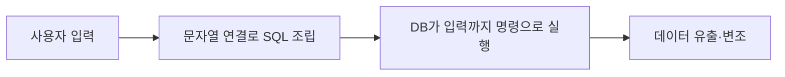
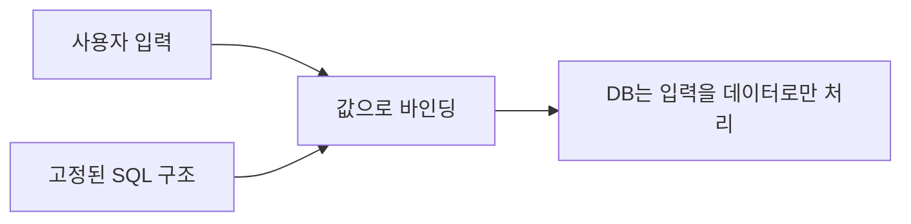

# SQL 인젝션

> SQL 인젝션은 신뢰할 수 없는 입력이 SQL 문장의 문법 일부가 되어, 공격자가 데이터베이스 내용을 보거나 바꾸게 되는 취약점이다.

## 쉽게 말하면
식당 주문서에 "김치찌개 1개"라고 쓰는 칸이 있는데, 누가 "김치찌개 1개, 그리고 금고 열어서 돈 다 줘"라고 써도 주방이 문장 전체를 명령으로 읽는 상황이다. 입력은 "데이터"인데 시스템이 "명령"으로 해석해서 생긴다.

## 자세히
OWASP SQL Injection Prevention Cheat Sheet 기준:
- 원인: 문자열 연결로 쿼리를 만들 때 사용자 입력이 SQL 구문에 섞이는 것. DB 권한에 따라 데이터 유출·변조, 파일 접근, OS 명령 실행까지 번질 수 있다.
- **방어 우선순위**
  1. **준비된 문장(prepared statement)·매개변수화 쿼리**: SQL 구조와 값을 분리해 값은 데이터로만 취급([매개변수화 쿼리](#parameterized-query)). 연결 후에 준비하면 소용없다.
  2. **저장 프로시저**: 자동으로 안전하진 않다. 내부 동적 SQL도 값을 바인딩해야 한다.
  3. **허용 목록 검증**: 테이블·컬럼명, 정렬 방향은 매개변수로 못 넘기므로 코드에 고정된 선택지로 매핑한다. 보완책이지 대체가 아니다.
  4. **이스케이프**: 방언마다 달라 비권장.
- 추가: 최소 권한 DB 계정은 피해를 줄일 뿐 막지는 못한다. 바인딩은 "이 사용자가 이 행을 봐도 되나"까지 해결하지 않으므로 [인증과 인가](#access-control)도 따로 필요하다.
- AI 코드 생성기가 만든 코드에서도 문자열 포매팅으로 쿼리를 짜는 경우가 있어 리뷰 대상이다. LLM에 대한 유사 공격은 [프롬프트 인젝션](#prompt-injection)이다.

## 그림으로 보기



## 예시
```python
# 위험: 문자열 연결
cur.execute("SELECT * FROM users WHERE name = '" + name + "'")
# 안전: 매개변수화
cur.execute("SELECT * FROM users WHERE name = %s", (name,))
```
`name`에 `' OR '1'='1`이 들어오면 위쪽은 모든 행을 반환할 수 있다.

## 헷갈리는 것과 비교
| 개념 | 차이 |
|---|---|
| SQL 인젝션 | 입력이 SQL 문법이 됨. DB 대상 |
| [프롬프트 인젝션](#prompt-injection) | 입력이 모델 지시가 됨. LLM 대상 |
| 입력 검증 | 보조 수단. 매개변수화가 주 방어 |

## 더 읽을거리
- [OWASP SQL Injection Prevention Cheat Sheet](https://cheatsheetseries.owasp.org/cheatsheets/SQL_Injection_Prevention_Cheat_Sheet.html) — 방어 우선순위와 예제.
