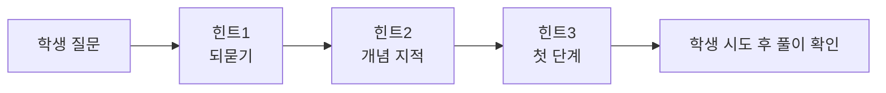

# 단계별 힌트 설계

> AI 튜터가 정답을 바로 주지 않고 약한 힌트에서 강한 힌트 순으로 올려 주는 구조.

## 쉽게 말하면
수학 선생님이 "어느 공식이 떠오르니?" → "넓이 공식을 써 봐" → "밑변×높이÷2야" 순으로 단서를 늘리는 방식이다.

## 자세히
- **보통 3~4단계**: ① 질문으로 되묻기 ② 개념 지적 ③ 첫 단계 보여주기 ④ 풀이 확인(학생이 먼저 시도한 뒤).
- **상승 규칙**: 학생이 시도·설명한 뒤에만 다음 단계로, 시도 없이 반복 요청 시 한 단계만 올림.
- **시스템 프롬프트로 강제**: Khanmigo는 소크라테스식 시스템 프롬프트로 설계되어 우회하기 어렵게 만들었다는 2차 설명(공식 확인 필요).
- **주의**: 힌트가 사실상 정답이 되거나 학생이 힌트만 소비하면 학습 효과가 없다. [우회 시험](#tutor-jailbreak-testing)으로 점검.

## 그림으로 보기

## 예시
시스템 프롬프트 일부: "학생이 먼저 시도하기 전에는 정답을 말하지 말고 한 단계 힌트만 준다."

## 헷갈리는 것과 비교
| 개념 | 차이 |
|---|---|
| 단계별 힌트 | 단서의 강도 조절 |
| [생산적 어려움](#productive-struggle) | 왜 막힘이 필요한가 |
| [튜터 가드레일](#ai-tutor-guardrails) | 전체 안전 설계 |

## 더 읽을거리
- [Hackernoon: Your AI tutor may be helping you learn less](https://hackernoon.com/your-ai-tutor-may-be-helping-you-learn-less) — 비판적 관점
- [Free Academy: AI as a Tutoring Assistant](https://freeacademy.ai/lessons/ai-tutoring) — 설계 개요
