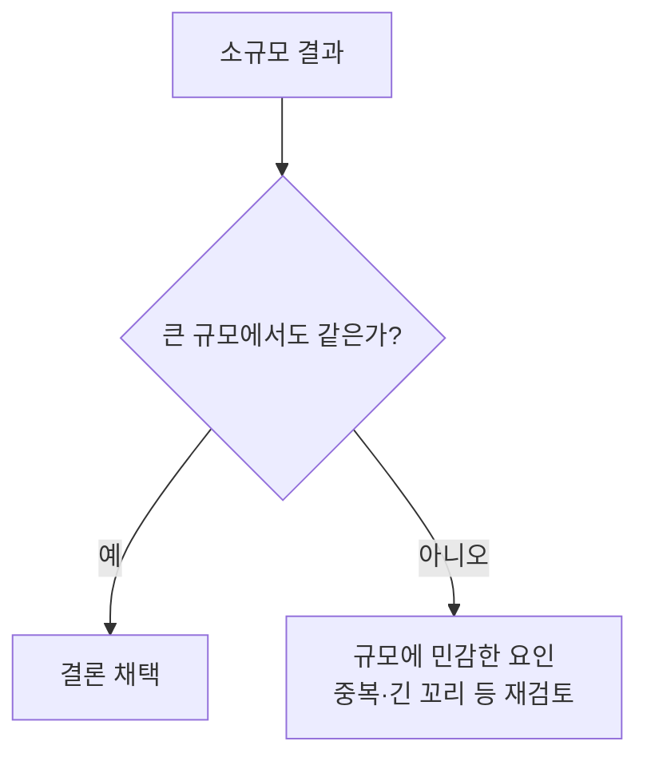

# 단계별 규모 검증

> 데이터나 설계 후보를 **작은 규모 실험으로 먼저 걸러 내고, 살아남은 소수만 더 큰 규모에서 다시 확인**하는 방식. 비용을 아끼면서 "작을 때만 맞는 결론"을 막는다.

## 쉽게 말하면
새 레시피 후보 10개를 모두 대형 주방에서 만들 수는 없다. 소형 화덕에서 먼저 맛을 보고 유망한 2~3개만 대형 주방에서 대량으로 시험한다. 소형 화덕에서 맛있던 것이 대형에서도 맛있는지 마지막에 확인하는 것이 핵심이다.

## 자세히
- **FineWeb의 2단계**(arXiv 2406.17557, PDF 본문 직접 읽음): ① 1.71B 모델·약 280억 토큰으로 필터 후보를 비교 ② 선택한 설계는 **3,500억 토큰** 실행으로 단계마다 누적 개선을 확인. 교육 점수 필터(FineWeb-Edu)도 같은 방식으로 3,500억 토큰 규모에서 확인했고, MMLU 33%→37%(상대 약 12%), ARC 46%→57%(약 24%) 개선을 보고한다. 분류기는 임계값 3에서 검증 F1 82%였다.
- **규모가 바뀌면 결론이 바뀌는 경우**: 전역 중복 제거는 작은 표본에서는 효과가 보이지 않았다. 3,500억 토큰 표본에서도 제거하지 않은 모델과 거의 같았고, 이 때문에 [중복 가시성](#dedup-visibility-sample-size) 문제가 거론됐다. 즉 작은 규모는 일부 효과를 못 본다.
- **다른 대규모 설계 사례**: DataComp-LM(arXiv 2406.11794, 초록 직접 읽음)은 412M~7B 파라미터의 여러 규모에서 데이터 큐레이션을 비교하는 테스트베드이고, 모델 기반 필터링이 핵심이라고 보고한다. 7B·2.6T 토큰 모델이 5-shot MMLU 64%에 도달했다(논문 주장). 규모 전이를 직접 분석한 내용은 초록에 없어 확인하지 못했다.
- **작은 규모가 큰 규모를 얼마나 맞히나**: Signal and Noise(arXiv 2508.13144, 직접 읽음)는 소규모 순위가 큰 모델 순위를 맞히는 비율을 "결정 정확도"로 정의하고, 벤치마크 SNR이 높을수록 결정 정확도가 높다(R=0.791)고 보고한다.
- **운영 요령(제안)**: ① 소규모에서 큰 차이만 후보로 남긴다 ② 후보는 큰 규모에서 한 번 더 ③ 소규모에서 효과가 없던 항목도 규모에 민감한 것(중복 제거 등)인지 따져 본다 ④ 최종 선택은 목표 규모 지표로 한다.

## 그림으로 보기

## 예시
| 단계 | FineWeb-Edu 사례 |
|---|---|
| 1단계 | 분류기 학습·임계값 후보 비교 |
| 2단계 | 3,500억 토큰 학습으로 확인 |
| 결과 | MMLU 33→37%, ARC 46→57% |
- 업무 장면: 사내 챗봇용 데이터 정제 방식 5가지를 작은 모델로 비교해 상위 2개만 큰 모델 파인튜닝으로 재검증한다.

## 헷갈리는 것과 비교
| 개념 | 차이 |
|---|---|
| 단계별 규모 검증 | 작은 규모 선별 후 큰 규모 재확인 |
| [Chinchilla 최적 학습량 ablation](#chinchilla-optimal-ablation) | 각 단계의 학습량을 정하는 기준 |
| [ablation 연산 예산](#ablation-compute-budget) | 단계 전체의 비용 |
| [중복 가시성과 표본 크기](#dedup-visibility-sample-size) | 소규모에서 안 보이는 효과의 예 |

## 더 읽을거리
- [The FineWeb Datasets (arXiv 2406.17557)](https://arxiv.org/abs/2406.17557) — 280억·3,500억 토큰 2단계 실험(PDF 직접 읽음).
- [DataComp-LM (arXiv 2406.11794)](https://arxiv.org/abs/2406.11794) — 다중 규모 데이터 큐레이션 테스트베드(초록 직접 읽음).
