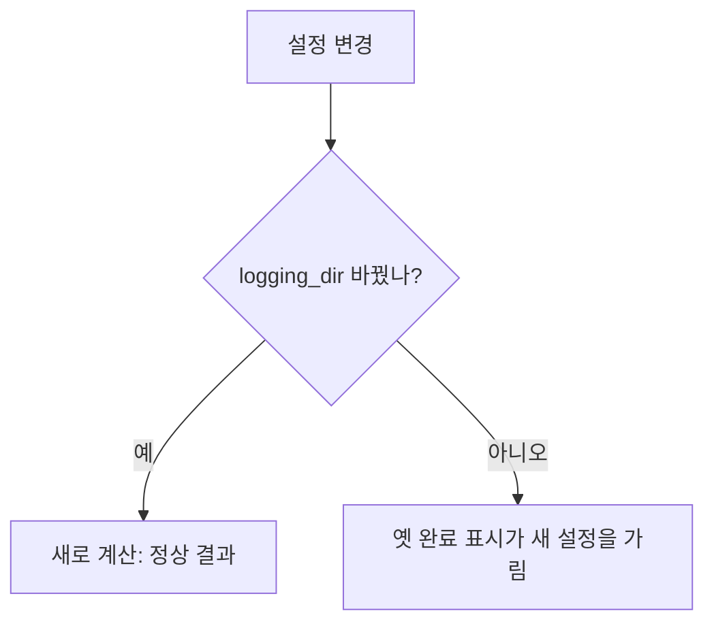

# 낡은 완료 표시 문제

> 재개 기능이 "이 조각은 이미 끝났다"는 **표시만 보고** 건너뛰면, 처리 코드나 설정을 바꿨는데도 옛 결과가 남아 새 설정이 적용되지 않는다. 이 낡은 완료 표시가 조용한 오류의 흔한 원인이다.

## 쉽게 말하면
빨래 바구니에 "세탁 완료" 스티커를 붙여 두었는데, 세제를 바꾼 뒤에도 스티커 때문에 다시 빨지 않는 상황이다. 스티커는 "그 세제로 빨았는지"까지는 모른다.

## 자세히
- datatrove는 task가 끝나면 `logging_dir/completions/`에 빈 파일을 만들고, 재실행 때 그 표시가 있으면 건너뛴다([skip_completed](#datatrove-skip-completed)). README는 같은 `logging_dir`을 다른 파이프라인·작업에 재사용하지 말라고 경고한다(열어 확인).
- 표시가 비어 있는 파일이라 **어떤 설정으로 끝났는지는 기록하지 않는다**.
- **직접 실행**(datatrove 최신판, JSONL 4파일×50문서, 글자 수 필터, tasks=4):

| 실행 | 필터 임계값 | logging_dir | 결과 |
|---|---|---|---|
| 1차 | 60자 초과 | logs_s | 148문서 남음 |
| 2차(설정만 바꿈) | 150자 초과 | **같은** logs_s, 새 출력 폴더 | **0문서**(4개 task 모두 건너뜀, 파일 생성 없음) |
| 3차 | 150자 초과 | **새** logs_s3 | 56문서 남음 |

  2차 실행은 오류 없이 끝났지만 새 출력 폴더가 비었다. 새 설정의 정상 결과(56)는 logging_dir을 바꾸자 나왔다. 오류 메시지가 없다는 점이 가장 위험하다.
- **방지책(제안)**: ① 설정·코드 버전을 `logging_dir` 이름에 넣는다(예: `logs/filter_v2_thr150`). ② 설정이 바뀌면 `skip_completed=False`로 돌리거나 `completions/`를 지운다. ③ 실행 끝에 출력 문서 수가 예상 범위인지 검사한다(0이면 경고). ④ 설정 해시를 완료 표시와 함께 저장하는 자체 래퍼를 쓴다.
- 일반 원칙: 캐시·체크포인트·완료 표시는 **입력과 설정이 바뀌면 무효화**되어야 한다(캐시 무효화 문제와 같은 계열).

## 그림으로 보기

## 예시
- 필터 임계값을 조정하며 반복 실험할 때 실행마다 `logs/run_<날짜>_<설정>`처럼 폴더를 분리.
- 교육: 위 3단계 실험을 직접 돌려 "오류 없이 0건"이 나오는 상황을 체험하게 한다.

## 헷갈리는 것과 비교
| 개념 | 차이 |
|---|---|
| [skip_completed](#datatrove-skip-completed) | 기능 자체. 편리하지만 설정 변화를 모름 |
| 낡은 완료 표시 | 그 기능이 만드는 함정 |
| 멱등성 | 같은 입력을 다시 처리해도 결과가 같게 설계 |
| 캐시 무효화 | 같은 계열의 일반 문제 |

## 더 읽을거리
- [huggingface/datatrove README](https://github.com/huggingface/datatrove) — completions와 logging_dir 재사용 경고(열어 확인).
