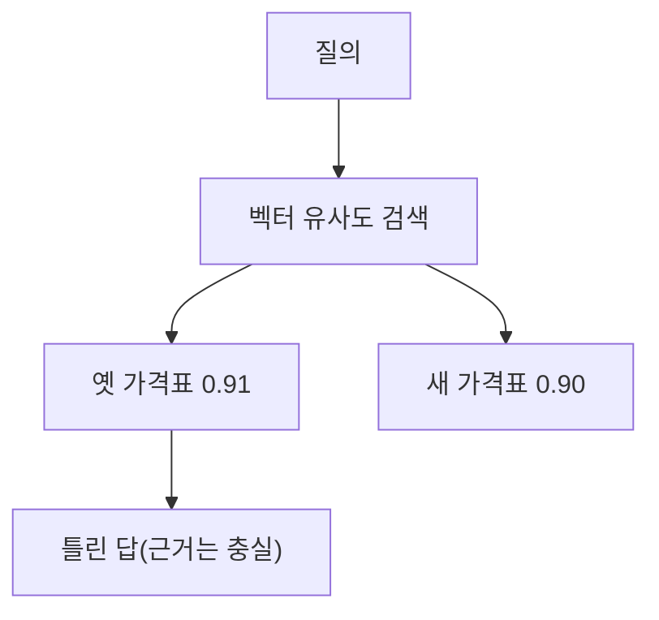

# 낡은 문서 정리

> RAG 검색 시스템의 색인에 들어 있는 구버전·삭제된·유효기간이 지난 문서를 찾아 대체하거나 제거하는 일이다. 임베딩 유사도는 시간을 모르기 때문에, 낡은 문서가 최신 문서와 거의 같은 점수로 검색되어 틀린 답이 나온다.

## 쉽게 말하면
도서관에 개정판이 나왔는데 옛 판이 서가에 그대로 꽂혀 있는 상황이다. 사서가 "내용이 비슷한 책"을 골라 주면 옛 판을 건넬 수 있고, 책에는 틀린 정보가 적혀 있으니 답이 틀려도 사서의 잘못이 아니다. 서가에서 옛 판을 치워야 한다.

## 자세히
(검색 결과 요약과 한 실무자 글(tianpan.co)을 직접 열어 확인. 모두 블로그·실무 글이라 표준이 아니라 설계 지침으로 읽는다.)
- **핵심 문제(tianpan.co)**: 임베딩 유사도는 시간을 무시한다. 낡은 가격표 페이지와 새 페이지가 거의 같은 점수일 수 있어 검색은 "가장 가까운 것"을 돌려줄 뿐 "현재 것"을 돌려주지 않는다.
- **일반 평가가 놓치는 이유**: 충실성·근거성 검사는 답이 검색된 텍스트를 정확히 반영하면 통과한다. 텍스트 자체가 낡았다는 점은 못 잡는다. 이는 환각이 아니라 **오래된 검색(stale retrieval)** 이라 해법은 프롬프트나 생성기가 아니라 검색 파이프라인에 있다.
- **세 가지 실패 모드(같은 글)**
  1. **좀비 문서**: 원본에서 지운 문서가 색인에 남음(GDPR 사유로 지운 것 포함). 변경 데이터 캡처(CDC)·웹훅·정기 대조(reconciliation)로 삭제를 전파해야 한다. 희소(키워드) 색인도 같이 지워야 한다는 지적도 있다(검색 결과).
  2. **조용한 버전 드리프트**: 갱신된 페이지가 옛 버전을 대체하지 않고 **나란히 추가**됨. 콘텐츠 해시와 주기적 재수집으로 탐지.
  3. **임베딩 모델 불일치**: 임베딩 모델을 올리고 재색인하지 않으면 질의와 문서가 서로 다른 벡터 공간에 놓인다. 문서마다 모델 버전을 기록하고 불일치를 알린다.
- **수집 시점에 저장할 메타데이터**: 색인 시각, 원본 수정 시각, TTL(유효 기간), 콘텐츠 해시, 임베딩 모델 버전, 문서 ID·원본 URL·상태(현행/대체됨).
- **필터 vs 시간 감쇠**: 감쇠는 낡은 문서의 순위를 낮출 뿐 제외하지 않으므로 옛 버전이 틀린 정보일 때는 부족하다는 주장이 있다. 정책이나 유효기간이 지난 콘텐츠는 모델이 보기 전에 **완전히 제거(사전 필터)** 해야 하고, 부드러운 경우에는 반감기 감쇠를 쓸 수 있다. 필터는 앱이 정의한 버전·상태 필드에 의존한다.
- **동기화 방식**: 정기 배치(단순하지만 최대 하루 낡을 수 있음) vs 웹훅·CDC 이벤트 기반(가격·정책처럼 빠르게 변하는 소스).
- **검증**: 삭제된 문서가 없는지, 현재 버전이 옛 버전보다 위에 오는지, 답이 유효한 근거만 인용하는지 보는 대조 작업과 CI의 "신선도 슬라이스" 회귀 테스트, 검색된 청크의 나이 분포 모니터링을 권한다(같은 글).
- **수치는 출처 불명**: 글이 인용한 "LangChain 문서 코퍼스 67% 감소", "자기 교정 검색 14~37% 향상", "α≈0.7·반감기 14일 감쇠" 등은 방법론이 제시되지 않았거나 일화 수준이라 이 노드에서 근거로 삼지 않는다.

## 그림으로 보기

## 예시
- 사내 규정 챗봇: 문서 메타데이터에 `status=current`, `effective_to` 날짜를 두고, 검색 시 `status=current AND effective_to >= 오늘` 필터를 건다.
- 월 1회 대조 작업: 원본 시스템의 문서 ID 목록과 색인의 ID 목록을 비교해 색인에만 있는 ID를 삭제한다(제안).

## 헷갈리는 것과 비교
| 개념 | 차이 |
|---|---|
| 낡은 문서 정리 | 색인의 구버전·삭제 문서 관리 |
| 환각 | 근거 없이 지어냄(이건 근거가 낡은 경우) |
| [데이터 버전 관리](#data-versioning) | 데이터 변경 이력과 복원 |
| [데이터 드리프트](#data-drift) | 입력 분포의 변화 |

## 더 읽을거리
- [Stale Retrieval: The Data Quality Problem Your RAG Pipeline Is Hiding](https://tianpan.co/blog/2026-04-15-stale-retrieval-rag-data-quality) — 세 가지 실패 모드와 완화책(직접 열어 확인, 실무자 글).
- [Twig: Outdated Knowledge Base](https://help.twig.so/rag-scenarios-and-solutions/accuracy/stale-data) — 오래된 지식 베이스 시나리오(검색 결과 기준, 본문 미열람).
