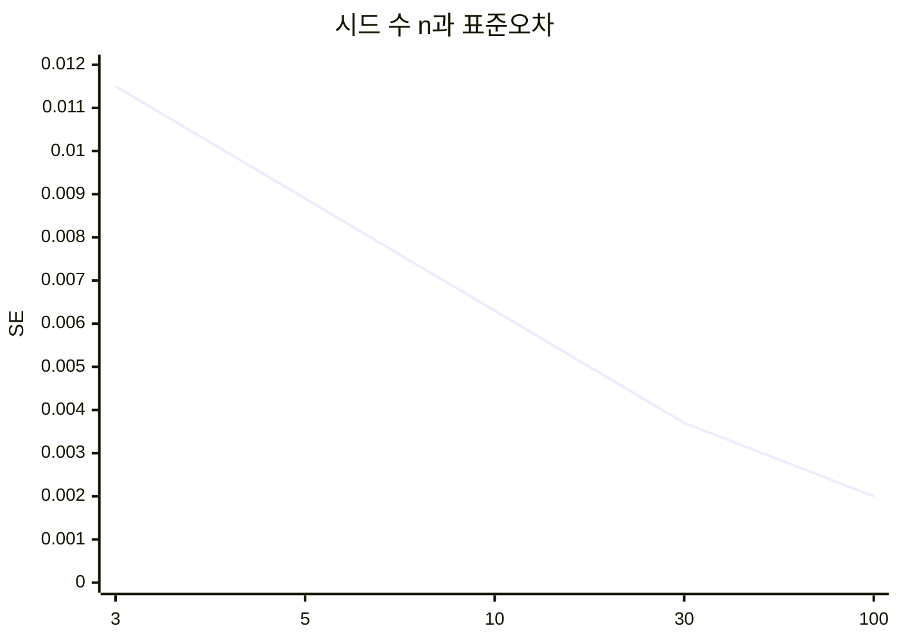

# 점수 평균의 표준오차

> 시드를 n번 돌린 점수의 **평균**이 얼마나 정확한지를 나타내는 값. 시드 간 표준편차 s에 대해 표준오차(SE)는 s/√n이다. 시드를 늘리면 줄어들지만 **√n에 비례해서만** 줄어든다.

## 쉽게 말하면
키를 재는 줄자가 매번 ±2cm 흔들릴 때, 한 번 잰 값보다 4번 재서 평균 낸 값이 두 배 정확하다. 정확도를 2배로 올리려면 측정은 4배, 10배로 올리려면 100배가 필요하다.

## 자세히
- 표준편차(s)는 "시드마다 점수가 얼마나 다른가", 표준오차(SE)는 "그 평균이 참값에서 얼마나 벗어날까"다. 보고할 때 둘을 섞지 않는다.
- **직접 실행**(numpy: 점수가 평균 0.85, 표준편차 0.02의 정규분포라고 가정, 3,000회 반복):

| 시드 수 n | 이론 SE(0.02/√n) | 시뮬레이션 평균 SE | 95% 신뢰구간 반폭(≈2·SE) |
|---|---|---|---|
| 3 | 0.0115 | 0.0103 | 0.023 |
| 5 | 0.0089 | 0.0083 | 0.018 |
| 10 | 0.0063 | 0.0062 | 0.013 |
| 30 | 0.0037 | 0.0036 | 0.007 |
| 100 | 0.0020 | 0.0020 | 0.004 |

- n이 작으면(3~5) s 추정 자체가 불안정해 SE가 **과소 추정**되는 경향이 있다(위 표 n=3: 0.0103 < 0.0115). 소표본에서는 t분포를 쓰는 신뢰구간이 더 안전하다.
- **실무 감각**: 두 모델 차이가 0.01이면 n=10 정도(반폭 0.013)로는 구분이 안 된다. 보고 문구 예: "0.852 ± 0.006 (SE, n=10 시드)".
- 한계: 정규성과 시드 독립을 가정한 시뮬레이션이다. 시드 간 상관이 있으면 실제 SE는 더 크다.

## 그림으로 보기



## 예시
```python
import numpy as np
scores = np.array(scores)
se = scores.std(ddof=1) / np.sqrt(len(scores))
print(f"{scores.mean():.3f} ± {se:.3f} (SE, n={len(scores)})")
```

## 헷갈리는 것과 비교
| 개념 | 차이 |
|---|---|
| 표준편차 | 시드별 점수가 흩어진 정도(n이 늘어도 그대로) |
| 표준오차 | 평균의 불확실성(n이 늘면 √n으로 감소) |
| [시드 스윕 보고](#seed-sweep-reporting) | SE를 포함해 보고하는 방식 |
| [시드별 짝지은 비교](#paired-seed-comparison) | 같은 시드에서 차이를 직접 비교 |

## 더 읽을거리
- [Wikipedia: Standard error](https://en.wikipedia.org/wiki/Standard_error) — SE의 정의와 √n 관계.
- [scipy.stats.sem](https://docs.scipy.org/doc/scipy/reference/generated/scipy.stats.sem.html) — 표준오차 계산 함수.
