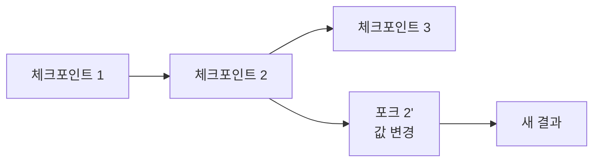
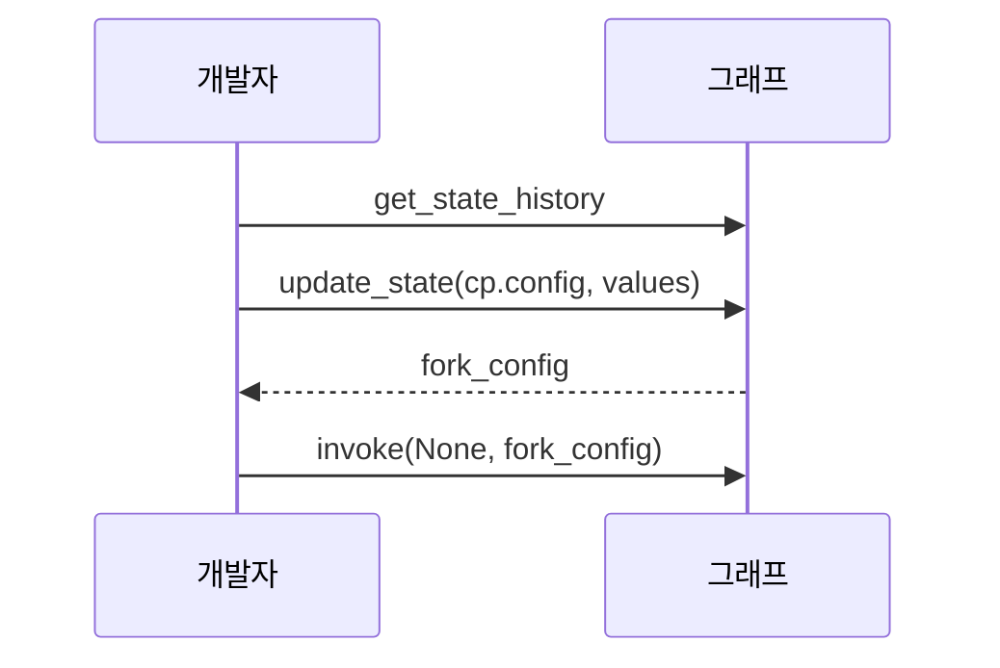

# 상태 분기(fork)

> LangGraph에서 과거 체크포인트를 골라 값을 바꾼 새 체크포인트를 만들고 거기서부터 다시 실행해, 원래 기록은 두고 다른 갈래를 만드는 기법이다.

## 쉽게 말하면
게임 세이브 파일을 불러와 다른 선택지를 골라 보는 것이다. 원래 세이브는 그대로 있고, 새 세이브(갈래)가 하나 더 생긴다.

## 자세히
LangGraph Time travel 문서 기준:
- `graph.get_state_history(config)`: 스레드의 체크포인트를 최신순으로 반환. 각 항목에 `next`(다음 노드)와 `checkpoint_id`가 있다.
- **리플레이**: `invoke(None, checkpoint.config)`. 그 지점 이전 노드는 다시 안 돌고 이후 노드는 다시 돈다. LLM·API 호출 결과는 달라질 수 있다. 마지막 체크포인트에서는 아무 일도 없다.
- **포크**: `update_state(checkpoint.config, values=...)`로 그 지점에서 갈라지는 새 체크포인트를 만들고, 반환된 `fork_config`로 `invoke(None, fork_config)`. 원래 기록은 보존된다(스레드를 되돌리는 롤백이 아니다).
- `as_node`: 갱신을 어느 노드가 낸 것으로 볼지 정한다. 기본은 추론하지만 병렬 가지·새 스레드·노드 건너뛰기에서는 명시한다.
- interrupt는 타임 트래블 중에도 다시 걸려 새 `Command(resume=...)`를 기다린다.

## 그림으로 보기



## 예시
```python
cp = next(s for s in graph.get_state_history(config) if s.next == ("write_joke",))
fork = graph.update_state(cp.config, values={"topic": "chickens"})
graph.invoke(None, fork)
```
업무 장면: 에이전트가 3단계에서 엉뚱한 검색어를 만들었을 때, 그 단계로 돌아가 검색어만 고쳐 이어 실행해 비교한다. 디버깅과 "what-if" 실험에 유용하다.

## 헷갈리는 것과 비교
| 개념 | 차이 |
|---|---|
| 리플레이 | 값 그대로 다시 실행 |
| 포크 | 값을 바꿔 새 갈래 생성 |
| [update_state](#langgraph-update-state) | 포크를 만드는 도구 |
| [타임 트래블](#langgraph-time-travel) | 둘을 아우르는 기능 |

## 더 읽을거리
- [LangGraph Time travel](https://docs.langchain.com/oss/python/langgraph/use-time-travel) — 리플레이·포크 코드
