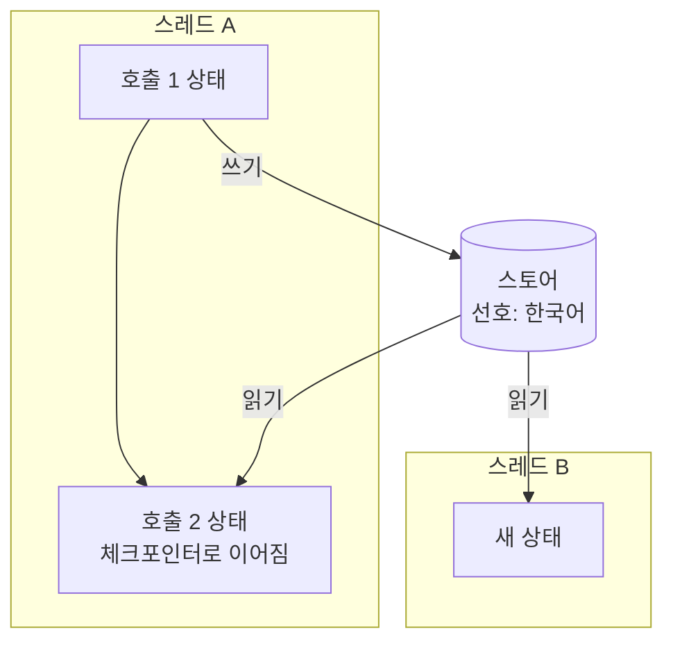

# 상태와 장기 메모리

> LangGraph에서 **상태(state)** 는 한 번의 대화·실행(스레드) 안에서 이어지는 단기 기억이고, **장기 메모리(store)** 는 스레드를 넘어 남는 지식(사용자 선호·사실)이다. 보통 **체크포인터(스레드별 상태 저장)** 와 **스토어(스레드 공유 키-값 저장)** 를 함께 쓴다.

## 쉽게 말하면
상담 센터에서 오늘 통화 내용을 적는 메모지(상태)는 통화가 끝나면 그 통화 파일에만 남는다. 반면 고객 카드(장기 메모리)에 "이 고객은 한국어 선호"라고 적어 두면 다음 통화, 다른 상담원도 본다.

## 자세히
(LangGraph 공식 문서 Persistence + 직접 실행, langgraph 1.2.24)
- **체크포인터(단기, 스레드별)**: `thread_id`로 구분되는 한 스레드의 그래프 상태 스냅샷을 저장해 대화 연속성, 사람 개입 대기, 되감기(time travel), 장애 복구를 지원한다. 운영용은 `PostgresSaver`, 로컬 개발용은 `SqliteSaver`, `InMemorySaver`는 메모리에만 있어 **재시작하면 사라진다**.
- **스토어(장기, 스레드 간)**: 그래프 상태 **밖**의 키-값 데이터를 스레드를 넘어 공유한다. 사용자 선호·사실·공유 지식에 적합. 문서 요지: 대부분의 앱은 **둘 다** 쓴다(현재 스레드용 체크포인터 + 지속 데이터용 스토어).
- **직접 실행**(`InMemorySaver` + `InMemoryStore`, 노드가 스토어에서 "선호"를 읽고 "한국어"를 기록):

| 호출 | 결과 `msgs` |
|---|---|
| thread **A** 첫 호출 | `['스레드A 입력', '이전 선호 없음']` |
| thread **A** 두 번째 호출 | `['스레드A 입력', '이전 선호 없음', '스레드A 입력', '이전 선호: 한국어']` — **같은 스레드는 이전 상태가 이어짐**(체크포인터) |
| thread **B** 첫 호출 | `['스레드B 입력', '이전 선호: 한국어']` — **새 스레드라 상태는 비었지만** 스토어의 선호는 보임(장기 메모리) |

- **무엇을 어디에 두나**:

| 데이터 | 둘 곳 |
|---|---|
| 현재 대화 메시지·진행 단계 | 상태(체크포인터) |
| 사용자 선호·프로필·누적 지식 | 스토어 |
| 중간 계산 결과(그 실행에서만) | 상태 |

- **주의**: 인메모리 저장소는 데모용이다. 운영에서는 영속 저장소(Postgres 등)를 쓰고, 개인정보가 스토어에 쌓이므로 보관·삭제 정책을 정한다. 스토어 네임스페이스 설계 등 세부는 별도 Stores 가이드를 본다(이 글에서 확인하지 않음).
- 한계: API 이름·경로(`runtime.store` 등)는 버전에 따라 달라질 수 있다.

## 그림으로 보기


## 예시
```python
from langgraph.checkpoint.memory import InMemorySaver
from langgraph.store.memory import InMemoryStore

app = graph.compile(checkpointer=InMemorySaver(), store=InMemoryStore())
cfg = {"configurable": {"thread_id": "A"}}
app.invoke({"msgs": ["안녕"]}, cfg)      # 같은 thread_id면 이전 상태 이어짐
# 노드 안: runtime.store.put(("profile","u1"), "lang", {"v": "한국어"})
```
- 고객 상담 봇: 대화 내용은 스레드 상태, "이 고객은 존댓말·한국어 선호"는 스토어에 저장.

## 헷갈리는 것과 비교
| 개념 | 차이 |
|---|---|
| 상태(체크포인터) | 한 스레드 안의 단기 기억 |
| 스토어(장기 메모리) | 스레드를 넘어 공유되는 지식 |
| [메시지 상태](#messages-state) | 상태 안의 대화 기록 |
| [RAG](#rag) | 문서 검색으로 지식을 가져오는 방식(메모리와 목적이 다름) |

## 더 읽을거리
- [LangGraph: Persistence](https://docs.langchain.com/oss/python/langgraph/persistence) — 체크포인터와 스토어 개요.
