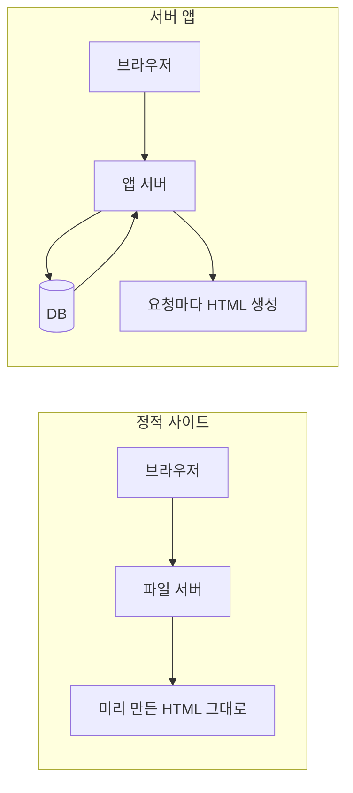
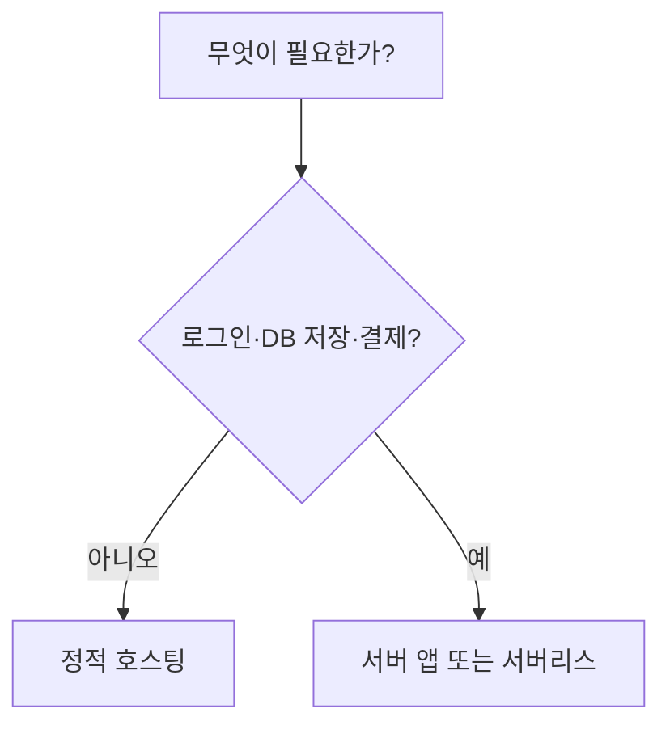

# 정적 사이트 vs 서버 앱

> **정적 사이트**는 미리 만들어 둔 파일(HTML·CSS·JS·이미지)을 **누구에게나 그대로** 보내 주는 방식이고, **서버 앱(동적 사이트)** 은 요청이 올 때마다 서버가 **데이터베이스를 조회해 페이지를 만들어** 보내는 방식이다. 이 선택이 호스팅 종류·비용·할 수 있는 기능을 가른다.

## 쉽게 말하면
정적 사이트는 인쇄해 둔 안내 책자를 나눠 주는 것(누가 와도 같은 책자), 서버 앱은 직원이 손님마다 주문을 확인해 맞춤 영수증을 그 자리에서 뽑아 주는 것이다.

## 자세히
(MDN "Client-Server overview" 기준 + 직접 실행)
- **정적 사이트**: 서버가 파일 시스템에서 파일을 읽어 **그대로 반환**한다. 같은 자원 요청에는 같은 내용이 가고, 서버는 주로 `GET` 요청만 처리하며 URL 매개변수나 쿠키에 따라 응답을 바꾸지 않는다. 페이지가 적고 모든 사용자에게 같은 내용일 때 알맞다.
- **동적 사이트**: 요청 URL과 데이터로 필요한 것을 판단해 **DB에서 정보를 가져와 HTML 템플릿에 끼워** 응답을 만든다. 내용이 많거나 자주 바뀌고, **사용자별 맞춤**(로그인), 사용자가 입력한 데이터 저장이 필요할 때 알맞다. `GET`과 `POST` 등을 처리한다.
- **비교**(MDN 표 요약):

| 항목 | 정적 | 동적(서버 앱) |
|---|---|---|
| 응답 | 모두에게 같은 파일 | 요청마다 DB·템플릿으로 생성 |
| 서버 일 | 파일 읽어 반환 | 라우팅·DB 조회·템플릿 렌더 |
| 유지보수 | 페이지마다 따로, 많아지면 반복 | 템플릿 하나 고치면 전체 갱신 |
| 규모 | 페이지가 늘수록 부담 | 데이터로 수천 항목까지 |

- **직접 실행**(파이썬 내장 서버): `/static` 요청은 두 번 모두 `<h1>소개</h1>`로 **같은 응답**, `/user/kim`·`/user/lee`는 `방문 1번째`, `방문 2번째`처럼 **요청마다 다른 응답**(서버가 상태를 갖고 즉석 생성).
- **이 지식 지도 사이트도 정적 사이트다**: 저장소의 `index.html`이 브라우저에서 `fetch`로 `data/graph.json`과 `articles/*.md`(약 2,156개 글 파일)를 읽어 화면을 그리고, GitHub Pages가 이 파일들을 **그대로 서빙**한다(서버 코드 없음, 2026-11-25 확인). 이처럼 **정적 호스팅 + 브라우저에서 JS로 데이터를 읽는 구조**로도 꽤 많은 앱을 만들 수 있다.
- **선택 가이드**:
  1. 소개 페이지·문서·포트폴리오·블로그 → 정적(저렴하고 단순, GitHub Pages 등).
  2. 로그인·결제·DB 저장·관리자 화면 → 서버 앱(또는 서버리스 함수·BaaS 조합).
  3. 중간: 정적 사이트 + 외부 API/서버리스로 필요한 부분만 동적으로.
- **바이브코딩 주의**: AI가 "서버가 필요 없는 구조"를 제안했는데 실제로는 비밀 키가 필요한 기능이면 **키가 브라우저에 노출**되므로 서버 쪽을 따로 두어야 한다([환경 변수와 API 키](#env-secrets)).
- 한계: 현대 프레임워크(Next.js 등)는 정적 생성과 서버 렌더링을 섞는 방식이라 경계가 흐려졌다([웹 프레임워크](#web-frameworks)).

## 그림으로 보기

## 예시
- 정적: 회사 소개 사이트, 개인 포트폴리오, 학습 노트(이 지도처럼 JS가 JSON 파일을 읽는 구조 포함).
- 동적: 쇼핑몰(상품 DB·장바구니), 사내 신청 시스템(로그인·승인 상태).
- 프롬프트: "서버 없이 GitHub Pages에 올릴 수 있는 구조로 만들어 줘. 데이터는 JSON 파일로 두고 브라우저에서 읽어."

## 헷갈리는 것과 비교
| 개념 | 차이 |
|---|---|
| 정적 사이트 | 파일을 그대로 전송 |
| 서버 앱 | 요청마다 생성, DB 사용 |
| 서버리스 | 서버 관리 없이 함수 단위로 실행(동적 기능을 가볍게) |
| [도메인과 DNS](#domain-dns) | 어떤 호스팅이든 주소를 연결하는 방법 |

## 더 읽을거리
- [MDN: Client-Server overview](https://developer.mozilla.org/en-US/docs/Learn_web_development/Extensions/Server-side/First_steps/Client-Server_overview) — 정적·동적 사이트와 요청·응답 흐름.
