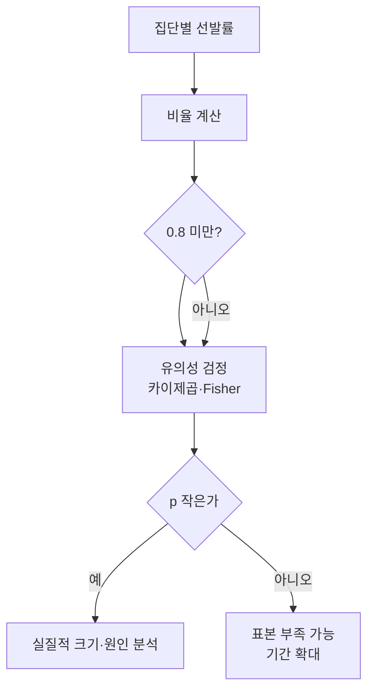

# 통계적 유의성과 실질적 유의성

> 집단 간 선발률 격차가 **우연이 아닌지(통계적 유의성)**와 **현실에서 의미 있을 만큼 큰지(실질적 유의성)**를 따로 확인해야 한다는 원칙. 4/5 규칙은 후자의 거친 경험칙이다.

## 쉽게 말하면
동전을 10번 던져 앞면이 6번 나왔다고 "이 동전은 편향"이라 하긴 어렵다. 반면 1,000번 던져 600번이면 의심할 만하다. 그런데 앞면 비율이 51%인 동전을 100만 번 던져 편향을 "확실히" 증명해도, 51%는 실생활에서 별 차이가 없을 수 있다. 확실함(통계)과 큼(실질)은 다른 질문이다.

## 자세히
출처: [4/5 규칙](#four-fifths-rule) 노드가 확인한 29 CFR 1607.4 내용, 검색 요약(2차 자료라 EEOC Q&A 원문은 확인 못 함), SciPy `fisher_exact` 문서(본문 확인, 2026-11-18). 아래 숫자는 직접 계산했다.
- **4/5 규칙의 성격**: 비율 규칙은 표본 크기를 보지 않는다. 표본이 작으면 모집단 선발률이 같아도 0.8 미만이 자주 나온다는 해설이 있고, 지침은 작은 표본에서 다른 자료로 보완할 수 있다고 한다.
- **유의성 검정**: 큰 표본에는 카이제곱 검정, 작은 표본에는 Fisher 정확 검정을 권하는 자료가 많다(2차 자료). 2×2 표(집단×선발/탈락)에서 귀무가설은 "선발 odds가 같다"이다.
- **두 기준이 엇갈릴 수 있다**: 한 해설은 80% 규칙이 불리한 영향을 시사하는데 카이제곱은 아니라고 하는 경우를 소개한다. 반대도 가능하다.
- **직접 계산한 사례**(집단 A 대비 집단 B):

| A 선발 | B 선발 | 비율 | Fisher p | 해석 |
|---|---|---|---|---|
| 6/10 | 4/10 | 0.667 | 0.656 | 0.8 미만이지만 우연일 수 있음 |
| 50/100 | 40/100 | 0.800 | 0.201 | 0.8 경계, 유의하지 않음 |
| 500/1000 | 400/1000 | 0.800 | <0.001 | 규칙상 통과, 통계상 유의 |

- **실무 순서(제안)**: ①비율로 선별 ②유의성 검정 ③격차의 크기와 원인 분석 ④표본이 작으면 기간을 늘려 재측정. "2 표준편차" 관례는 이번 조사에서 확인하지 못했다.
- **주의**: 여러 집단을 동시에 검정하면 우연히 유의한 결과가 나올 수 있다(다중 비교, 일반 지식).

## 그림으로 보기


## 예시
```python
from scipy.stats import fisher_exact
table = [[50, 50], [40, 60]]    # [선발, 탈락] A집단, B집단
print(fisher_exact(table).pvalue)   # 약 0.20
```
교육 활용: HR 직무 교육에서 "비율이 0.79면 무조건 위법"이라는 오해를 바로잡는 실습 소재.

## 헷갈리는 것과 비교
| 개념 | 차이 |
|---|---|
| 통계적 유의성 | 격차가 우연일 확률(p) |
| 실질적 유의성 | 격차의 현실적 크기·영향 |
| [4/5 규칙](#four-fifths-rule) | 크기를 보는 거친 경험칙 |
| [작은 표본 주의](#small-sample-caveat) | 표본이 작을 때 두 지표가 흔들리는 문제 |

## 더 읽을거리
- [SciPy fisher_exact](https://docs.scipy.org/doc/scipy/reference/generated/scipy.stats.fisher_exact.html) — 2×2 표 정확 검정 사용법
- [4/5 규칙](#four-fifths-rule) — 조문 기반 정리(이 지도 안의 노드)
