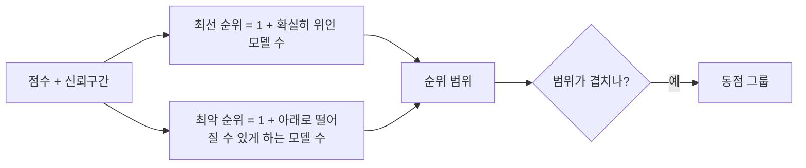
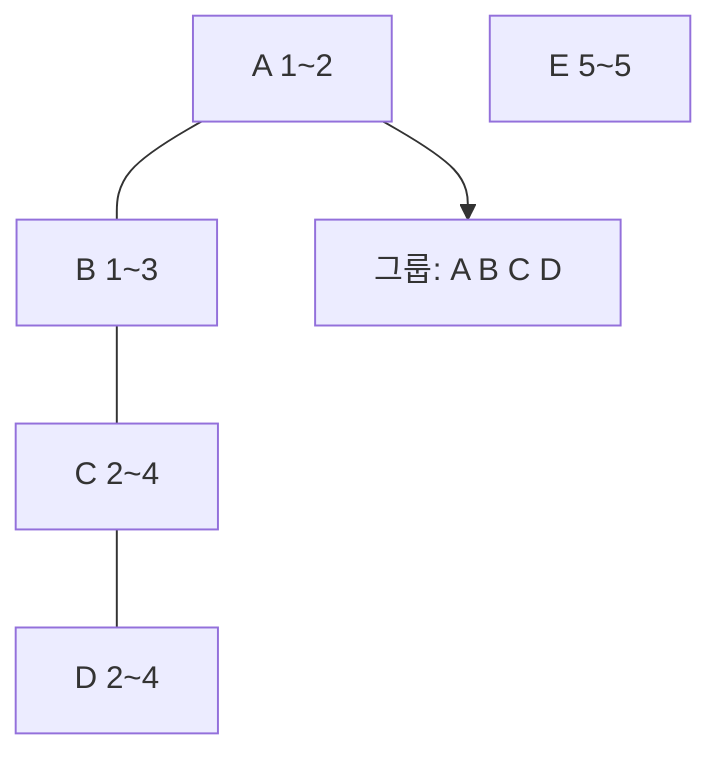

# 통계적으로 구분 안 되는 그룹

> 순위표에서 점수 차이가 신뢰구간 안에 들어가면 그 모델들은 통계적으로 구분되지 않는다. 1위·2위·3위로 줄 세우는 대신 "겹치는 구간 그룹"이나 순위의 범위(rank spread)로 읽어야 한다.

## 쉽게 말하면
달리기 기록이 0.01초 차이인데 측정 오차가 0.05초라면 1등과 2등을 가리는 것은 의미가 없다. "공동 선두 그룹"이라고 부르는 편이 정직하다. 순위표도 오차 막대를 같이 읽어야 한다.

## 자세히
- **LMArena(Arena)의 방법(arena.ai 블로그 Ranking Method, 2025-11-14 게시·2026-02-28 갱신, 열람)**: 점수와 신뢰구간(CI)은 그대로 두고 순위를 새로 표시한다. **원순위(raw rank)**는 점수 위치에 따른 고유한 순위로 "진짜 순위의 현재 최선의 추정"이다. 예전 방식은 낙관적 순위만 보여 줘 CI가 넓은 신규 모델에 높은 순위를 줬다고 한다.
- **순위 범위(rank spread)**: 모든 모델의 CI를 바탕으로 한 최선 순위에서 최악 순위까지의 구간이다. 최선 순위 = 1 + (하한이 이 모델의 상한보다 높은 모델 수), 최악 순위 = 1 + (상한이 이 모델의 하한보다 높은 모델 수). 두 모델은 순위 범위가 겹치면 동점(구분 불가)이다.
- **문서의 예**: 모델 C의 원순위는 3, A만 하한이 C의 상한보다 높아 최선 순위 2, A·B·D·E의 상한이 모두 C의 하한보다 높아 최악 순위 5, 범위 2~5다.
- **구간 계산 방식(검색 요약, 본문 일부)**: 2025-07에 부트스트랩에서 M-추정량의 중심극한정리 기반 닫힌 식 구간으로 바꿨고 부트스트랩과 매우 비슷한 결과를 훨씬 적은 계산으로 얻는다고 한다. 점수는 Bradley-Terry 모형에서 나오며 전투 수가 적은 모델에 가중치를 다시 부여하면 구간이 넓어져 동점이 늘어난다고 한다(본문 미확인).
- **직접 구성한 5모델 예(점수 구간은 가정)**: A 1290~1310, B 1270~1292, C 1262~1284, D 1250~1270, E 1200~1225라고 하자. 위 정의로 순위 범위를 계산하면 A 1~2, B 1~3, C 2~4, D 2~4, E 5~5다. A·B·C·D는 서로 범위가 겹쳐 하나의 "구분 안 되는 그룹"이고 E는 확실히 아래다. 점수로는 A가 1위지만 B와의 구간이 겹쳐 1위가 확정이 아니다.
- **읽는 방법(해석)**: 점수·구간·순위 범위를 같이 보고, 그룹 안 모델은 비용·지연 등 다른 기준으로 고른다([작은 차이를 넘는 모델 선택](#model-choice-beyond-small-gaps)).
- **한계(해석)**: 구간이 겹친다고 두 모델이 같다는 뜻이 아니라 이 데이터로는 차이를 확인할 수 없다는 뜻이다. 구간이 겹쳐도 짝 비교 검정으로는 차이가 드러날 수 있다([같은 문항 쌍 비교](#paired-test-same-items)). 또한 CI 겹침 판정은 다중 비교 문제를 엄밀히 보정하지 않는다.

## 그림으로 보기

## 예시
- 사내 모델 비교표에 점수 옆에 95% 구간과 순위 범위를 넣어 "A·B·C·D는 구분 안 됨"이라고 표기하고, 그룹 안에서는 비용 순으로 정렬한다.
- 교육 활용: 순위표를 그룹으로 다시 그려 보며 "1위 모델을 도입한다"는 결정의 근거가 약함을 토론한다.

## 헷갈리는 것과 비교
| 개념 | 차이 |
| --- | --- |
| 원순위 | 점수만으로 매긴 고유 순위. 최선의 추정치 |
| 순위 범위 | 구간으로 본 가능한 최선·최악 순위 |
| [작은 차이를 넘는 모델 선택](#model-choice-beyond-small-gaps) | 구분 안 되는 후보 사이의 선택 기준 |
| [리더보드 작은 격차](#leaderboard-small-gap) | 상위 주제 |

## 더 읽을거리
- [Arena: Ranking Method](https://arena.ai/blog/ranking-method) — 원순위·순위 범위·동점 정의와 예
