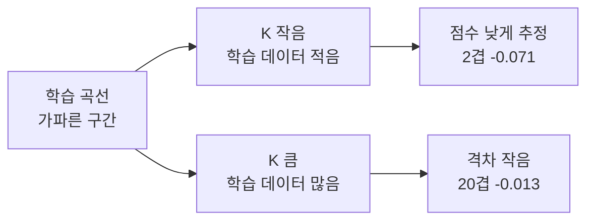
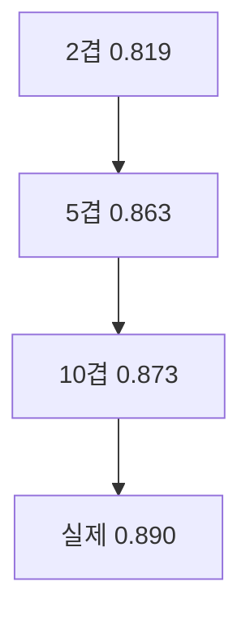

# 가파른 학습 곡선 위험

> 데이터가 적어 학습 곡선이 아직 가파르게 오르는 구간에서는, K가 작은 교차검증이 학습 데이터를 덜 쓰기 때문에 점수를 실제보다 낮게(비관적으로) 추정한다. 곡선이 가파를수록 이 편향이 커진다.

## 쉽게 말하면
공부 시간이 아직 짧아 하루 공부량에 따라 점수가 크게 달라지는 학생을 생각해 보자. 이 학생의 실력을 재려고 공부할 내용의 절반만 보여 주고 시험을 보면, 실제로 전부 공부했을 때보다 낮은 점수가 나온다. 시험 방식이 실력을 깎아 먹은 것이다.

## 자세히
- **원리**: K겹 교차검증은 매번 데이터의 (K−1)/K만으로 학습한다. 최종 모델은 전부를 쓰므로 교차검증 점수는 "더 적은 데이터로 만든 모델"의 점수다. 학습 곡선이 오르는 중이면 그 점수가 최종 모델보다 낮다. scikit-learn 문서(열람)도 학습 곡선이 데이터가 적을 때 더 모을수록 일반화가 좋아진다고 설명한다([데이터를 더 모을 가치 판단](#data-more-worth)).
- **직접 해 본 실험(숫자 손글씨 중 100개를 학습에 사용, 로지스틱 회귀, 40번 반복)**: 같은 100개로 학습한 모델을 나머지 1,697개로 평가한 "실제" 정확도는 0.890이었다. 같은 100개에 대한 교차검증 평균은 2겹 0.819(차 −0.071), 3겹 0.851(−0.040), 5겹 0.863(−0.028), 10겹 0.873(−0.017), 20겹 0.877(−0.013)이었다. K가 클수록 격차가 줄었다. 합리적 해석은 K가 클수록 학습 크기가 100개에 가까워진다는 것이다.
- **위험(해석)**: ① 2~3겹으로 모델을 비교하면 데이터를 많이 필요로 하는 복잡한 모델이 불리하게 평가된다 ② 낮은 점수만 보고 "이 방법은 안 된다"고 결론 낼 수 있다 ③ 곡선이 평평한 큰 데이터에서는 이 편향이 거의 없다.
- **대처**: 작은 데이터에서는 K를 5~10 이상으로 하고, 모델 비교는 같은 K·같은 분할을 쓴다([비교용 k 고정](#fixed-k-for-comparison)). K를 키울수록 계산이 늘고 폴드 점수의 변동이 달라질 수 있다([교차검증의 분산·편향 절충](#cv-variance-bias-tradeoff)).

## 그림으로 보기

## 예시
- 라벨 100건짜리 분류기를 2겹으로 평가해 0.82가 나왔다면, 전체 100건으로 학습한 실제 성능은 0.89 근처일 수 있다. 10겹으로 다시 재면 격차가 줄어든다.
- 교육 활용: K를 2·5·10·20으로 바꿔 표를 만들며 "평가 방식도 점수를 바꾼다"를 체험한다.

## 헷갈리는 것과 비교
| 개념 | 차이 |
| --- | --- |
| 비관적 편향 | K 작을 때 점수가 낮게 추정 |
| 과적합 | 학습은 높고 검증은 낮음 |
| [학습 곡선](#learning-curve) | 표본 수별 점수 |
| [홀드아웃 vs 교차검증](#holdout-vs-cv) | 분할 방식 선택 |

## 더 읽을거리
- [scikit-learn: Learning curve](https://scikit-learn.org/stable/modules/learning_curve.html) — 표본 수에 따른 점수
- [scikit-learn: Cross-validation](https://scikit-learn.org/stable/modules/cross_validation.html) — K 선택과 5·10겹 권장
