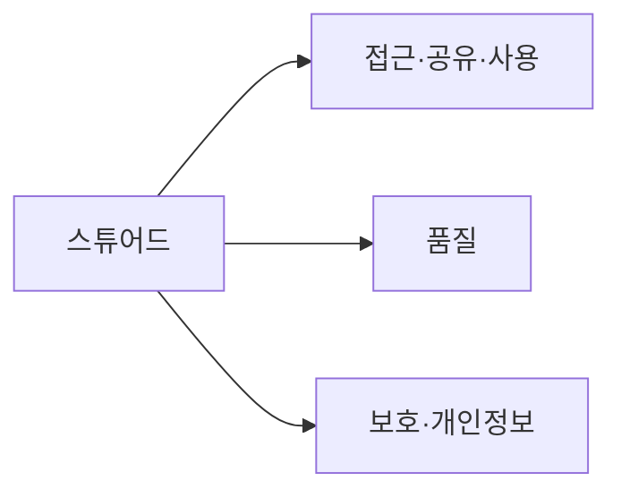

# 스튜어드 유형

> 데이터 스튜어드를 담당 대상·성격별로 나눠 부르는 분류다. 다만 **널리 합의된 표준 분류는 없고**, 기관마다 구분 방식이 다르다.

## 쉽게 말하면
건물 관리인도 "청소 담당, 보안 담당, 설비 담당"으로 나누듯, 스튜어드도 데이터의 *내용*을 보는 사람과 *시스템*을 보는 사람으로 나눠 부르곤 한다. 하지만 나누는 선은 건물마다 다르다.

## 자세히
(NSW 툴킷 Module 6, Queen's University 역할 페이지, 영국 정부 데이터 소유권 페이지를 열어 봤다. **어느 곳도 "객체·업무·프로세스·시스템 스튜어드" 같은 유형 분류를 정의하지 않았다.** 아래 분류는 일반적으로 쓰이는 틀로 제시할 뿐 이 글에서 확인하지 못한 주장이다.)
- **NSW**: 스튜어드를 유형으로 나누지 않고 *기능*(Operational Data Manager)으로 정의. 보통 사업 관리자·프로세스 오너·내용 전문가이며 데이터 접근의 "게이트키퍼". 일상 관리, 공유 협약·라이선스 확인, 메타데이터(데이터 사전·비즈니스 규칙) 유지, 생성자에게 품질 피드백.
- **Queen's**: 유형 대신 **책임 영역**으로 구분 — ① 접근·공유·사용 ② 품질 ③ 보호·개인정보.
- **영국 정부 페이지**: 2026-04-16 갱신에서 데이터 소유권 안내를 이 페이지에서 제거했고 별도 페이지로 옮겼다. 이 글은 그 페이지를 읽지 못했다.
- **주장(미확인)**: 대상별로 객체(고객·상품 같은 데이터 객체)·업무 영역·프로세스·시스템 스튜어드로 나누는 설명이 실무에 있다. 도입 시에는 자기 조직의 책임 영역부터 정하는 편이 안전하다.

## 그림으로 보기

## 예시
- 고객 데이터 스튜어드: 마케팅·고객지원이 쓰는 고객 필드의 정의와 접근 요청을 승인(NSW식 게이트키퍼).
- 교육 소재: "우리 회사 스튜어드는 어떤 선으로 나뉘는가?" 토론.

## 헷갈리는 것과 비교
| 개념 | 차이 |
|---|---|
| 스튜어드 | 내용·품질·접근 관리 |
| [보관 책임자](#data-custodian) | 시스템·표준·승인 |
| [RACI](#raci-data-responsibility) | 역할별 책임을 표로 정리하는 도구 |

## 더 읽을거리
- [NSW Module 6](https://www.data.nsw.gov.au/data-capability/data-governance-toolkit/module-6-assigning-roles-and-responsibilities) — 스튜어드 = Operational Data Manager(직접 읽음).
- [Queen's University Data Roles](https://www.queensu.ca/data-strategy-and-governance/roles) — 스튜어드 3개 책임 영역(직접 읽음).
- [GOV.UK 데이터 소유권 페이지](https://www.gov.uk/government/publications/essential-shared-data-assets-and-data-ownership-in-government/data-ownership-in-government-html) — 열어 보니 해당 내용이 이동됨.
