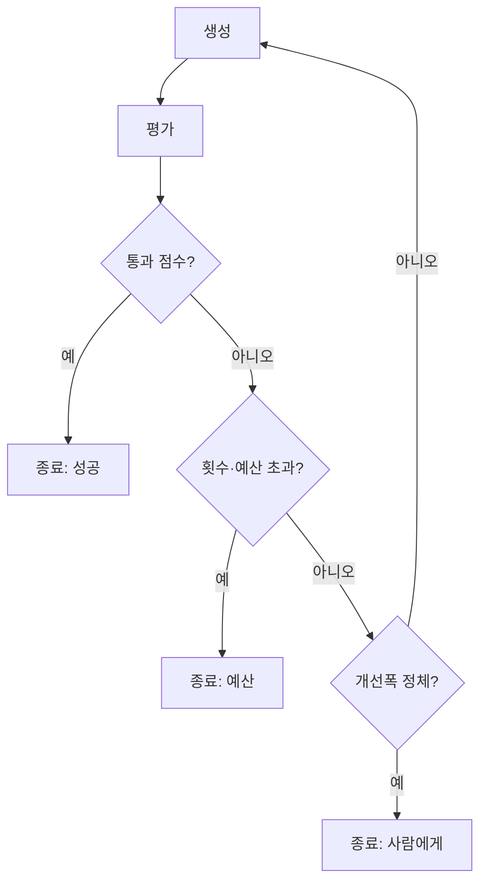

# 루프 종료 조건

> 평가-개선 루프나 에이전트 루프가 언제 멈출지 정하는 규칙. 통과 점수·최대 횟수·개선폭이 대표적이다.

## 쉽게 말하면
원고를 고치는 편집자에게 "이만하면 됐다"는 기준이 없으면 영원히 고친다. "점수 90점 넘으면 끝, 아무리 고쳐도 5번까지만, 두 번 연속 나아진 게 없으면 끝"처럼 미리 정해 둬야 한다.

## 자세히
- Anthropic "Building effective agents": [평가자-최적화 루프](#evaluator-optimizer)는 **명확한 평가 기준**과 반복이 **측정 가능한 가치**를 줄 때 적합하다. 에이전트는 보통 과제가 완료되면 끝나지만 **최대 반복 횟수 같은 중단 조건**을 넣어 통제한다고 한다. 구체적 종료 설계는 원문에 없고 아래는 실무 정리다.
- 종료 조건 3종 세트:
  1. **통과 조건**: 점수 ≥ 기준, 테스트 전부 통과, [루브릭](#rubric-design) 충족.
  2. **예산 조건**: 최대 반복 N회, 최대 토큰·시간·비용.
  3. **정체 조건**: 직전 대비 개선폭이 임계값 미만이거나 같은 오류 반복.
- 어느 하나만 걸려도 멈춘다. 예산 조건이 없으면 비용이 무한정 늘 수 있다.
- 멈춘 이유(통과/예산/정체)를 로그에 남기고, 정체면 [사람에게 넘긴다](#human-in-the-loop).
- 평가자가 [편향](#judge-bias)되면 점수가 부풀어 일찍 멈출 수 있어 교정이 필요하다.

## 그림으로 보기

## 예시
번역 개선 루프: 점수 ≥ 8 또는 3회 반복 또는 점수 증가 < 0.3이면 종료. 코드 수정 루프: 테스트 전부 통과 또는 10회.

## 헷갈리는 것과 비교
| 개념 | 차이 |
|---|---|
| 종료 조건 | 루프를 언제 멈출지 |
| [게이트 검사](#gate-check) | 단계 통과 여부 (되돌아가지 않을 수도 있음) |
| [에이전트 루프](#agent-loop) | 도는 구조 자체 |

## 더 읽을거리
- [Building effective agents(Anthropic)](https://www.anthropic.com/engineering/building-effective-agents) — 평가자-최적화 워크플로와 중단 조건 언급.
