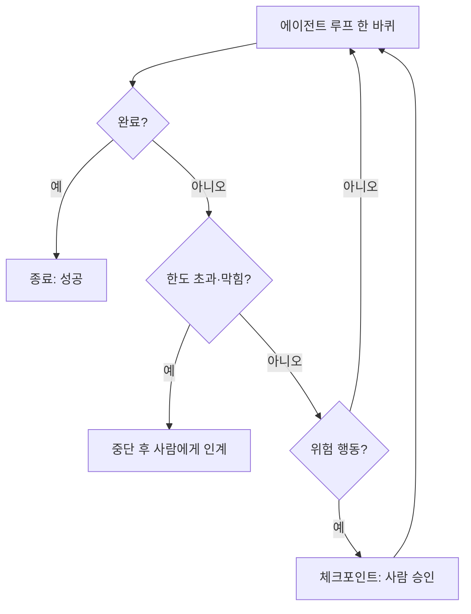

# 종료 조건과 가드레일

> 에이전트 루프가 무한히 돌거나 돈을 태우지 않도록 **언제 멈출지·언제 사람에게 넘길지**를 정해 두는 장치다. 반복 횟수 상한, 예산, 체크포인트가 대표적이다.

## 쉽게 말하면
자동차의 속도 제한 장치와 비상 브레이크다. 목적지에 도착하면(완료) 서고, 길을 잃었으면(막힘) 서고, 기름이 바닥나면(예산) 서고, 위험한 구간에서는 운전대를 사람에게 넘긴다.

## 자세히
- **반복 상한**: Anthropic도 최대 반복 횟수 같은 종료 조건을 두라고 안내한다. 상한은 에이전트 의사와 무관하게 멈추는 회로 차단기다. OpenAI Agents SDK는 `max_turns`, LangGraph는 `recursion_limit`을 쓴다(기본값은 버전에 따라 다르다: 25라는 자료, 1.0.6부터 1,000이라는 자료 — 공식 문서 확인 필요).
- **완료 정의**: 단계 수만으로는 부족하다. "관측 가능한 완료 조건"(테스트 통과 등)을 먼저 정한다. 출구를 done / stuck / 예산 초과 / 인계의 넷으로 두자는 제안.
- **막힘 감지**: 새 정보가 없으면 재시도하지 말고 멈추거나 올린다. 멀티에이전트는 에이전트별·워크플로별 시도 예산을 둔다.
- **예산 종료**: 반복·비용·시간 중 하나가 임계치를 넘으면 중단하고 도움을 요청.
- **가드레일 vs 사람 개입**: 가드레일은 입출력을 자동 필터링. 사람 개입(HITL)은 위험한 행동 직전에 사람이 결정하며, 중단과 상태 저장(checkpointer)이 필요하다.
- 위 수치·기본값은 블로그·비교표 기준이다.

## 그림으로 보기

## 예시
- 코딩 에이전트: 최대 30턴, 같은 오류 3회 반복 시 중단하고 요약 보고.
- 결제·삭제 같은 행동은 사람 승인 후에만 실행.

## 헷갈리는 것과 비교
| 개념 | 차이 |
|---|---|
| 종료 조건 | 루프를 멈추는 규칙 |
| [샌드박스](#sandboxing) | 실행을 가둠 |
| [에이전트 루프](#agent-loop) | 반복 구조 자체 |
| [최소 권한](#least-privilege-agents) | 할 수 있는 일의 범위 |

## 더 읽을거리
- [Agent stop conditions (Taskade)](https://www.taskade.com/wiki/ai-agents/agent-stop-conditions) — 프레임워크 기본값 비교
- [Guardrails for a runaway agent (DEV)](https://dev.to/maximusft/guardrails-for-a-runaway-agent-8h5) — 폭주 방지 사례
- [Human-in-the-Loop in AI Agents](https://jacar.es/en/human-in-the-loop-in-ai-agents/) — 체크포인트 설계
