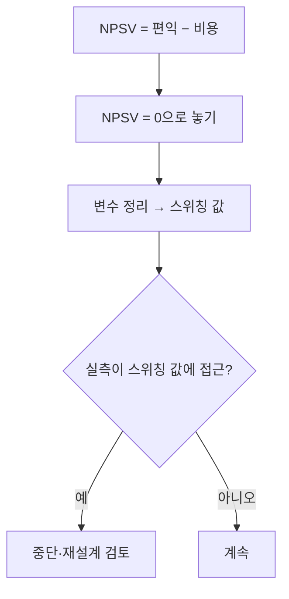

# 중단 기준 정하기 (switching value)

> 결과가 뒤집히는 가정 값, 즉 "이 숫자가 얼마 밑으로(위로) 가면 이 프로젝트는 더 이상 가치가 없다"는 지점을 미리 계산해 두고, 파일럿에서 그 값에 가까워지면 멈추기로 약속하는 방법.

## 쉽게 말하면
등산 전에 "정오까지 정상에 못 닿으면 하산한다"고 정해 두는 것과 같다. 시간을 정해 두면 힘들 때 감정이 아니라 약속으로 결정한다.

## 자세히
- **정의(영국 재무부 Green Book 보충 지침 "Examples of appraisal calculations" 6장, PDF 본문 직접 열람)**: 스위칭 값(switching value)은 핵심 변수가 어떤 값으로 바뀌어야 해당 선택지가 더는 비용 대비 가치가 없게 되는지를 뜻한다. 예시에서는 순현재사회가치(NPSV)가 0이 되는 값이다.
- **계산법(문서)**: 비공식으로는 스프레드시트에 숫자를 넣고 NPSV가 0이 될 때까지 시행착오. 공식적으로는 NPSV = 편익의 현재가치 − 비용의 현재가치에서 NPSV를 0으로 놓고 구하려는 변수를 한쪽으로 정리한다.
- **문서 예(영국 정부 가상 사례 Willow)**: 초기 투자 200만 파운드, 사회적 편익 현재가치 354만 파운드, 5년간 운영 비용(임금·장비·환경)의 현재가치 합 95.8만 파운드. 초기 투자의 스위칭 값 = 354만 − 95.8만 = 258.2만 파운드. 초기 투자비가 200만이 아니라 258.2만 파운드가 되면 NPSV가 0이 된다.
- **해석(designingbuildings 위키가 Green Book을 인용, 열람)**: 핵심 입력이 그 값에 이를 가능성이 낮으면 권고는 견고하고, 가능성이 높으면 취약하다. 같은 문서 개념이 2018판에서는 "다른 선택지로 바뀌는" 값까지 포함했다고 적힌다. 구체 문구는 판에 따라 다를 수 있다.
- **AI 도입안에 적용(이 글의 해석)**: 파일럿 시작 전에 "월 절감 시간이 얼마 아래면 중단"인지 계산해 둔다. 아래 예는 [토네이도 차트](#tornado-chart)의 가상 모델을 이어받은 것이다.

## AI ROI 가상 예시(이 글에서 직접 계산)
연 순효과 = 사용자×월 절감시간×12×시간당 인건비 − 사용자×라이선스 월단가×12. 사용자 100명, 인건비 3만 원/시간, 라이선스 월 3만 원/인일 때 순효과 0 조건은 월 절감 시간 × 30,000 = 30,000, 즉 월 절감 시간 1시간이다. 기준안은 3시간이므로 스위칭 값(1시간)보다 2시간 여유가 있다.
→ 파일럿 규칙 예: "2개월 연속 실측 월 절감 시간이 1.5시간 미만이면 중단 검토". 1시간은 손익분기, 1.5시간은 여유를 둔 경고선(경고선 수치는 임의 설정).

## 그림으로 보기

## 예시
- 위 규칙을 파일럿 계획서에 적고 매월 실측값과 비교하는 표를 둔다.
- 교육 실습: 자기 도입안에서 가장 불확실한 입력 하나를 골라 순효과가 0이 되는 값을 구한다.

## 헷갈리는 것과 비교
| 개념 | 차이 |
|---|---|
| 스위칭 값 | 결론이 뒤집히는 입력값 |
| [토네이도 차트](#tornado-chart) | 입력별 영향 폭 순위 |
| [몬테카를로 ROI](#monte-carlo-roi) | 결과 분포 |
| 손익분기점 | 스위칭 값의 한 특수 사례(NPSV=0일 때) |

## 더 읽을거리
- [HM Treasury: Green Book supplementary guidance, examples of appraisal calculations](https://assets.publishing.service.gov.uk/media/6a438fb48cbc951a27d80e7b/Green_Book_supplementary_guidance_-_examples_of_appraisal_calculations.pdf) — 6장 스위칭 값(본문 열람)
- [Designing Buildings: Switching value](https://www.designingbuildings.co.uk/wiki/Switching_value) — 정의와 해석
