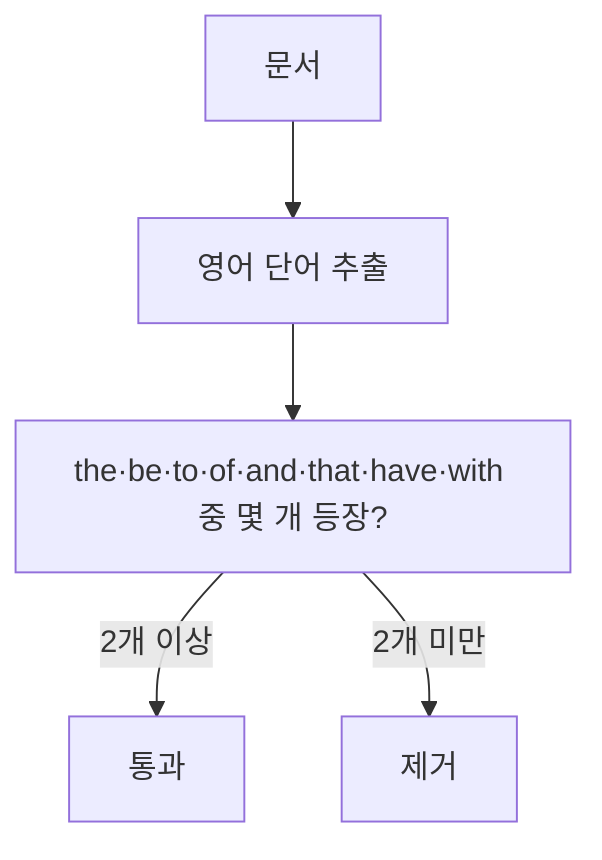
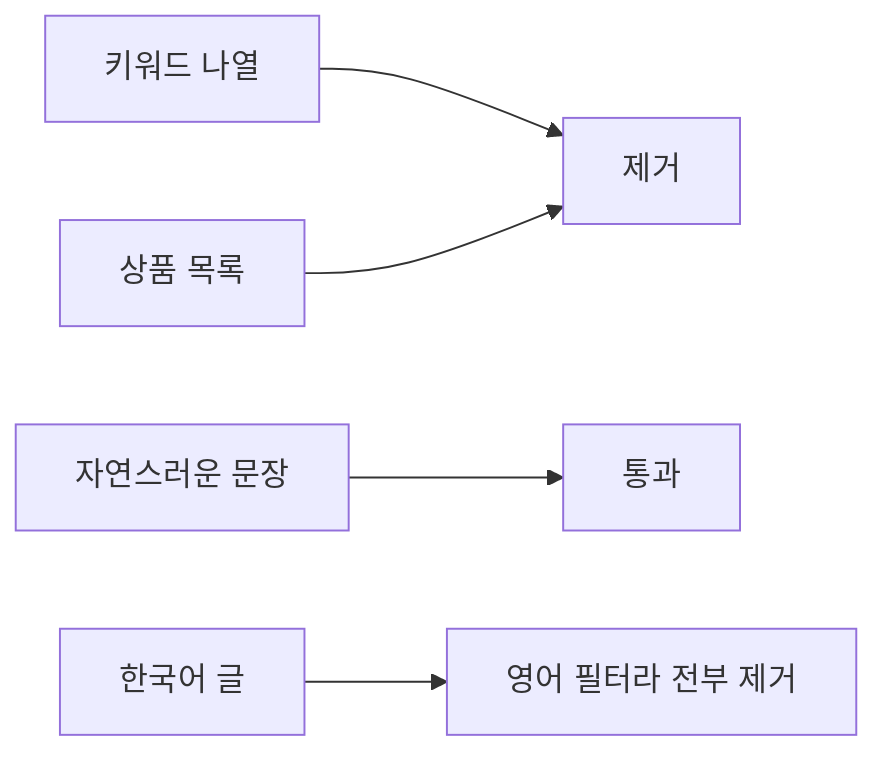

# 불용어 필터

> 문서에 **the, of, and 같은 아주 흔한 영어 단어가 최소 몇 개 들어 있는지** 세어, 영어처럼 보이지만 실제 문장이 아닌 글(키워드 나열·상품 목록 등)을 걸러 내는 단순한 품질 필터.

## 쉽게 말하면
진짜 영어 문장에는 "the", "of", "and" 같은 접착제 단어가 꼭 섞여 있다. 단어만 쭉 나열한 글에는 이 접착제가 없다. 접착제 단어 몇 개가 보이는지만 세도 "문장인지 아닌지"를 꽤 거를 수 있다.

## 자세히
(DeepMind Gopher 논문 arXiv 2112.11446 부록 A.1을 PDF에서 직접 읽음)
- **규칙**: MassiveWeb 품질 필터의 일부로 "다음 영어 단어 **the, be, to, of, and, that, have, with** 중 **최소 2개**가 없는 문서를 제거"한다. 논문은 이것이 영어처럼 보이지만 일관된 영어 글이 없는 문서를 잘 처리한다고 설명한다.
- **같이 쓰는 다른 휴리스틱(같은 절)**: 단어 수 50~10만, 평균 단어 길이 3~10자, `#`·`…`의 기호/단어 비율 0.1 이하, 줄의 90% 넘게 글머리표로 시작하거나 30% 넘게 말줄임표로 끝나는 문서 제거, 단어의 80%가 알파벳 한 글자 이상 포함. 편향을 줄이려고 "단순하고 이해하기 쉬운" 필터만 쓴다고 밝힌다. 금지어 목록 대신 SafeSearch를 쓴 이유로 Dodge 외(2021)의 소수 집단 글 과삭제 지적을 든다([방언별 필터링 편향](#dialect-filtering-bias)).
- **효과**: 1.4B 모델로 데이터 처리 단계를 하나씩 비교한 절제 실험(5GB 하위 표본)에서 단순 휴리스틱 품질 필터를 더하면 downstream 성능이 크게 개선되고, 중복 제거가 추가 개선을 줬다고 보고한다(개별 필터별 효과 분리는 확인하지 못함).
- **직접 구현해 본 결과(`the, be, to, of, and, that, have, with` 중 2개 이상 규칙)**:
  | 문서 | 일치 단어 | 결과 |
  |---|---|---|
  | 자연스러운 영어 문장 | and, be, have, that, the, to | 통과 |
  | SEO 키워드 나열 | 없음 | 제거 |
  | 색상·사이즈 상품 목록 | 없음 | 제거 |
  | 짧은 영어 "The cat sat." | the만 | **제거(오탐)** |
  | 파이썬 코드+영어 주석 | and, of, the, to | **통과** |
  | 한국어 문장 | 없음 | **제거** |
  짧은 정상 문장은 오탐으로 걸리고, 코드에 섞인 영어 주석은 통과한다. 한국어는 영어 불용어가 없어 전부 제거되므로 **한국어 데이터에는 그대로 못 쓴다**(한국어는 조사·어미 기반의 별도 규칙이 필요, 제안).
- **한계**: 영어 전용이고 짧은 글에 취약하다. 단어 수 하한(50단어)이 이미 짧은 글을 걸러 내므로 함께 쓰이는 점도 고려한다.

## 그림으로 보기



## 예시
```python
STOP = {"the","be","to","of","and","that","have","with"}
ok = len(STOP & set(words)) >= 2
```
- 업무 장면: 한국어 코퍼스에는 이 필터를 쓰지 말고, 한국어에 맞는 규칙(예: 자주 쓰는 조사·어미 포함 여부)을 새로 정해 표본 100건으로 오탐을 확인한다.

## 헷갈리는 것과 비교
| 개념 | 차이 |
|---|---|
| 불용어 필터(품질) | 흔한 단어가 있는지 보고 비문장 제거 |
| 불용어 제거(전처리) | 검색·분석 전에 흔한 단어를 빼는 것(반대 개념) |
| [Gopher 품질 휴리스틱](#gopher-quality-heuristics) | 이 필터가 속한 규칙 묶음 |
| [금지어 목록 필터](#bad-words-list-filter) | 특정 단어가 있으면 제거(편향 문제) |

## 더 읽을거리
- [Scaling Language Models: Methods, Analysis & Insights from Training Gopher (arXiv 2112.11446)](https://arxiv.org/abs/2112.11446) — MassiveWeb 품질 필터 규칙(PDF 직접 읽음).
