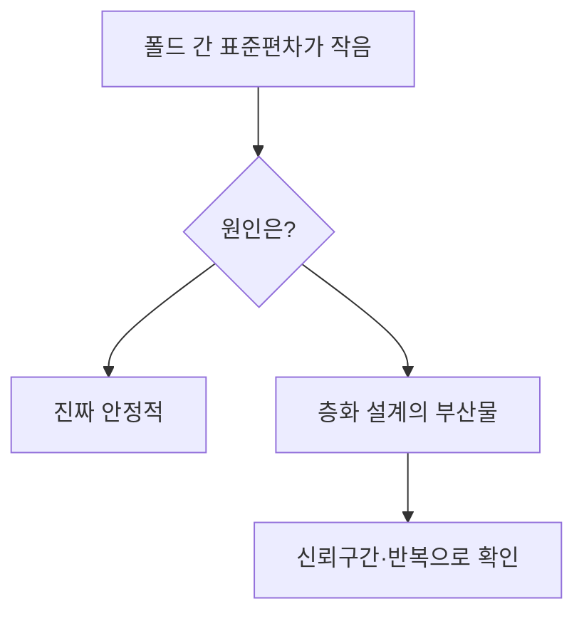

# 층화와 지표 퍼짐

> 층화(stratification)는 폴드마다 클래스 비율을 같게 맞춰서 폴드 간 지표의 변동 중 클래스 구성 차이에서 오는 부분을 줄인다. 하지만 지표 자체의 표본 잡음은 줄이지 못하므로, 폴드 간 퍼짐이 작아 보여도 실제 불확실성이 작다는 뜻은 아니다.

## 쉽게 말하면
조 편성에서 각 조에 남녀를 똑같이 배정하면 조별 성적 차이 중 성비 때문에 생긴 차이는 사라진다. 그러나 조원이 몇 명 안 되면 개인 컨디션에 따른 흔들림은 그대로다. 조 평균이 비슷해 보이는 것과 평균이 믿을 만한 것은 다르다.

## 자세히
- **공식 주의(scikit-learn 교차검증 문서, 열람)**: 층화는 폴드 간 변동을 줄이므로 클래스가 희귀할 때 보고되는 변동(폴드 간 퍼짐)이 실제 불확실성을 과소평가할 수 있다. 희귀 클래스에서 일반 KFold는 소수 클래스가 없는 폴드를 만들 수 있고(문서 예: 50개 중 5개가 클래스 1일 때 3겹 KFold의 한 폴드에 클래스 1이 0개) StratifiedKFold는 모든 폴드가 약 1:9 비율을 유지한다.
- **직접 해 본 시뮬레이션(순수 파이썬, 시드 13, 300번 반복)**: 표본 100개 중 양성 10개, 양성은 N(1,1), 음성은 N(0,1)의 점수를 갖고 임계값 0.5로 판정하는 고정 규칙의 5겹 평가다. 폴드당 양성 수의 표준편차는 일반 무작위 분할 1.14, 층화 0.00(폴드마다 정확히 2개)이었다. 그러나 폴드별 재현율의 표준편차는 무작위 0.308, 층화 0.301로 거의 같았다. 층화가 폴드 구성을 균일하게 만들었는데도 폴드당 양성이 2개뿐이라 재현율(0, 0.5, 1 같은 값 중 하나)이 크게 흔들린다. 모델 학습을 하지 않은 고정 규칙 실험이며 한 가지 설정의 결과다.
- **해석**: 층화는 폴드 간 클래스 비율 차이를 없애지만 폴드가 작다는 사실은 그대로다. 폴드 간 표준편차가 줄어드는 것은 "결과가 안정적"이라는 증거가 아니라 설계의 부산물일 수 있다.
- **그래서 어떻게 보고하나(해석)**: ① 폴드 간 표준편차만 신뢰구간처럼 쓰지 않는다 ② 전체 교차검증 예측을 모아 한 번에 지표를 구한 뒤 [Wilson](#wilson-interval)·부트스트랩 구간을 낸다 ③ [반복 층화 K겹](#repeated-stratified-kfold)으로 분할 변동을 본다 ④ 양성 개수를 함께 적는다.
- **층화의 가치는 여전히 있다**: 소수 클래스가 폴드에서 빠져 지표가 정의되지 않는 문제([클래스 누락 시 지표 미정의](#metric-undefined-missing-class))를 막는다.

## 그림으로 보기

## 예시
- 양성 20개뿐인 평가에서 5겹 층화의 폴드별 재현율이 0.75, 0.75, 0.75, 0.75, 0.75로 같아 보이면, 폴드당 양성 4개라서 가능한 값이 몇 개뿐이라는 점을 짚고 전체 재현율을 Clopper-Pearson 구간으로 보고한다.
- 교육 활용: 층화와 비층화의 폴드별 점수 퍼짐을 시뮬레이션해 비교하며 "퍼짐이 작다 ≠ 정확하다"를 토론한다.

## 헷갈리는 것과 비교
| 개념 | 차이 |
| --- | --- |
| [회귀 목표 구간화 층화](#stratify-regression-binning) | 상위 주제 |
| 폴드 간 표준편차 | 설계의 영향을 받은 퍼짐 |
| 신뢰구간 | 표본 크기에 근거한 불확실성 |
| [반복 층화 K겹](#repeated-stratified-kfold) | 분할 운에 의한 변동을 직접 확인 |

## 더 읽을거리
- [scikit-learn: Cross-validation](https://scikit-learn.org/stable/modules/cross_validation.html) — 층화가 변동을 줄인다는 주의
