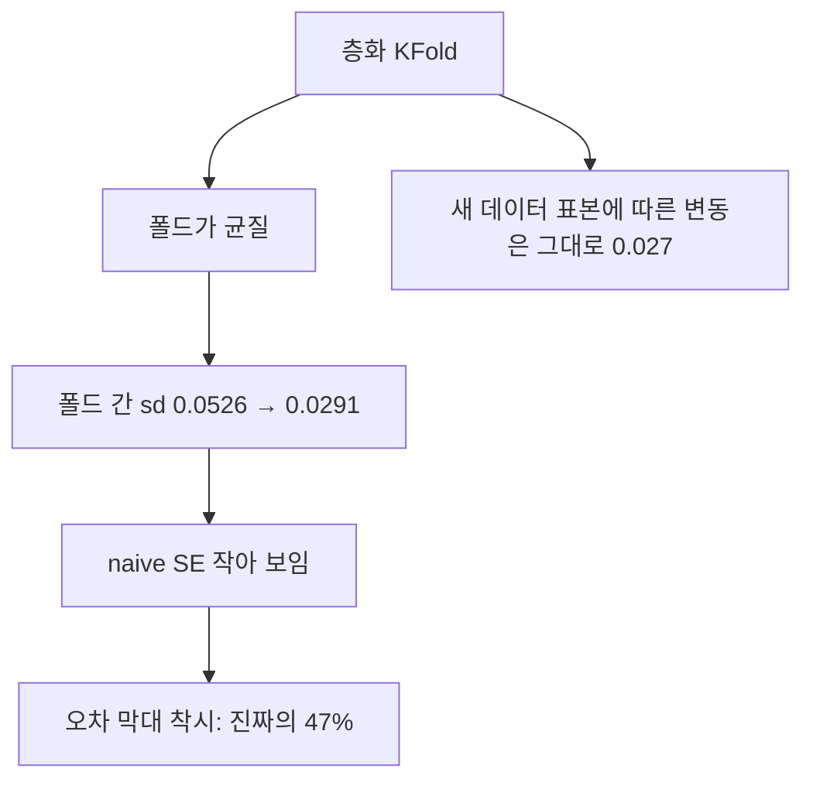
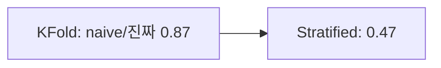

# 층화가 변동을 줄이는 효과

> 층화(stratified) 폴드는 폴드마다 클래스 비율을 비슷하게 만들어 **폴드 간 점수 표준편차를 작게** 만든다. 하지만 이는 "폴드끼리 비슷해 보이는 것"이지 **모델 성능의 불확실성이 줄어든 것이 아니어서**, 오차 막대를 보면 더 자신 있어 보이는 착시가 생긴다.

## 쉽게 말하면
교실을 키 순서로 줄 세워 모둠마다 비슷한 키로 맞추면 모둠 평균이 거의 같아진다. 그렇다고 "학생 전체의 평균 키를 더 정확히 안다"는 뜻은 아니다. 모둠 간 차이를 지워 버렸을 뿐이다.

## 자세히
- **공식 가이드(scikit-learn)**: 층화는 폴드를 더 균질하게 만들며, **통계적 문제가 아니라 공학적 문제를 우회**하기 위해 도입됐고 교차검증 반복 간 측정 지표의 **퍼짐을 인위적으로 줄일 수 있다**고 설명한다.
- **직접 시뮬레이션(scikit-learn 1.9.1, 양성 10%인 불균형 모집단 5만 개에서 150개를 300번 뽑아 로지스틱 회귀 5-폴드 CV, 폴드 점수는 정확도)**
  | 분할 | 폴드 간 표준편차(평균) | CV 평균의 진짜 표준편차(데이터셋 간) | naive 표준오차(sd/√5) | naive/진짜 |
  |---|---|---|---|---|
  | 일반 KFold | 0.0526 | 0.0271 | 0.0235 | 0.87 |
  | 층화 KFold | **0.0291** | 0.0277 | **0.0130** | **0.47** |
  층화로 폴드 간 표준편차는 0.0526→0.0291로 거의 절반이 됐지만, **데이터셋을 새로 뽑았을 때 CV 평균이 흔들리는 폭은 0.0271 대 0.0277로 사실상 같다.** 그래서 naive 표준오차(0.0130)는 진짜 불확실성(0.0277)의 약 절반(47%)으로 크게 낙관적이 됐다. 일반 KFold는 이 비율이 0.87로 상대적으로 덜 어긋났다.
- **왜 그런가**: 불균형 데이터에서 일반 KFold는 폴드마다 양성 개수가 들쭉날쭉해 점수가 흔들리지만 이 흔들림은 평균에서 대부분 상쇄된다. 층화는 이를 줄여 폴드 간 편차만 작게 만들 뿐 "새 데이터 표본이 달라질 때의 변동"은 줄이지 못한다.
- **그래서**
  1. 층화는 폴드에 클래스가 없어 지표가 정의되지 않는 문제를 막는 데 쓰고(그 목적에는 유용), 오차 막대가 작아졌다고 해석하지 않는다.
  2. 불확실성은 [부트스트랩 신뢰구간](#bootstrap-confidence-interval)·독립 시험 세트·[반복 교차검증](#repeated-cross-validation)의 반복 간 변동으로 따로 평가한다.
  3. 보고할 때 "층화 5-폴드, 폴드 간 표준편차 0.029"처럼 분할 방식을 명시([오차 막대 과소평가](#cv-error-bar-underestimation)).
  4. 모델 비교는 같은 층화 분할로 하되 차이의 유의성은 독립 평가로 확인.
- 이 수치는 한 모집단·모델의 설정이다. 다른 불균형 비율과 모델에서는 크기가 달라질 수 있다.

## 그림으로 보기

## 예시
- 사기 탐지 연구에서 층화 5-폴드 정확도 91.2 ± 1.3을 보고하고, 별도로 부트스트랩 신뢰구간(±2.7)을 함께 제시.
- 교육: "측정의 정밀함(작은 오차 막대)과 정확함(진짜 불확실성)은 다르다".

## 헷갈리는 것과 비교
| 개념 | 차이 |
|---|---|
| 폴드 간 표준편차 | 폴드끼리 얼마나 비슷한가 |
| 점수의 불확실성 | 새 데이터 표본에서 점수가 흔들리는 폭 |
| 층화 | 폴드 균질화(공학적 장치) |
| [비관적 편향](#pessimistic-bias-small-k) | 평균의 체계적 오차 |

## 더 읽을거리
- [scikit-learn 교차검증 가이드](https://scikit-learn.org/stable/modules/cross_validation.html) — 층화의 목적과 퍼짐을 인위적으로 줄일 수 있다는 주의.
- [StratifiedKFold API](https://scikit-learn.org/stable/modules/generated/sklearn.model_selection.StratifiedKFold.html) — 층화는 공학적 문제를 푸는 것이라는 설명.
