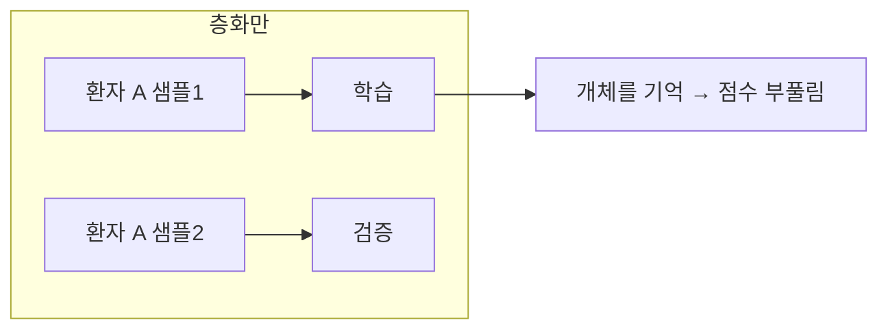
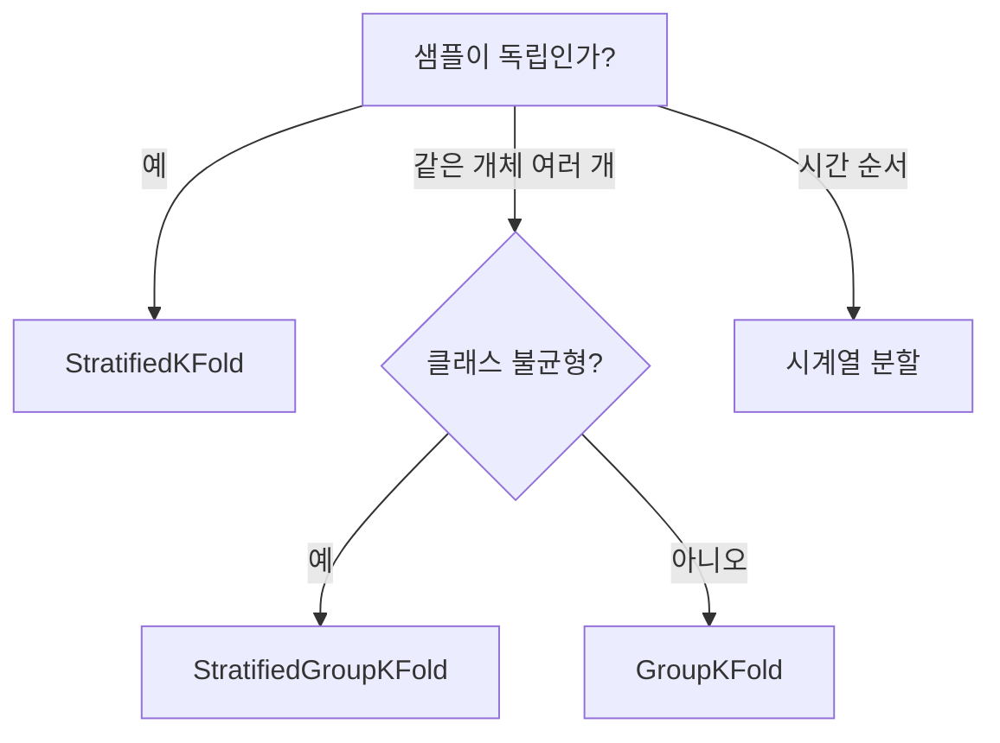

# 층화와 누수의 차이

> **층화(stratification)는 폴드마다 클래스 비율을 맞추는 일이고, 누수 방지는 같은 출처의 샘플이 학습·검증에 갈라지지 않게 하는 일이다.** 층화만으로는 누수를 막지 못한다.

## 쉽게 말하면
시험 문제를 학습지와 시험지로 나누면서 "쉬운 문제·어려운 문제 비율은 같게" 맞췄다고 하자(층화). 그런데 같은 문제의 숫자만 바꾼 쌍둥이 문제가 학습지와 시험지에 갈라져 있으면, 학생은 답을 외워서 맞힌다(누수). 비율은 맞아도 시험이 부정확하다.

## 자세히
(scikit-learn 1.9.1에서 직접 실행해 확인.)
- `StratifiedKFold.split(X, y, groups)`의 `groups`는 **무시**되고 경고가 뜬다: `The groups parameter is ignored by StratifiedKFold`(공식 API 문서에도 `groups` ignored로 적힘).
- **실험**: 40개 그룹×5샘플(200개), 라벨은 그룹 단위로 정해짐. `StratifiedKFold(5, shuffle=True)`로 나눈 결과 폴드마다 **학습과 테스트에 동시에 등장한 그룹 수가 32, 29, 31, 24, 25개**였다. `StratifiedGroupKFold`는 **0, 0, 0, 0, 0**.
- 결과 영향: 같은 환자·사용자·문서의 샘플이 양쪽에 있으면 모델이 개체를 기억해 검증 점수가 **낙관적으로 부풀려진다**. 실서비스에서는 처음 보는 개체가 오므로 성능이 떨어진다.
- 공식 문서의 층화 목적: 폴드에 특정 클래스가 없어 AUC 등이 정의되지 않는 문제를 피하려는 **공학적 우회**이며, 층화가 폴드 간 지표 퍼짐을 인위적으로 줄일 수 있다고 한다.
- **선택 기준**: 샘플이 독립이면 `StratifiedKFold`. 같은 개체가 여러 샘플이면 `GroupKFold` 또는 `StratifiedGroupKFold`. 시간 순서가 있으면 시계열 분할.
- 누수는 분할 외에도 전처리(전체 데이터로 스케일러 학습)·피처 설계에서도 생긴다. 분할기만 바꾼다고 모두 해결되지는 않는다.

## 그림으로 보기

## 예시
- 환자당 CT 여러 장을 `StratifiedKFold`로 나눴더니 AUC 0.99, 새 병원에서는 0.80 → 그룹 누수 의심, 환자 단위 분할로 재평가.
- 교육: "점수가 너무 좋으면 의심하라" 사례.

## 헷갈리는 것과 비교
| 개념 | 해결하는 문제 |
|---|---|
| 층화 | 폴드 간 클래스 비율 차이 |
| 그룹 분할 | 같은 개체의 학습·검증 분리 |
| [데이터 누수](#data-leakage) | 검증 정보가 학습에 새는 모든 경우(분할은 그중 하나) |
| [StratifiedGroupKFold](#stratified-group-kfold) | 둘을 동시에 최선 노력으로 |

## 더 읽을거리
- [scikit-learn 교차검증 가이드](https://scikit-learn.org/stable/modules/cross_validation.html) — 층화의 목적과 그룹 분할기 소개.
- [StratifiedGroupKFold API](https://scikit-learn.org/stable/modules/generated/sklearn.model_selection.StratifiedGroupKFold.html) — 그룹 보존 + 층화.
