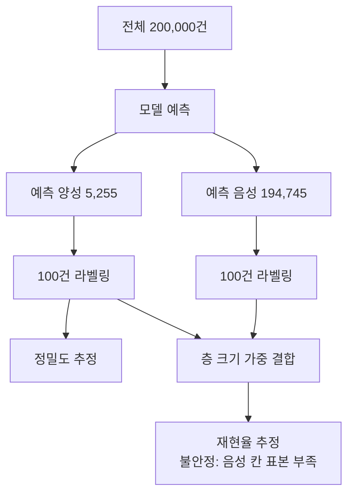

# 층화 평가 표집

> 양성이 드문 대규모 데이터에서 라벨을 달 표본을 고를 때, 전체에서 무작위로 뽑지 않고 **모델의 예측 층(예측 양성 / 예측 음성)별로 나눠 뽑고 층 크기로 가중**하는 설계. 같은 라벨링 예산으로 정밀도 추정이 훨씬 정확해진다.

## 쉽게 말하면
1만 장 중 불량이 드문 공장에서 200장만 검사할 때, 아무 데서나 뽑으면 "불량으로 의심된 제품"은 한두 개만 걸린다. 의심 제품 칸에서 100장, 정상 칸에서 100장을 따로 뽑으면 각 칸의 상태를 제대로 볼 수 있다. 다만 칸 크기에 맞춰 환산해야 한다.

## 자세히
- **직접 실행**(numpy 시뮬레이션: 데이터 200,000개, 양성 비율 0.5%, 점수 임계값으로 예측 양성 5,255개; 진짜 정밀도 0.136, 진짜 재현율 0.696; 라벨링 예산 200개, 1,000회 반복):

| 표집 방식 | 정밀도 추정 평균 | 표준편차 |
|---|---|---|
| 전체 무작위 200개 | 0.130 | **0.159** |
| 층화(예측 양성 100 + 예측 음성 100) | 0.137 | **0.035** |

  무작위 표집은 200개 중 예측 양성이 몇 개 안 돼 정밀도 추정이 크게 흔들렸다(표준편차 4.5배). 층화는 예측 양성 칸에 100개를 집중해 안정적이다.
- **재현율은 다르다**: 같은 표집으로 재현율을 추정하면 평균 0.892(진짜 0.696), 표준편차 0.262로 **불안정하고 치우쳤다**. 예측 음성 칸의 양성(FN)이 약 0.16%로 드물어, 100개로는 FN을 거의 못 잡기 때문이다. 재현율은 [거짓 음성 표집](#false-negative-sampling)처럼 음성 칸에 예산을 더 주거나 점수 구간별 층화가 필요하다.
- **절차**: ① 예측 결과로 층 나누기, ② 층별 무작위 표집(층 크기·표집 확률 기록), ③ 라벨링, ④ 층 크기 가중으로 정밀도·재현율 추정, ⑤ 불확실성은 부트스트랩([가중 추정의 신뢰구간](#weighted-confidence-interval)).
- 한계: 한 합성 설정의 결과. 층 경계(임계값)를 바꾸면 수치가 달라진다.

## 그림으로 보기

## 예시
- 유해 콘텐츠 필터 점검: 필터가 걸러 낸 글 5,000건 중 100건, 통과한 글 190,000건 중 100건을 사람이 라벨링해 오탐률과 누락률을 추정.
- 가중치: 예측 양성 층 가중 = 5,255/100, 예측 음성 층 가중 = 194,745/100.

## 헷갈리는 것과 비교
| 개념 | 차이 |
|---|---|
| 층화 평가 표집 | 예측 층별로 뽑고 가중 |
| 단순 무작위 표집 | 전체에서 균등하게 뽑음 |
| [층화 분할(학습/테스트)](#stratified-train-test-split) | 분할 시 클래스 비율 유지(다른 목적) |
| [거짓 음성 표집](#false-negative-sampling) | 음성 칸에서 누락 양성을 찾는 데 집중 |

## 더 읽을거리
- [Wikipedia: Stratified sampling](https://en.wikipedia.org/wiki/Stratified_sampling) — 층화 표집의 원리와 가중.
- [scikit-learn: Metrics and scoring](https://scikit-learn.org/stable/modules/model_evaluation.html) — 정밀도·재현율 정의.
