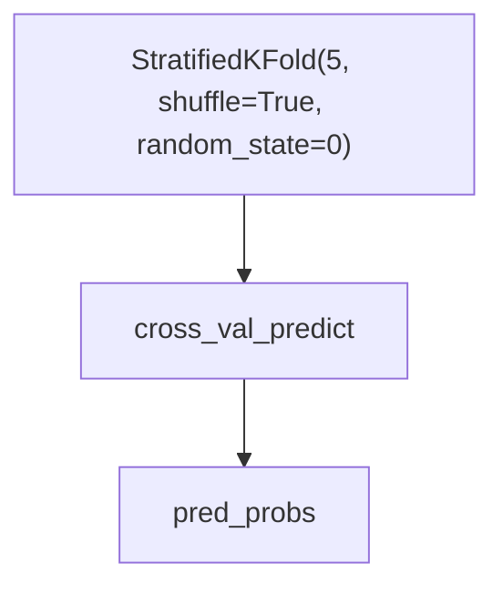

# pred_probs용 층화 폴드

> pred_probs(샘플별 예측 확률)를 교차 검증으로 만들 때, 클래스 비율을 폴드마다 비슷하게 유지하는 층화 분할(StratifiedKFold)과 셔플 설정을 쓰면 폴드 간 편차와 클래스 누락을 줄일 수 있다.

## 쉽게 말하면
반을 5조로 나눌 때 남학생만 한 조에 몰리지 않게 섞어서 편성하는 것과 같다. 한 조에 특정 유형이 하나도 없거나 몰려 있으면 그 조 결과가 치우친다.

## 자세히
- **문서의 권고(cleanlab)**: 클래스 비율이 폴드마다 비슷하도록 층화 교차 검증을 쓰라고 한다. 셔플·시드는 이 문서가 다루지 않는다.
- **직접 실행한 분할 결과(가상 데이터 300개, 소수 클래스 32개, 5-fold, 폴드별 소수 클래스 개수)**:

| 분할 | 폴드별 소수 클래스 수 | 비고 |
| --- | --- | --- |
| KFold 셔플 없음 | 11, 5, 7, 4, 5 | 원래 순서대로 나눔 |
| KFold 셔플 | 4, 6, 8, 7, 7 | 무작위 섞임, 편차 있음 |
| StratifiedKFold 셔플 | 7, 7, 6, 6, 6 | 거의 균등 |
| 라벨 정렬된 데이터 + KFold 셔플 없음 | 0, 0, 0, 0, 32 | 최악: 한 폴드에 소수 클래스 몰림 |

 마지막 줄처럼 데이터가 라벨순으로 정렬돼 있으면 셔플 없는 KFold는 학습 폴드에 클래스가 아예 없는 상황을 만들 수 있다([폴드에 클래스가 빠질 때](#missing-class-in-fold)). 이 수치는 이번 실행 한 번의 결과다.
- **설정 요령(해석)**: ① `StratifiedKFold(n_splits=K, shuffle=True, random_state=seed)` ② K는 가장 작은 클래스 샘플 수보다 크지 않게 ③ 결과 재현을 위해 시드를 고정하고, 후보 안정성은 시드를 바꿔 확인.
- **한계(해석)**: 층화는 라벨 기준이다. 같은 사용자·같은 문서의 샘플이 폴드에 갈리는 누수는 그룹 기준(GroupKFold)으로 막는다.

## 그림으로 보기



## 예시
```python
cv = StratifiedKFold(n_splits=5, shuffle=True, random_state=0)
pred_probs = cross_val_predict(clf, X, y, cv=cv, method="predict_proba")
```
- 교육 활용: 위 4가지 분할의 폴드별 소수 클래스 수를 직접 세어 보게 한다.

## 헷갈리는 것과 비교
| 개념 | 차이 |
| --- | --- |
| KFold | 라벨 비율 무시 |
| StratifiedKFold | 라벨 비율 유지 |
| GroupKFold | 같은 그룹을 한 폴드로 묶음 |
| [표본 외 예측 절차](#oof-predictions-workflow) | 층화 폴드를 쓰는 전체 순서 |

## 더 읽을거리
- [cleanlab pred_probs 교차 검증 튜토리얼](https://docs.cleanlab.ai/stable/tutorials/pred_probs_cross_val.html) — 층화 권고
- [scikit-learn Cross-validation 가이드](https://scikit-learn.org/stable/modules/cross_validation.html) — 층화 분할기와 클래스 누락 설명
