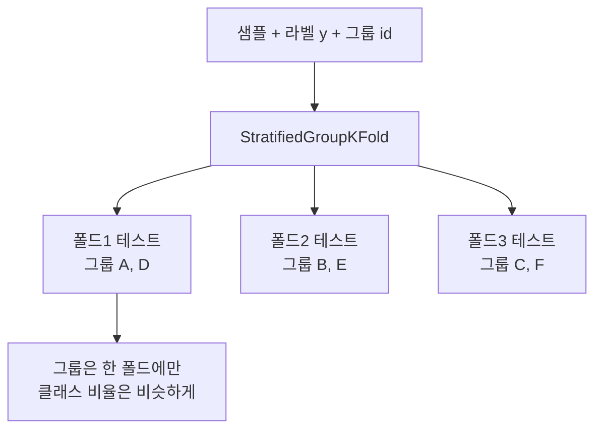
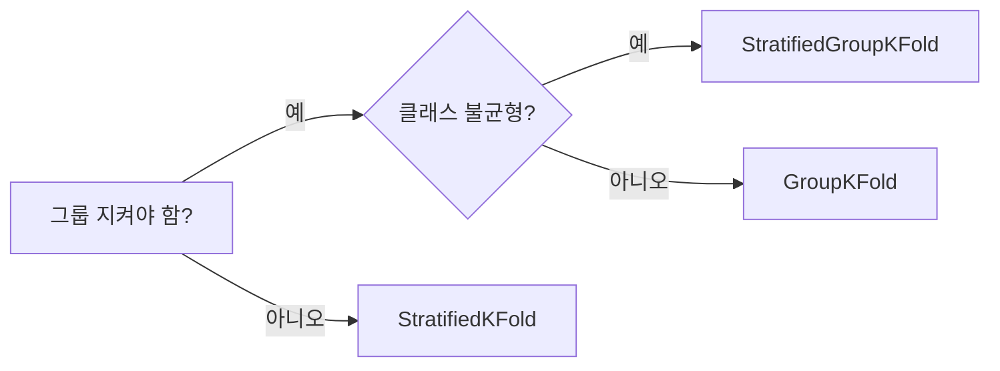

# StratifiedGroupKFold

> scikit-learn의 교차검증 분할기로, **같은 그룹은 한 폴드에만 넣으면서 가능한 한 클래스 비율도 폴드마다 비슷하게 유지**한다(문서 기준 scikit-learn 1.9.1).

## 쉽게 말하면
한 가족(그룹)은 같은 반에 배정하되, 각 반의 남녀·학년 비율은 비슷하게 맞추고 싶은 담임 배정과 같다. 가족을 쪼갤 수 없으니 비율은 "최대한" 맞출 뿐이다.

## 자세히
- **시그니처**: `StratifiedGroupKFold(n_splits=5, shuffle=False, random_state=None)`. `split(X, y, groups)`처럼 `y`와 `groups`를 모두 넘긴다.
- **보장**: 각 그룹은 전체 폴드를 통틀어 **정확히 한 번** 테스트 세트에 들어간다. 그래서 서로 다른 그룹 수는 `n_splits` 이상이어야 한다.
- **GroupKFold와 차이**: `GroupKFold`는 폴드당 그룹(샘플) 수를 비슷하게, 이 클래스는 클래스 비율을 비슷하게 맞추려 한다.
- **한계(문서)**: 층화는 *최선 노력*이다. 소수 그룹이 샘플을 대량 보유하면 정확한 층화가 불가능해 `GroupKFold`와 비슷해진다. 그룹마다 샘플이 1개면 `StratifiedKFold`와 같다. 라벨 값 이름에는 불변이다(`Happy/Sad`를 `1/0`로 바꿔도 같은 분할).
- **shuffle**: 클래스별 샘플을 섞지만 전역 셔플은 아니다. 분포가 비슷한 그룹끼리만 섞인다. `random_state`는 `shuffle=True`일 때만 쓴다.
- **메타데이터 라우팅**: `set_split_request(groups=...)`는 1.3에서 추가됐다.
- 용도: 같은 환자·사용자·문서에서 나온 샘플이 학습/검증에 갈라져 들어가는 **데이터 누수**를 막으면서 불균형 라벨을 다룰 때.

## 그림으로 보기



## 예시
```python
from sklearn.model_selection import StratifiedGroupKFold
sgkf = StratifiedGroupKFold(n_splits=3, shuffle=True, random_state=0)
for tr, te in sgkf.split(X, y, groups):
    ...  # 같은 환자의 샘플은 tr 또는 te 한쪽에만
```
- 환자별 여러 이미지가 있는 의료 데이터에서 질병 비율을 폴드마다 비슷하게 유지.

## 헷갈리는 것과 비교
| 개념 | 차이 |
|---|---|
| StratifiedKFold | 클래스 비율 유지, 그룹 무시 |
| GroupKFold | 그룹 보존, 클래스 비율 무시 |
| StratifiedGroupKFold | 둘 다(최선 노력) |

## 더 읽을거리
- [scikit-learn: StratifiedGroupKFold](https://scikit-learn.org/stable/modules/generated/sklearn.model_selection.StratifiedGroupKFold.html) — 공식 API 문서와 예제.
