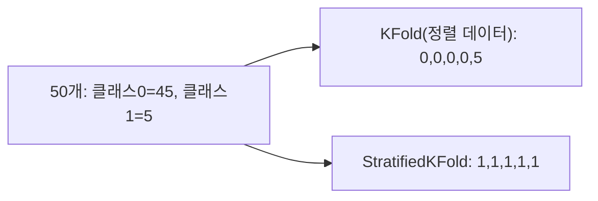
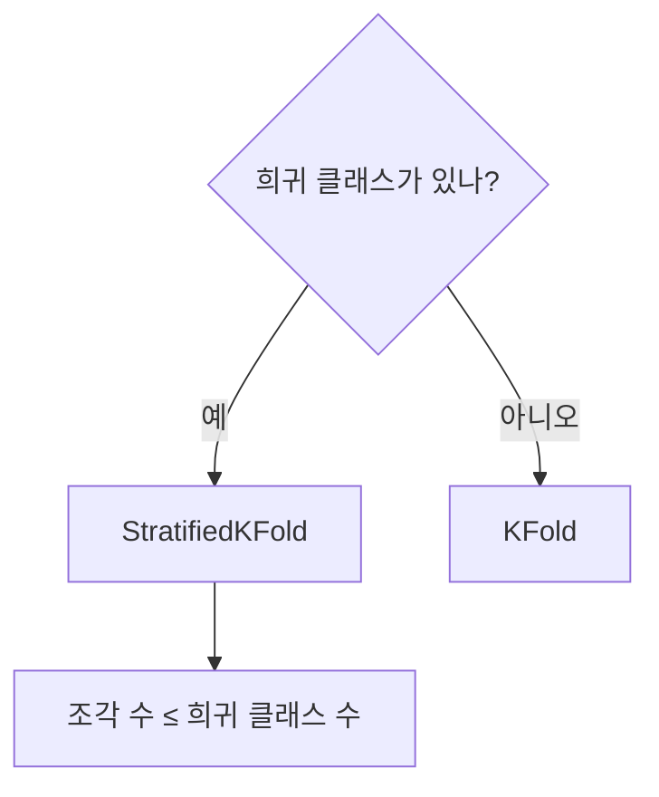

# 층화 k-겹

> 교차 검증에서 각 조각(fold)이 전체 데이터와 비슷한 클래스 비율을 갖도록 나누는 방식(StratifiedKFold)이다. 희귀 클래스가 있는 분류 문제에서 어떤 검증 조각에 희귀 클래스가 아예 없는 사고를 막는다.

## 쉽게 말하면
반 학생 50명 중 왼손잡이가 5명이다. 5개 모둠을 아무렇게나 나누면 한 모둠에 왼손잡이가 몰리거나 하나도 없을 수 있다. 층화는 왼손잡이를 모둠마다 1명씩 고르게 배치해서 모둠별 비교가 공정하게 한다.

## 자세히
(scikit-learn 1.9.1 공식 문서 확인 + **이 세션에서 직접 실행**한 결과.)
- **정의(공식 문서)**: `StratifiedKFold(n_splits=5, shuffle=False, random_state=None)`는 KFold와 같지만 각 조각이 전체와 대략 같은 클래스 비율을 유지한다. 문서는 `KFold`가 "클래스나 그룹의 영향을 받지 않는다"고 적는다.
- **직접 실행 결과**: 50개 샘플 중 클래스 0이 45개, 클래스 1이 5개(문서 예와 같은 구성)인 데이터를 5조각으로 나눠 **각 시험 조각에 든 클래스 1의 개수**를 셌다.
  - 데이터가 클래스 순서대로 정렬된 경우: `KFold` → `[0, 0, 0, 0, 5]`(희귀 클래스가 마지막 조각에 전부 몰림), `StratifiedKFold` → `[1, 1, 1, 1, 1]`.
  - 순서를 무작위로 섞은 데이터에 `KFold(shuffle=False)`를 쓰면 `[0, 2, 0, 1, 2]`처럼 들쑥날쑥. `StratifiedKFold`는 같은 데이터에서 `[1, 1, 1, 1, 1]`.
  - 즉 희귀 클래스가 5개뿐이면 `n_splits=5`가 한계다. 조각 수가 희귀 클래스 수보다 크면 층화를 유지할 수 없다(경고가 나올 수 있으며 이번 실행에서는 확인하지 않았다).
- **언제 쓰나**: 분류 문제의 클래스 불균형, 특히 희귀 클래스가 중요한 경우(불량·사기 탐지). 회귀나 그룹이 있는 데이터에는 맞지 않는다. 같은 사용자의 샘플이 여럿이면 [그룹 단위 분할](#group-wise-split)의 `StratifiedGroupKFold`를 고려한다.
- **함정(일반적)**: 층화는 라벨 비율을 맞출 뿐 **누수를 막아 주지 않는다**. 중복·근접 중복 샘플이 학습과 검증 조각에 갈라져 있으면 층화해도 점수가 부풀 수 있다([근접 중복 제거](#near-duplicate-removal)).
- **관련 함수**: `train_test_split(..., stratify=y)`도 같은 아이디어다.

## 그림으로 보기



## 예시
```python
import numpy as np
from sklearn.model_selection import KFold, StratifiedKFold
X = np.ones((50,1)); y = np.array([0]*45 + [1]*5)
print([int(y[te].sum()) for _, te in KFold(5).split(X, y)])            # [0, 0, 0, 0, 5]
print([int(y[te].sum()) for _, te in StratifiedKFold(5).split(X, y)])  # [1, 1, 1, 1, 1]
```
(직접 실행 결과 그대로.)

## 헷갈리는 것과 비교
| 개념 | 차이 |
|---|---|
| KFold | 클래스 무시 |
| StratifiedKFold | 클래스 비율 유지 |
| [그룹 단위 분할](#group-wise-split) | 같은 그룹이 양쪽에 걸치지 않게 |
| [k-겹 교차 검증](#k-fold-cross-validation) | 상위 개념 |

## 더 읽을거리
- [scikit-learn: Cross-validation](https://scikit-learn.org/stable/modules/cross_validation.html) — KFold·StratifiedKFold 정의와 예(직접 열어 확인).
