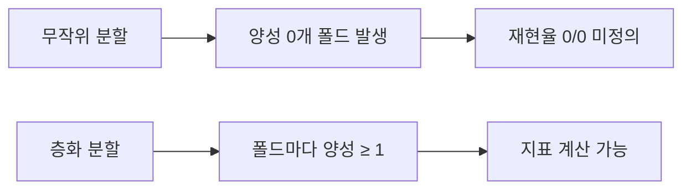
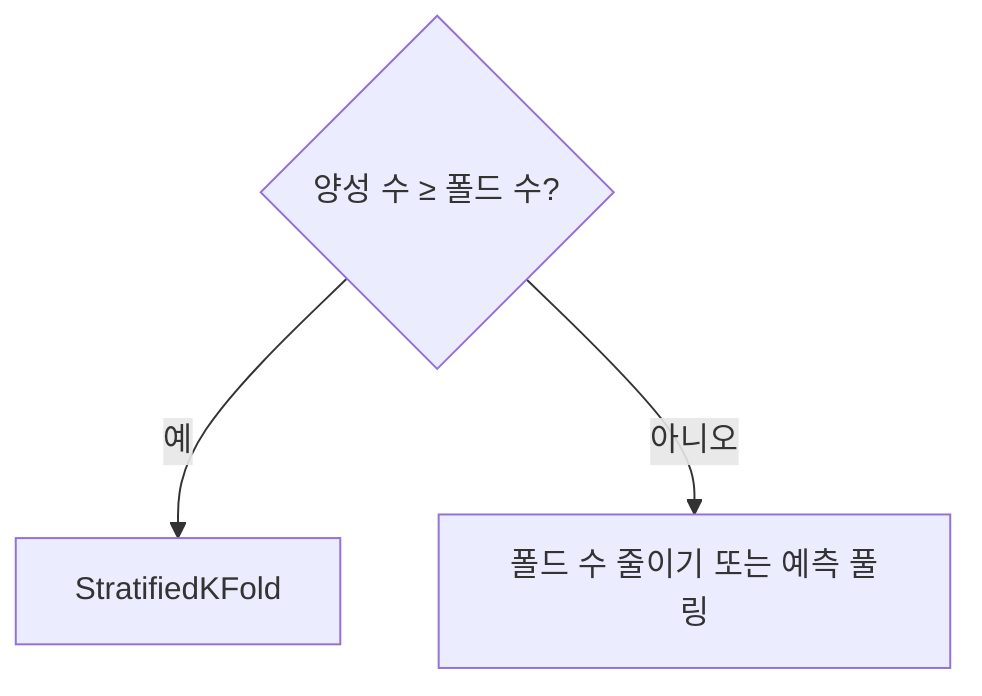

# 층화로 지표 미정의 막기

> 양성이 드문 데이터를 무작위로 폴드에 나누면 **어떤 폴드에 양성이 하나도 없어** 재현율·정밀도·AUC가 계산되지 않는(0/0) 일이 자주 생긴다. **층화 분할**은 폴드마다 클래스를 고르게 넣어 이 문제를 막는다.

## 쉽게 말하면
반에서 5명뿐인 왼손잡이를 5개 모둠에 무작위로 흩으면 왼손잡이가 한 명도 없는 모둠이 생길 수 있다. "모둠별 왼손잡이 적중률"을 내려면 모둠마다 최소 한 명은 있도록 일부러 배분해야 한다.

## 자세히
- **직접 시뮬레이션(순수 파이썬, 무작위 5겹 분할 2만 번)**: 한 폴드라도 양성이 0개인 확률
  | 전체 n | 양성 수 | 폴드 수 | 양성 없는 폴드가 생길 확률 |
  |---|---|---|---|
  | 100 | 20 | 5 | 3.3% |
  | 100 | 10 | 5 | 43.4% |
  | 500 | 10 | 5 | 47.0% |
  | 100 | 5 | 5 | 95.8% |
  | 200 | 10 | 10 | **99.96%** |
  양성이 폴드 수의 2배 이하만 되어도 거의 매번 정의되지 않는 폴드가 나온다. 전체 크기 n이 커져도 **양성 개수**가 문제이므로 해결되지 않는다(100→500에서 43→47%).
- **StratifiedKFold(scikit-learn 문서 확인)**: 각 시험 폴드가 클래스 비율을 최대한 보존하고, 가장 큰 시험 세트와 가장 작은 시험 세트는 최대 1개 차이(0.22부터). 라벨 값에 의존하지 않는다. `shuffle=True`일 때만 `random_state`가 의미를 가진다.
- **한 클래스가 n_splits보다 적을 때**: 문서 페이지는 다루지 않는다. 소스 기억에 따르면 일부 클래스만 부족하면 경고(UserWarning)를 내고 그 클래스는 모든 폴드에 못 들어간다(버전별 확인 필요). **양성 수 ≥ 폴드 수**가 최소 조건이다.
- **그래도 안 풀리는 경우**: 양성이 폴드 수보다 적으면 폴드 수를 줄이거나(예: 3겹), 반복 층화 CV, 또는 leave-one-out + 예측을 모아 한 번에 지표 계산(out-of-fold 풀링)한다. 폴드별 지표 평균보다 **전체 예측을 모아 계산**하면 0/0이 없어진다.
- **주의**: 층화는 지표를 정의하게 해 줄 뿐 [불확실성을 줄이지 않는다](#stratification-shrinks-variance). 그룹이 있으면 층화 그룹 분할(StratifiedGroupKFold)을 쓴다.

## 그림으로 보기



## 예시
```python
from sklearn.model_selection import StratifiedKFold, cross_val_predict
skf = StratifiedKFold(n_splits=5, shuffle=True, random_state=0)
pred = cross_val_predict(model, X, y, cv=skf, method="predict_proba")[:, 1]
# 모든 폴드의 예측을 모아 한 번에 AUC/재현율 계산
```
- 사기 거래 200건 중 8건이면 5겹에서도 폴드당 1~2건뿐이므로 지표가 매우 불안정하다는 점을 같이 보고한다.

## 헷갈리는 것과 비교
| 방법 | 보장 | 한계 |
|---|---|---|
| KFold | 없음 | 희귀 클래스 누락 |
| StratifiedKFold | 클래스 비율 | 그룹 분리는 별개 |
| StratifiedGroupKFold | 비율+그룹 | 근사 |
| 예측 풀링 | 0/0 회피 | 폴드별 변동 못 봄 |

## 더 읽을거리
- [sklearn StratifiedKFold](https://scikit-learn.org/stable/modules/generated/sklearn.model_selection.StratifiedKFold.html) — 보장 사항·shuffle 규칙(열어 확인).
