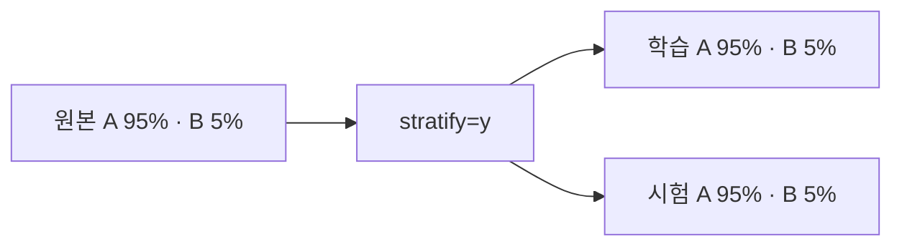
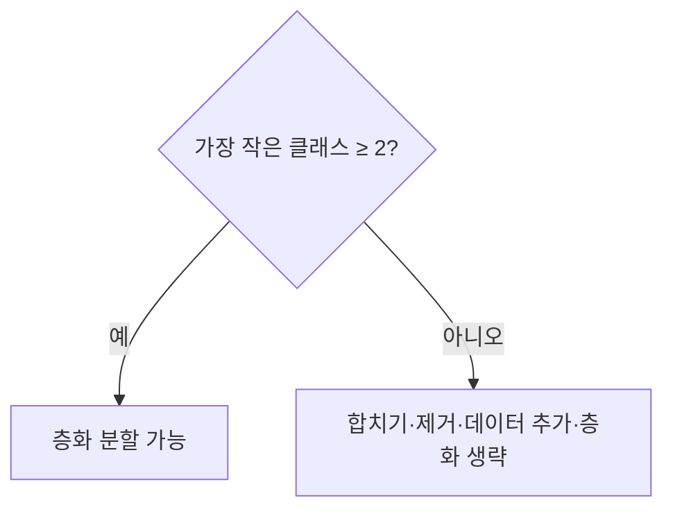

# 층화 train_test_split

> `train_test_split`에 `stratify=y`를 주면 학습·시험 세트의 클래스 비율이 원본과 같게 유지되도록 나눈다. 클래스가 불균형할 때 시험 세트에 희귀 클래스가 아예 빠지는 일을 막는다.

## 쉽게 말하면
반에 안경 쓴 학생이 5%뿐일 때 무작위로 조를 짜면 어떤 조엔 안경 쓴 학생이 한 명도 없을 수 있다. "각 조에 5%씩"이라고 정해 놓고 나누는 것이 층화다.

## 자세히
(scikit-learn 1.9.1 문서를 직접 열어 확인하고, 아래 동작은 직접 실행해 검증.)
- 시그니처: `train_test_split(*arrays, test_size=None, train_size=None, random_state=None, shuffle=True, stratify=None)`.
- `stratify`: 길이 `n_samples`의 배열. 값을 클래스 라벨로 보고 층화한다. `shuffle=False`이면 `stratify`는 `None`이어야 한다.
- `test_size`: 0~1 실수는 비율, 정수는 개수. 둘 다 `None`이면 0.25.
- **직접 실행 결과(scikit-learn 1.9.1)**: 클래스 비율 95:5 데이터 100개를 `test_size=0.2`로 시드 0~5로 나눴을 때, 층화 없이는 시험 세트 속 희귀 클래스 개수가 `[1, 0, 1, 3, 3, 1]`로 들쭉날쭉(0개인 경우도 있음)했고, `stratify=y`를 주면 모든 시드에서 `1`개로 일정했다.
- **너무 작은 클래스**: 한 클래스가 샘플 1개뿐이면 `ValueError: The least populated classes in y have only 1 member... cannot be less than 2`가 난다(직접 실행 확인). 해결: 희귀 클래스 합치기·제거, 데이터 더 모으기, 또는 층화 없이 나누기. 시험 세트 크기가 클래스 수보다 작을 때도 같은 종류의 오류가 난다(일반 지식, 버전 확인 필요).
- 층화는 라벨 기준이다. 같은 환자·문서가 갈리는 문제는 해결하지 못하므로 그룹이 있으면 [StratifiedGroupKFold](#stratified-group-kfold) 같은 도구를 쓴다.
- 교차 검증판은 [층화 k-겹](#stratified-k-fold).

## 그림으로 보기



## 예시
```python
from sklearn.model_selection import train_test_split
X_tr, X_te, y_tr, y_te = train_test_split(
    X, y, test_size=0.2, random_state=42, stratify=y)
```
- 불량 5%의 제조 데이터, 사기 거래 1%의 금융 데이터처럼 불균형 분류에서 기본 습관으로 쓴다.

## 헷갈리는 것과 비교
| 개념 | 차이 |
|---|---|
| 층화 분할 | 클래스 비율 유지 |
| 그룹 분할 | 같은 그룹이 한쪽에만 |
| [층화 k-겹](#stratified-k-fold) | 교차 검증에서 폴드마다 비율 유지 |
| 단순 무작위 분할 | 비율이 우연에 따라 흔들림 |

## 더 읽을거리
- [scikit-learn: train_test_split](https://scikit-learn.org/stable/modules/generated/sklearn.model_selection.train_test_split.html) — 인자·예제(열어 확인, 1.9.1).
