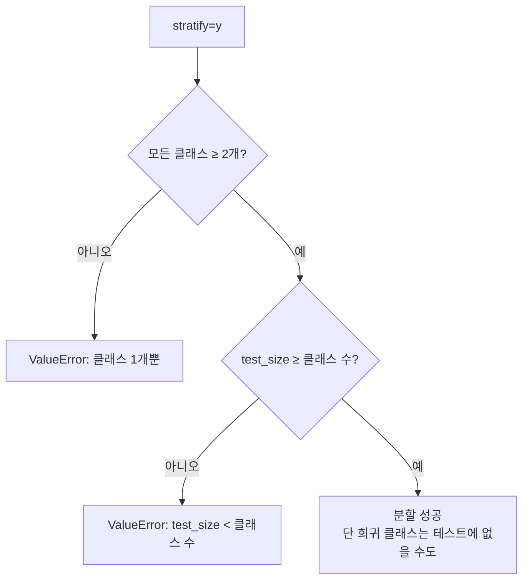
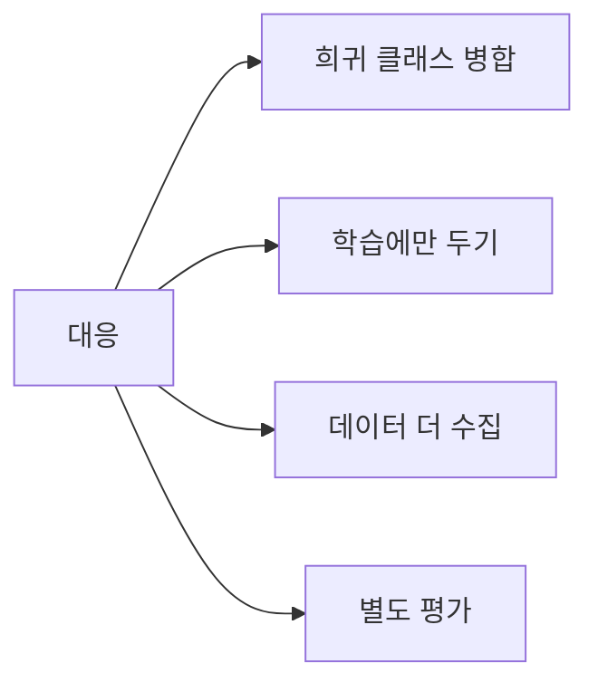

# stratify 최소 클래스 오류

> `train_test_split(..., stratify=y)`에서 **어떤 클래스가 샘플 1개뿐이거나**, `test_size`가 클래스 수보다 작으면 `ValueError`가 난다. 층화는 학습과 테스트 양쪽에 각 클래스가 최소 하나씩 들어가야 하기 때문이다.

## 쉽게 말하면
반 학생을 학년 비율대로 조를 나누려는데, 특정 학년 학생이 1명뿐이라면 두 조에 나눌 수가 없다. 그 학생을 한쪽에 몰아넣거나 다른 학년과 합쳐야 한다.

## 자세히
(scikit-learn 1.9.1에서 직접 실행)
- **클래스 1개뿐**: `y`에 클래스 2의 샘플이 1개면 `ValueError: The least populated classes in y have only 1 member, which is too few. The minimum number of groups for any class cannot be less than 2. Classes with too few members are: [2]`.
- **테스트 크기가 클래스 수보다 작음**: 클래스 3개, 클래스 2가 2개뿐인 데이터(20개)에 `test_size=0.1`(=2개)을 주면 `ValueError: The test_size = 2 should be greater or equal to the number of classes = 3`.
- **통과하는 경우**: 같은 데이터에 `test_size=0.25`(5개)이면 통과하지만 **테스트 클래스 분포 `[3 2 0]`**로 희귀 클래스 2가 테스트에 한 개도 없다(학습 `[7 6 2]`에만 존재). 오류가 안 나도 희귀 클래스는 평가에서 빠진다. 최소 조건은 "클래스당 2개 이상, 테스트 크기 ≥ 클래스 수"일 뿐 모든 클래스가 테스트에 들어간다는 보장은 아니다(직접 확인).
- **공식 API 문서 확인**: `stratify`는 클래스 라벨 배열이며 `shuffle=False`이면 `stratify`는 `None`이어야 한다. 최소 클래스 오류 문구는 문서 본문에는 없어 실행으로 확인했다.
- **대응**
  1. **희귀 클래스를 합친다**(예: 클래스 2→클래스 1): 직접 확인하니 테스트 분포 `[3 2]`로 정상 분할(클래스 의미를 잃는 대가).
  2. **희귀 클래스를 학습에만 둔다**: 마스크로 분할 후 합친다(테스트에서 이 클래스는 평가하지 못함).
  3. **데이터를 더 모은다**: 희귀 클래스를 최소 몇 개 이상으로(교차검증이면 `n_splits` 이상, [조각 수와 희귀 클래스](#n-splits-vs-rare-class)).
  4. 층화를 포기하고 무작위 분할 + 희귀 클래스는 별도 평가(예: 소수 클래스만의 재현율).
  5. 라벨이 사실 오타·잡음일 수 있으니 희귀 클래스를 먼저 점검([라벨 품질 점수](#cleanlab-label-quality-score)).
- **교차검증과의 관계**: `StratifiedKFold(n_splits)`는 가장 작은 클래스가 `n_splits`보다 적으면 경고(전부 적으면 오류)([조각 수와 희귀 클래스](#n-splits-vs-rare-class)).

## 그림으로 보기



## 예시
```python
from sklearn.model_selection import train_test_split
import numpy as np
y = np.where(y == 2, 1, y)  # 희귀 클래스 2를 1로 병합
X_tr, X_te, y_tr, y_te = train_test_split(X, y, test_size=0.25, stratify=y, random_state=0)
```
- 불량 유형이 1건뿐인 제조 데이터: 유형을 "기타 불량"으로 합쳐 층화 분할.

## 헷갈리는 것과 비교
| 개념 | 차이 |
|---|---|
| 클래스 1개뿐 오류 | 클래스를 둘로 나눌 수 없음 |
| test_size < 클래스 수 오류 | 테스트에 모든 클래스를 못 넣음 |
| [조각 수와 희귀 클래스](#n-splits-vs-rare-class) | 교차검증 폴드 수 문제 |
| 무층화 분할 | 오류는 없으나 클래스 비율이 흔들림 |

## 더 읽을거리
- [train_test_split API](https://scikit-learn.org/stable/modules/generated/sklearn.model_selection.train_test_split.html) — `stratify`·`test_size`·`shuffle` 파라미터.
- [StratifiedKFold API](https://scikit-learn.org/stable/modules/generated/sklearn.model_selection.StratifiedKFold.html) — 층화 K-폴드와 비교.
