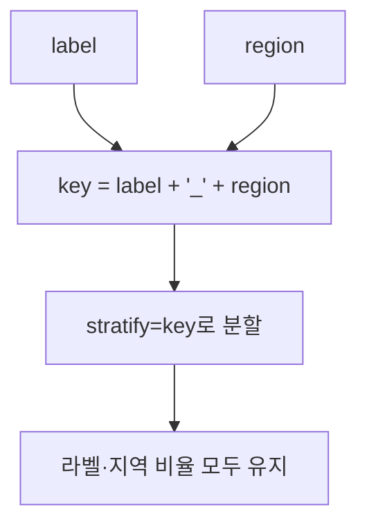
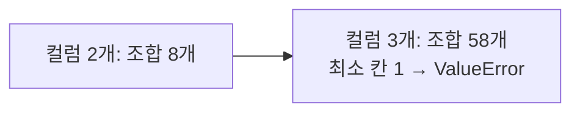

# 여러 컬럼 기준 층화

> 라벨뿐 아니라 **지역·기기·성별 같은 속성의 비율도 분할 후 유지**하고 싶을 때, 여러 컬럼 값을 `"A_KR"`처럼 이어 붙인 **조합 키**를 만들어 그 키로 층화하는 방법이다. 조합이 많아지면 샘플이 1개뿐인 칸이 생겨 층화가 실패한다.

## 쉽게 말하면
학급을 조로 나눌 때 "남녀 비율"만 맞추지 않고 "남녀 × 학년" 칸마다 비율을 맞추는 것이다. 칸이 너무 잘게 나뉘면 한 칸에 학생이 1명뿐이라 두 조에 나눌 수 없다.

## 자세히
(scikit-learn 1.9.1, 합성 데이터 1,000행: 라벨 A 85%·B 15%, 지역 KR 50%·US 30%·JP 15%·EU 5%, 직접 실행)
- **방법**: `df["key"] = df["label"] + "_" + df["region"]`, 그다음 `train_test_split(df, test_size=0.2, stratify=df["key"])`. `stratify`는 하나의 라벨 배열만 받으므로 조합 키로 해결한다.
- **효과**: 라벨만 층화하면 지역 EU의 테스트 비율이 0.06(전체 0.052)으로 흔들리고, 200번 반복했을 때 EU 비율의 평균 절대 편차는 **0.0107**이었다. 조합 키로 층화하면 **0.0020**으로 5분의 1이다. 라벨 A·B 비율은 둘 다 유지됐다.
- **희귀 조합의 한계**: 라벨 B이면서 EU인 조합은 전체 5건뿐. 테스트에 들어가는 평균 개수는 라벨만 0.9, 조합 키 1.0이다(데이터가 작아 어느 방식도 이 칸을 안정적으로 평가하지 못한다).
- **칸이 너무 많으면 실패**: 컬럼 하나(8가지)를 더 붙이면 조합이 **58개**, 최소 칸 크기 1이 되어 `ValueError: The least populated classes in y have only 1 member...`([stratify 최소 클래스 오류](#stratify-min-class-error)). 조합 수는 각 컬럼 값 개수의 곱으로 늘어난다.
- **대응**
  1. 키에 넣는 컬럼을 **꼭 필요한 1~2개**로 제한.
  2. 값이 많은 컬럼은 구간화·묶기(예: 나이 → 연령대, 소수 국가 → "기타").
  3. 가장 작은 칸이 `최소 2개`가 되도록 병합.
  4. 칸이 부족하면 라벨 층화 + 속성 분포를 사후 확인(편차 보고).
  5. 여러 라벨(멀티라벨)이 있으면 `iterative-stratification`(scikit-multilearn 등) 같은 전용 방법을 검토(미검증, 별도 조사 필요).
- **그룹과의 충돌**: 같은 개체를 한쪽에 몰아야 하면 조합 층화가 이를 보장하지 않는다([층화와 그룹의 충돌](#stratify-vs-group)).

## 그림으로 보기



## 예시
```python
df["key"] = df["label"].astype(str) + "_" + df["region"].astype(str)
train, test = train_test_split(df, test_size=0.2, stratify=df["key"], random_state=0)
print(pd.crosstab(test.region, test.label, normalize=True))  # 분포 확인
```
- 의료 영상: 질환 라벨 × 촬영 기기(2종)로 층화해 기기 편향을 줄인 분할.

## 헷갈리는 것과 비교
| 개념 | 차이 |
|---|---|
| 라벨 층화 | 라벨 비율만 유지 |
| 조합 키 층화 | 라벨+속성 비율을 함께 유지 |
| 멀티라벨 층화 | 한 샘플에 라벨이 여러 개(전용 알고리즘) |
| [층화와 그룹](#stratify-vs-group) | 그룹을 쪼개지 않는 조건이 추가 |

## 더 읽을거리
- [train_test_split API](https://scikit-learn.org/stable/modules/generated/sklearn.model_selection.train_test_split.html) — `stratify` 파라미터 설명.
- [StratifiedKFold API](https://scikit-learn.org/stable/modules/generated/sklearn.model_selection.StratifiedKFold.html) — 같은 조합 키를 `y` 자리에 넣어 교차검증에도 사용.
