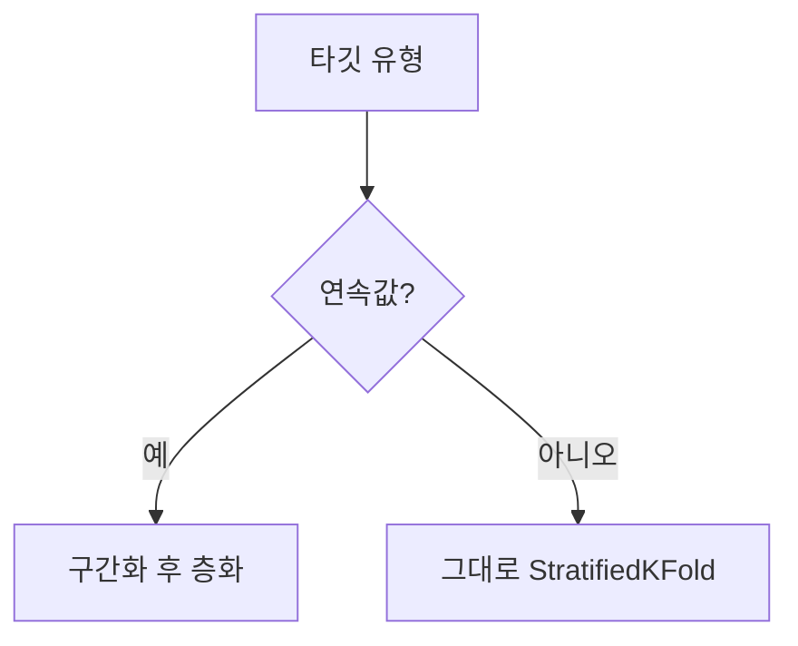

# 회귀 층화(구간화)

> 연속값 타깃(집값·매출)은 StratifiedKFold에 바로 넣을 수 없어서, **타깃을 구간(bin)으로 나눠 구간 번호를 "클래스"처럼 써서** 폴드마다 타깃 분포를 비슷하게 맞추는 요령이다.

## 쉽게 말하면
키가 제각각인 학생들을 "작은 편·중간·큰 편" 다섯 칸으로 나눠 놓고, 각 반에 칸별 학생이 같은 수만큼 들어가게 배정하는 것이다. 반마다 키 분포가 비슷해진다.

## 자세히
(scikit-learn 1.9.1에서 직접 실행해 확인. 구간화는 공식 문서에 없는 **실무 관행**이다.)
- 연속값 `y`를 그대로 넣으면 `ValueError: Supported target types are: ('binary', 'multiclass'). Got 'continuous' instead.`
- **방법**: `bins = np.quantile(y, [.2,.4,.6,.8])`, `y_bin = np.digitize(y, bins)`, 그다음 `StratifiedKFold(5, shuffle=True, random_state=0).split(X, y_bin)`. 분위수로 자르면 구간마다 샘플 수가 같다.
- **확인 결과**: 로그정규 분포 샘플 200개로 시험하니 모든 폴드 테스트가 구간당 8개씩 `[8 8 8 8 8]`이었고, 폴드별 타깃 평균은 1.43~1.70(전체 1.55)이었다. 꼬리가 긴 분포도 폴드마다 비슷하게 퍼진다.
- 구간 수 선택: 너무 많으면 [희귀 클래스 문제](#n-splits-vs-rare-class)가 생긴다. 보통 폴드 수의 몇 배 이하, 구간당 샘플이 `n_splits` 이상이 되게 한다(경험칙).
- 한계: 구간 내부의 변동은 통제하지 못한다. 그리고 공식 문서가 말하듯 층화는 통계적 문제가 아니라 **공학적 문제**(폴드 간 편차 줄이기)를 우회하는 도구이며 폴드 간 지표 퍼짐을 인위적으로 줄일 수 있다.
- 그룹이 있는 데이터는 구간화만으로 누수를 못 막는다([층화와 누수](#stratification-vs-leakage)).

## 그림으로 보기



## 예시
```python
y_bin = np.digitize(y, np.quantile(y, [.2,.4,.6,.8]))
for tr, te in StratifiedKFold(5, shuffle=True, random_state=0).split(X, y_bin):
    ...  # 모델은 원래 y로 학습, 분할만 y_bin 사용
```
- 집값 예측에서 고가 매물이 한 폴드에 몰리는 것을 방지.

## 헷갈리는 것과 비교
| 개념 | 차이 |
|---|---|
| 회귀 층화 | 분할 기준만 구간 번호, 학습은 원래 연속값 |
| 타깃 이산화(분류로 바꿈) | 모델 자체를 분류로 바꿈 — 다른 문제 |
| [StratifiedGroupKFold](#stratified-group-kfold) | 그룹까지 지킴 |

## 더 읽을거리
- [scikit-learn 사용자 가이드: 교차검증](https://scikit-learn.org/stable/modules/cross_validation.html) — 층화의 목적과 한계 서술.
- [StratifiedKFold API](https://scikit-learn.org/stable/modules/generated/sklearn.model_selection.StratifiedKFold.html) — 지원 타깃 유형.
