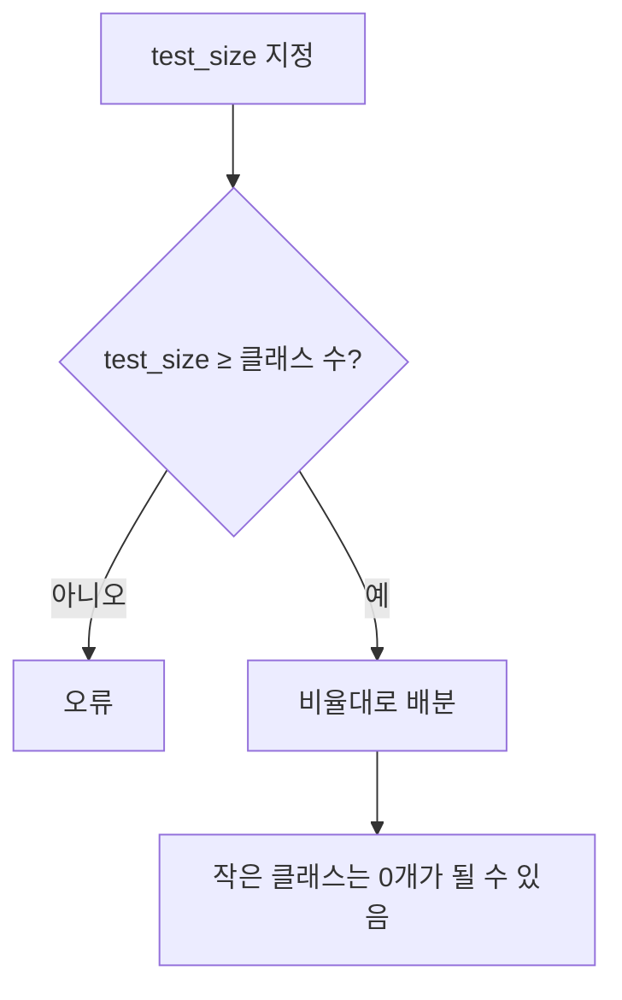
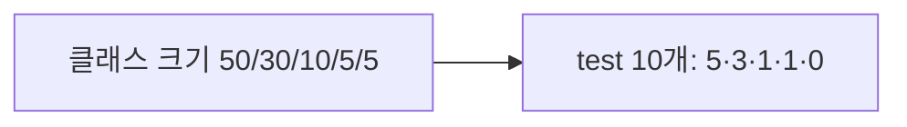

# test_size와 클래스 수 규칙

> scikit-learn의 `train_test_split(..., stratify=y)`는 테스트 세트 크기(`test_size`)가 클래스 수 이상이어야 한다는 검사를 한다. 이 검사를 통과해도 모든 클래스가 테스트 세트에 들어간다는 보장은 아니다.

## 쉽게 말하면
반 5개 중 각 반에서 한 명씩 대표를 뽑으려면 최소 5명을 뽑아야 한다. 하지만 5명을 "인원 비율대로" 뽑으면 작은 반의 대표는 빠질 수 있다.

## 자세히
- **직접 실행한 결과(scikit-learn 1.9.1, 샘플 100개, 클래스 5개의 크기 50/30/10/5/5, `stratify=y`)**:

| test_size | 결과 | 테스트 세트의 클래스별 개수(0~4) |
| --- | --- | --- |
| 3 (또는 비율 0.03 → 3개) | 오류: "The test_size = 3 should be greater or equal to the number of classes = 5" | - |
| 5 | 통과 | 3, 2 (클래스 0·1만 들어감) |
| 0.1 (= 10개) | 통과 | 5, 3, 1, 1 (클래스 4가 빠짐) |

  `test_size`가 클래스 수(5) 미만이면 오류가 나고 5 이상이면 통과하지만, 5개로 하면 5개 클래스 중 2개 클래스에서만 뽑혔고, 10개로 해도 가장 작은 클래스 하나가 테스트에 없었다. 층화는 클래스 비율대로 개수를 배분하기 때문에 작은 클래스는 0개가 될 수 있다.
- **샘플이 1개뿐인 클래스**: `stratify`를 쓰면 가장 적은 클래스가 1개뿐이어서 "any class cannot be less than 2" 오류가 난다(직접 확인). 어떤 클래스도 최소 2개는 있어야 층화 분할이 가능하다.
- **대응(해석)**: ① 테스트 비율을 가장 작은 클래스에도 몇 개가 들어갈 만큼 키운다 ② 희귀 클래스를 합치거나([희귀 클래스 병합](#merge-rare-classes)) 더 수집한다([희귀 클래스 추가 수집](#rare-class-collection)) ③ 테스트에 못 넣는 클래스는 학습에만 두고 평가 한계를 문서화한다([희귀 클래스 학습 전용 처리](#train-only-rare-class)) ④ 클래스별 평가 지표를 쓸 때 클래스당 테스트 샘플 수를 함께 보고한다.
- **교차 검증과의 연결(해석)**: K-fold 층화 분할도 가장 작은 클래스가 K개보다 적으면 문제가 생긴다([폴드에 클래스가 빠질 때](#missing-class-in-fold), [pred_probs용 층화 폴드](#stratified-folds-for-pred-probs)).

## 그림으로 보기

## 예시
- `train_test_split(X, y, test_size=0.1, stratify=y)`에서 `np.bincount(y_test)`로 클래스별 개수를 반드시 확인한다.
- 교육 활용: 클래스 크기를 바꿔 가며 테스트에 빠지는 클래스가 생기는 조건을 찾는다.

## 헷갈리는 것과 비교
| 개념 | 차이 |
| --- | --- |
| 검사 통과 | test_size ≥ 클래스 수 |
| 모든 클래스 포함 | 별도로 확인해야 함 |
| [폴드에 클래스가 빠질 때](#missing-class-in-fold) | 교차 검증판 같은 문제 |
| [희귀 클래스 병합](#merge-rare-classes) | 해결책 |

## 더 읽을거리
- [scikit-learn Cross-validation 가이드](https://scikit-learn.org/stable/modules/cross_validation.html) — 학습·테스트 분할과 층화 분할기
