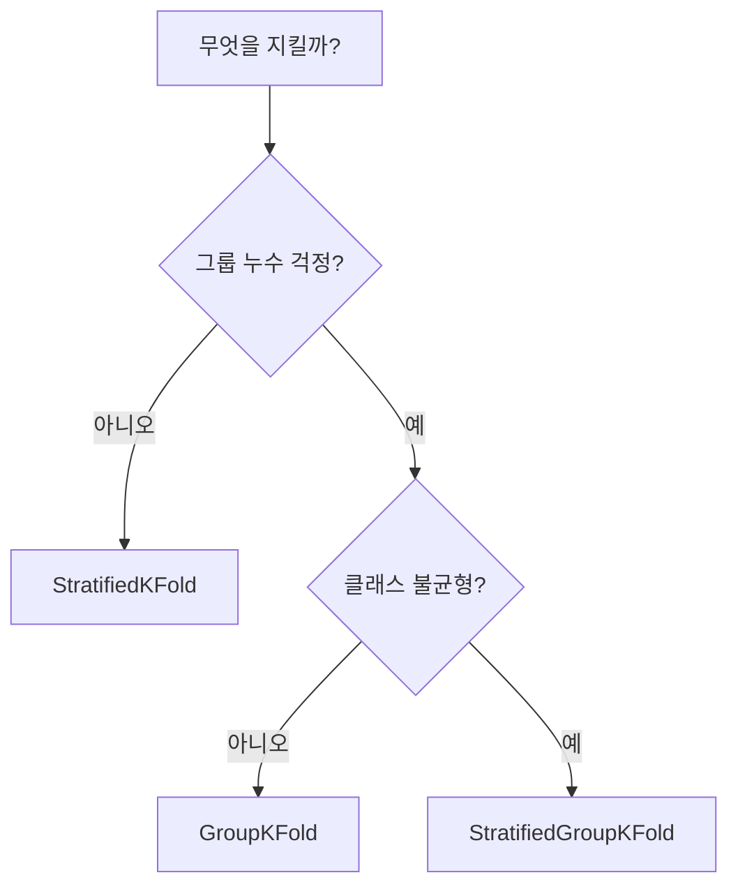
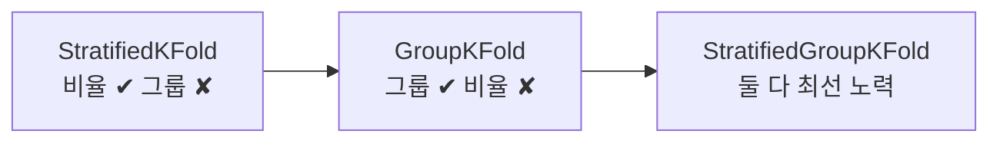

# 층화와 그룹의 충돌

> **클래스 비율을 맞추려는 층화**와 **같은 그룹을 한쪽에만 두려는 그룹 분할**은 서로 당기는 힘이 달라 한쪽을 지키면 다른 쪽이 깨진다. 둘을 동시에 최선으로 만족시키는 도구가 `StratifiedGroupKFold`다.

## 쉽게 말하면
반 배정에서 "남녀 비율을 같게"와 "형제는 같은 반"을 동시에 지키려는 것이다. 형제 수가 제각각이면 비율을 정확히 맞출 수 없어서 "최대한 가깝게"가 한계다.

## 자세히
(scikit-learn 1.9.1, 합성 데이터: 환자 100명, 환자당 샘플 1~30개, 환자 단위 라벨 양성 15% → 샘플 1,579개, 양성 비율 0.149, 5-폴드, 직접 실행)
| 분할기 | 폴드별 테스트 양성 비율 | 폴드 크기 | 학습·테스트에 걸친 환자 |
|---|---|---|---|
| StratifiedKFold | 0.149, 0.149, 0.149, 0.152, 0.149 | 316 안팎 | **86, 84, 86, 82, 88**(누수) |
| GroupKFold | 0.127, 0.187, 0.111, 0.171, 0.152 | 316 안팎 | 0 |
| StratifiedGroupKFold | 0.149, 0.152, 0.155, 0.146, 0.146 | 315~317 | 0 |
- **해석**: StratifiedKFold는 비율은 완벽하지만 환자가 양쪽에 걸쳐 누수가 크다. GroupKFold는 누수가 없지만 양성 비율이 0.111~0.187로 흔들린다. StratifiedGroupKFold는 **누수 0이면서 비율 편차도 작다**. 30개 시드에서 폴드의 최대 편차 평균은 StratifiedGroupKFold 0.005, GroupKFold 0.039(1회)였다.
- **공식 문서 설명(StratifiedGroupKFold)**: 같은 그룹이 한 폴드에만 들어가면서 가능한 한 클래스 비율을 유지하는 StratifiedKFold의 변형이며, 층화는 최선 노력이다. 소수 그룹이 샘플을 대량 보유하면 정확한 층화가 불가능해 GroupKFold에 가까워진다([StratifiedGroupKFold](#stratified-group-kfold)).
- **충돌이 심해지는 조건**: 그룹 수가 적음, 그룹 크기 편차가 큼, 라벨이 그룹 내부에서 섞여 있음(같은 환자에 양성·음성 혼재), 희귀 클래스가 소수 그룹에 몰림.
- **선택 지침**
  1. 샘플이 독립: `StratifiedKFold`.
  2. 그룹 보존이 최우선이고 클래스 불균형 없음: `GroupKFold`.
  3. 그룹 보존 + 클래스 균형: `StratifiedGroupKFold`(그룹 수 ≥ `n_splits`, 분할 후 비율·겹침 점검).
  4. 그룹 수가 적어 모든 방법이 불안정: 그룹 단위 반복(GroupShuffleSplit)이나 `n_splits` 축소, 클래스별 지표 따로 보고.
- **점검 습관**: 분할 후 [그룹 겹침 검증](#group-overlap-check)과 폴드별 양성 비율·크기를 표로 확인한다.

## 그림으로 보기



## 예시
```python
from sklearn.model_selection import StratifiedGroupKFold
cv = StratifiedGroupKFold(n_splits=5, shuffle=True, random_state=0)
for tr, te in cv.split(X, y, groups=patient_id):
    assert not set(patient_id[tr]) & set(patient_id[te])
```
- 환자별 영상 여러 장, 양성 환자 15%인 데이터에서 폴드별 양성 비율을 유지하며 환자는 분리.

## 헷갈리는 것과 비교
| 개념 | 차이 |
|---|---|
| 층화 | 클래스 비율 유지 |
| 그룹 분할 | 개체 분리(누수 방지) |
| 충돌 | 그룹 크기 불균형이 층화를 방해 |
| [층화와 누수](#stratification-vs-leakage) | 층화가 누수를 못 막는 실험 |

## 더 읽을거리
- [StratifiedGroupKFold API](https://scikit-learn.org/stable/modules/generated/sklearn.model_selection.StratifiedGroupKFold.html) — 최선 노력 층화와 그룹 보존.
- [scikit-learn 교차검증 가이드](https://scikit-learn.org/stable/modules/cross_validation.html) — 그룹 분할기 소개.
