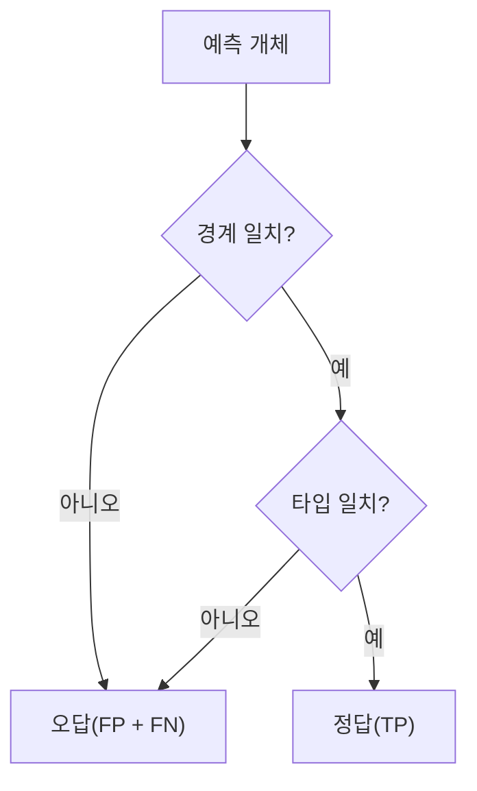
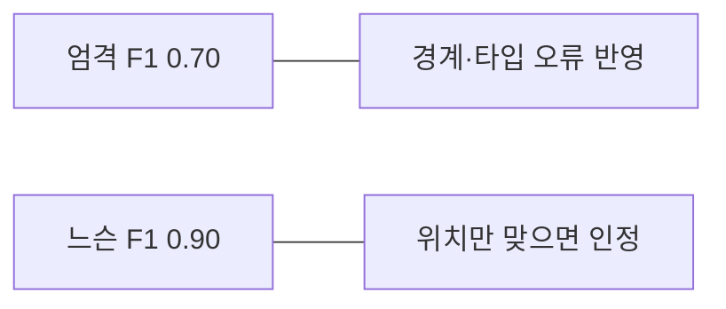

# 엄격 구간·유형 F1

> 개체명 인식 평가에서 예측이 정답으로 인정되려면 **경계(시작·끝 위치)와 타입이 둘 다 정확히 일치**해야 하는 F1. 한 글자만 어긋나도 오답이라 가장 까다로운 채점 방식이다.

## 쉽게 말하면
형광펜 시험에서 "급성 신부전"을 칠해야 하는데 "신부전"만 칠하면 거의 맞았어도 0점이다. 부분 점수는 없다. 대신 점수가 높다면 정말 정확히 표시한 것이다.

## 자세히
- **정의(arXiv 2605.20809 3.3절 확인)**: 엄격 일치는 "엔티티 경계와 타입의 **정확한 일치**"를 요구한다. 한 글자라도 겹치면 되는 **느슨한(soft) 일치**는 점수 계산이 아니라 **오류 범주화**에만 쓴다. 논문은 정밀도·재현율·F1 식을 따로 쓰지 않는다(표준 정의 사용).
- **표준 계산(일반 정의)**: TP = 경계·타입이 모두 일치한 예측 수, FP = 나머지 예측 수, FN = 일치되지 못한 gold 수. 정밀도 = TP/(TP+FP), 재현율 = TP/(TP+FN), F1 = 2PR/(P+R).
- **직접 계산 예(가상)**: gold 개체 10개, 예측 10개. 정확히 일치 7개, 경계만 다름 1개, 타입만 다름 1개, 헛 예측 1개(그리고 gold 중 1개는 놓침). 엄격 기준: TP 7, FP 3, FN 3 → P=R=0.70, **F1 0.70**. 겹침만 보는 느슨한 위치 기준(타입 무시)이면 경계 불일치·라벨 불일치도 위치는 맞으니 TP 9 → F1 0.90. 점수 차이 0.20은 경계·타입 오류 때문이다.
- **엄격 F1이 낮은 이유**: 모델이 개체를 찾았는데 **범위 선택**이나 **타입 정의**에서 사람 규칙서와 다르게 해석하는 경우가 많다. 규칙서에 경계·타입 기준이 모호할수록 엄격 F1이 낮다.
- **논문 맥락 수치(저자 보고)**: 규칙서를 넣었을 때 NCBI에서 GPT-5가 0.46 → 0.73, 중재 후 최고 BC5CDR 0.86·BioRED 0.82·NCBI 0.76(엄격 F1). 종료 기준 F1 0.9.
- **선택 가이드**
  | 목적 | 지표 |
  |---|---|
  | 자동 추출을 그대로 DB에 저장 | 엄격 F1 |
  | 후보를 사람이 검토 | 느슨한 F1(재현율 중시) |
  | 어디서 틀리는지 진단 | 엄격 + 오류 4유형 |
- **한계**: 규칙서가 정한 경계 관행에 매우 민감하다. 같은 모델도 규칙서가 다르면 점수가 크게 달라 데이터셋 간 직접 비교가 어렵다.

## 그림으로 보기



## 예시
```python
def strict_f1(gold, pred):          # 각 원소 = (start, end, type)
    g, p = set(gold), set(pred)
    tp = len(g & p); fp = len(p - g); fn = len(g - p)
    prec = tp / (tp + fp) if tp + fp else 0; rec = tp / (tp + fn) if tp + fn else 0
    return 2 * prec * rec / (prec + rec) if prec + rec else 0
```
- 계약서 조항 추출: "계약금 1,000만 원"과 "1,000만 원"의 경계를 규칙서에 명시해야 엄격 F1이 의미를 가진다.

## 헷갈리는 것과 비교
| 지표 | 일치 조건 |
|---|---|
| 엄격 구간·유형 F1 | 경계+타입 정확 일치 |
| 느슨한 F1 | 겹침만 있으면 인정 |
| 타입 무시 구간 F1 | 경계만 일치 |
| [NER 불일치 4유형](#discrepancy-categories-ner) | 오류의 종류 분류 |

## 더 읽을거리
- [arXiv 2605.20809 (HTML)](https://arxiv.org/html/2605.20809) — 3.3절 엄격 일치 정의(열어 확인).
