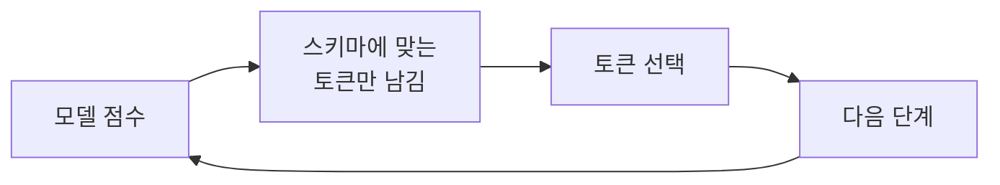
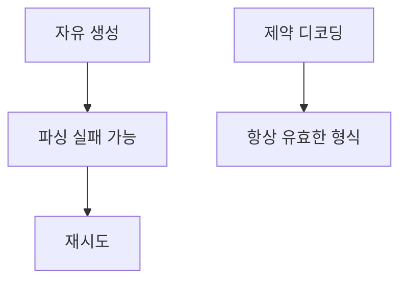

# 제약 디코딩 (Constrained / Structured Decoding)

> 제약 디코딩은 모델이 토큰을 고르는 순간에 JSON 스키마·정규식 같은 형식에 맞는 토큰만 고르게 해서, 출력이 처음부터 형식을 지키도록 보장하는 방식이다.

## 쉽게 말하면
글짓기 후 맞춤법 검사를 하는 대신, 빈칸 채우기 양식지에 쓰게 하는 것이다. 칸 밖으로 아예 못 나가니 틀린 형식이 나올 수 없다.

## 자세히
- 기존 방식: 모델이 자유롭게 쓰고 나서 파싱·정규식·재시도로 고친다. Outlines README는 이를 "깨지기 쉬운 코드"라고 표현한다.
- Outlines(오픈소스, README 확인): 원하는 출력 타입(Pydantic 모델·`Literal`·`int`·함수 시그니처)을 주면 생성 중에 구조를 보장한다. vLLM·Ollama·transformers·llama.cpp와 OpenAI·Gemini 같은 API에서도 쓴다. 내부 원리(허용되지 않는 토큰의 확률을 0으로 만드는 마스킹)는 이번 페이지에 설명이 없고 일반적으로 알려진 방식이다 — 확인하지 못함.
- 장점: 파싱 실패 제거, 재시도 비용 감소. 한계: 형식은 맞아도 **내용이 맞는다는 보장은 아니다**. 너무 엄한 제약은 답 품질을 해칠 수 있다(일반적 주의).
- 사용자 관점에서는 API의 "structured outputs/JSON 모드"가 같은 목적의 서비스형이다. [MCP 도구 호출](#mcp-tools)과 에이전트 도구 인자도 스키마 준수가 중요하다.

## 그림으로 보기



## 예시
```python
from typing import Literal
sentiment = model(
    "Analyze: 'This product completely changed my life!'",
    Literal["Positive", "Negative", "Neutral"],
)
print(sentiment)  # "Positive"
```
고객 문의를 분류해 `{"category": ..., "urgency": ...}` JSON으로 받아 곧바로 자동화 워크플로에 넘길 때 유용하다.

## 헷갈리는 것과 비교
| 개념 | 차이 |
|---|---|
| 제약 디코딩 | 생성 중에 형식 강제 |
| 후처리 파싱 | 생성 후 고침, 실패 가능 |
| 프롬프트로 JSON 요청 | 부탁일 뿐 보장 없음 |
| [허용 목록 검증](#allow-list-validation) | 결과를 받은 뒤 검증하는 보안 쪽 |

## 더 읽을거리
- [Outlines (GitHub)](https://github.com/dottxt-ai/outlines) — 타입 지정으로 구조화 출력, 지원 백엔드.
