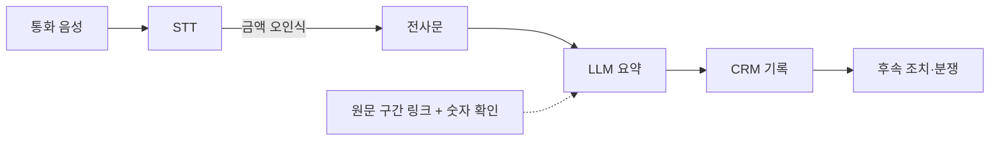

# 전사 오류 전파

> 음성을 글로 바꾸는 STT 단계의 오류가 그 위에서 돌아가는 요약·분류·기록으로 번져 최종 문서가 틀려지는 문제.

## 쉽게 말하면
번역가에게 틀린 원고를 주면 아무리 훌륭한 번역도 틀린다. 요약 AI는 전사문을 사실로 믿고 매끄럽게 요약한다.

## 자세히
출처: Careless Whisper(arXiv 2402.08021) 초록과 관련 정리는 [전사 오류](#transcription-error) 노드에 있다. 이 노드는 상담 요약 관점이다.
- **오류 유형**: 숫자·고유명사(금액, 계좌 일부, 상품명) 오인식, 화자 구분 실수, 소음 구간의 환각, 억양·사투리·콜센터 전화 음질로 인한 오인식.
- **전파 방식**: STT 오류 → 요약 LLM이 그대로 반영 → CRM 기록·후속 조치에 사용. 요약이 매끄러워 오류가 눈에 띄지 않는다. 상담 업무에서는 금액·날짜·약속 문구가 틀리면 분쟁으로 이어진다(일반 사례).
- **연구 근거**: Whisper 전사의 약 1%에 오디오에 없는 구절이 포함, 그 중 38%에 해악이 있다는 보고(초록 확인, 연구 데이터 한정).
- **완화(일반 제안)**: 요약에 원문 전사 구간 링크, 숫자·고유명사 구간은 신뢰도가 낮으면 표시, 중요 항목(금액, 약속)은 상담사 확인 단계, 샘플 감사로 STT 오류율과 요약 오류율을 분리 측정.
- 시간 절감을 평가할 때 오류 수정 시간을 포함([ACW](#after-call-work)).

## 그림으로 보기

## 예시
- 고객 "십이만 원"이 "이만 원"으로 전사 → 요약 "이만 원 환불 약속" → 분쟁. 숫자 항목에 원문 링크와 확인 체크 추가.
- 월간 감사: 50건 통화에서 STT 단어 오류와 요약 사실 오류를 따로 센다.

## 헷갈리는 것과 비교
| 개념 | 차이 |
|---|---|
| STT 오류 | 음성→텍스트 단계 |
| 요약 환각 | 요약 모델이 없는 내용 생성 |
| [전사 오류](#transcription-error) | 일반 개념 노드 |

## 더 읽을거리
- [Careless Whisper](https://arxiv.org/abs/2402.08021) — Whisper 환각 연구(초록 확인)
