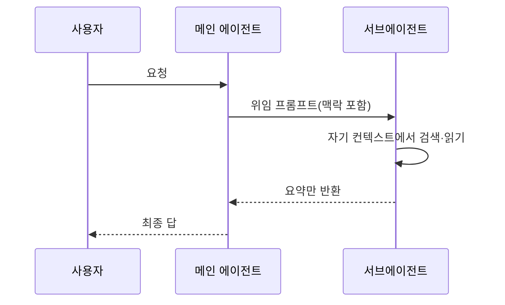
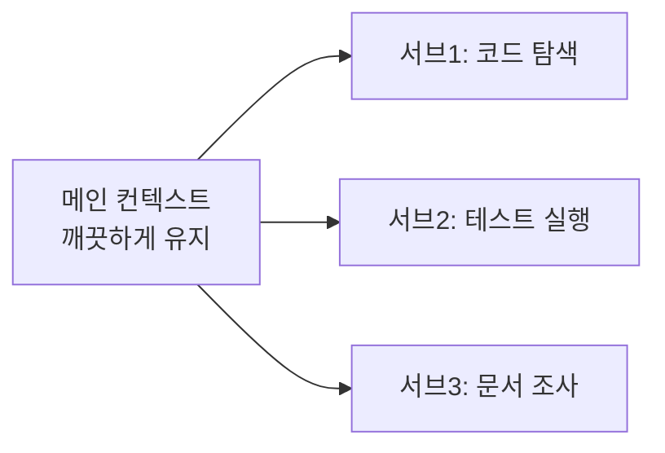

# 서브에이전트

> 메인 AI가 일부 작업을 **별도의 컨텍스트 창을 가진 보조 에이전트**에게 맡기고 **요약 결과만** 돌려받는 구조. Claude Code에서는 YAML 머리말이 붙은 Markdown 파일 하나로 정의한다. 메인 대화가 검색 결과·로그로 어지러워지는 것을 막는다.

## 쉽게 말하면
팀장이 자료 조사를 신입에게 시키면, 신입이 수십 페이지를 읽고 와서 "핵심은 이 세 줄"만 보고한다. 팀장 책상에는 요약만 남는다. 신입은 팀장과의 대화를 모르는 채로 시작하므로, 일을 맡길 때 필요한 배경을 적어 줘야 한다.

## 자세히
(Claude Code 공식 문서 `code.claude.com/docs/en/sub-agents`, 2026-11-25 확인 기준)
- **핵심 성질**: 서브에이전트는 자기 시스템 프롬프트·도구 권한·컨텍스트 창을 가진다. 메인 대화 내용을 **상속하지 않는다**(일반 서브에이전트는 CLAUDE.md도 상속하지 않음) → 위임 프롬프트에 필요한 맥락을 적어야 한다. 사용량 한도는 메인과 **같이** 소모된다.
- **정의 방식**: 이름·설명이 필수인 머리말 + 본문(=시스템 프롬프트).
```markdown
---
name: code-reviewer
description: 코드 품질·보안 검토. 코드 변경 후 사용.
tools: Read, Grep, Glob
model: sonnet
---
당신은 코드 리뷰어다. 구체적이고 실행 가능한 피드백을 준다.
```
- **저장 위치(우선순위 높은 순)**: 조직 관리 설정 → `--agents` CLI 플래그 → `.claude/agents/`(프로젝트) → `~/.claude/agents/`(개인) → 플러그인.
- **호출**: 설명과 맞는 요청이면 자동 위임, 이름으로 요청, @-멘션, 세션 전체를 `claude --agent <name>`으로.
- **도구 제한**: `tools`는 허용 목록, `disallowedTools`는 거부 목록. 기본 제공: Explore(읽기 전용 탐색), Plan, general-purpose 등.
- **한계와 주의**: ① 중첩 허용(기본 3단계, `CLAUDE_CODE_MAX_SUBAGENT_SPAWN_DEPTH=1`로 끔), ② 동시 실행 기본 20개, ③ 커스텀 서브에이전트 설명 합계가 약 15,000토큰을 넘으면 시작 경고, ④ **결과 보고가 길면 메인 컨텍스트가 다시 찬다**, ⑤ 저렴한 모델(예: Haiku)로 비용 조절 가능.
- 한계: 위 수치·기본값은 문서가 바뀌면 달라질 수 있다.

## 그림으로 보기



## 예시
- "인증 모듈 전체에서 토큰 갱신이 어떻게 동작하는지 조사해 줘" → Explore 서브에이전트가 파일 수십 개를 읽고 요약만 반환.
- 동시에 3개 서브에이전트에 서로 겹치지 않는 조사 주제를 주고, 결과를 메인이 종합.

## 헷갈리는 것과 비교
| 개념 | 차이 |
|---|---|
| 서브에이전트 | 별도 컨텍스트, 요약 반환, 부모가 지휘 |
| 도구(tool) | 함수 호출, 자체 추론 없음 |
| [오케스트레이터-워커](#orchestrator-workers) | 같은 계열의 멀티에이전트 설계 패턴 |
| 스킬 | 지침 묶음을 필요할 때 불러오는 방식(별도 컨텍스트 아님) |

## 더 읽을거리
- [Claude Code: Subagents](https://code.claude.com/docs/en/sub-agents) — 정의·호출·제한 공식 문서.
