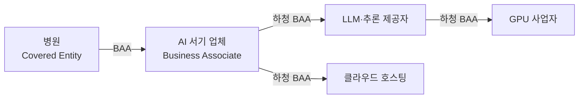
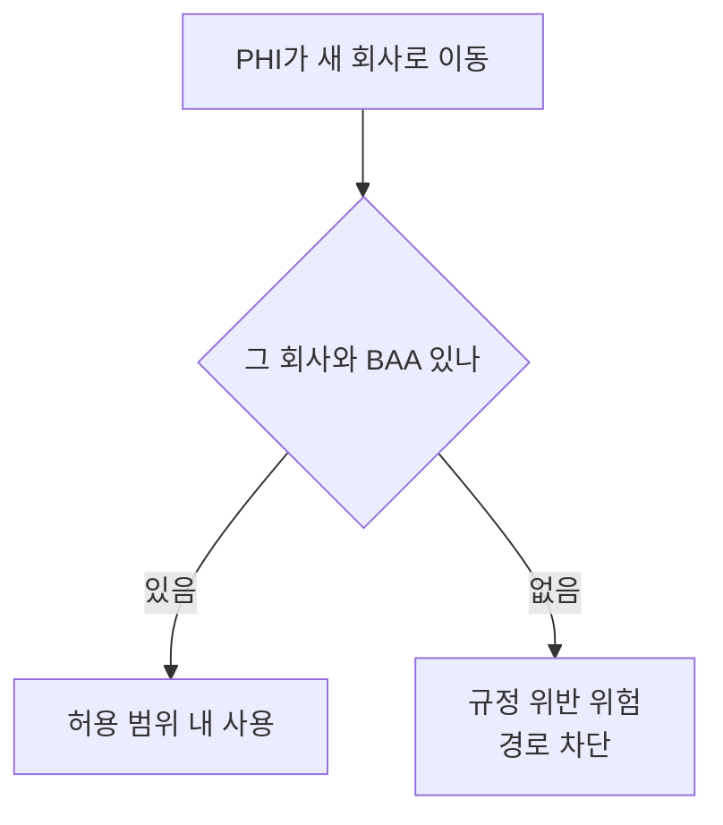

# 하청 BAA 연쇄

> AI 업체가 PHI 처리의 일부(모델 호스팅·추론·클라우드)를 다른 회사에 맡기면, 그 하청도 business associate가 되어 같은 수준의 계약 의무가 사슬처럼 아래로 이어지는 구조(flow-down).

## 쉽게 말하면
병원이 A사에 환자 서류 정리를 맡겼는데 A사가 다시 B사 창고에 서류를 보관시키면, B사까지 비밀 유지 약속을 해야 한다. 병원은 A사와만 계약했어도, 사슬 한 곳이라도 약속이 없으면 전체가 구멍이다.

## 자세히
- **규정(열어서 확인)**: 45 CFR 160.103에서 business associate는 "BA를 대신해 PHI를 만들고·받고·보관하고·전송하는 하청(subcontractor)"을 포함하고, 하청은 "BA가 기능·활동·서비스를 위임한 사람(직원 제외)"이다.
- **AI에 적용**: AI 서기 업체가 외부 LLM API나 클라우드 호스팅에 PHI를 보내면 그 회사가 하청 BA다(Paubox 글). 사람이 보지 않고 자동으로 접근해도 접근이다. 암호화했다고 BAA가 면제되지는 않는다는 설명도 같은 글에 있다.
- **계약 조건**: BA는 하청과 서면 계약을 맺어야 한다(검색한 2차 출처는 §164.502(e)(1)(ii), §164.504(e)(5)를 인용, 조문 자체는 확인하지 못함). 실무 조언은 상위 BAA와 실질적으로 같은 보호를 하청에도 요구하는 것이다(규정 문구가 아닌 실무 권고).
- **병원이 확인할 것**: 업체의 하청 목록, 특정 배포에 쓰는 LLM 제공자와의 BAA 유무, 해당 요금제 범위. 증명하지 못하면 그 경로로 PHI를 보내면 안 된다는 주장이 있다.
- **집행 사례(검색 요약, 미검증)**: 하청이 BAA 없이 PHI에 접근해 OCR이 $350,000 합의한 사례가 소개된다.

## 그림으로 보기

## 예시
- 점검표: 하청 목록 / 각 하청의 BAA 서명일 / 학습 금지 조항 동일 여부 / 데이터 위치.
- 질문: "음성 전사는 어느 회사 서버에서 돌고, 그 회사와 BAA가 있습니까?"

## 헷갈리는 것과 비교
| 개념 | 차이 |
|---|---|
| [BAA와 모델 학습 조항](#baa-model-training) | 한 계약 안의 학습 허용 여부, 여기는 계약 사슬 |
| [BAA](#business-associate-agreement) | 병원–업체 계약, 하청 BAA는 업체–하청 계약 |
| 단순 전달자(conduit) | 일시적 전달만 하는 경우의 예외로 보이나 대부분 AI 도구는 해당 안 됨(Paubox 설명) |

## 더 읽을거리
- [When does AI become a business associate under HIPAA? (Paubox)](https://www.paubox.com/blog/when-does-ai-become-a-business-associate-under-hipaa) — 하청·AI 사례(열어서 확인)
- [45 CFR 160.103 (eCFR)](https://www.ecfr.gov/current/title-45/subtitle-A/subchapter-C/part-160/subpart-A/section-160.103) — business associate·subcontractor 정의
