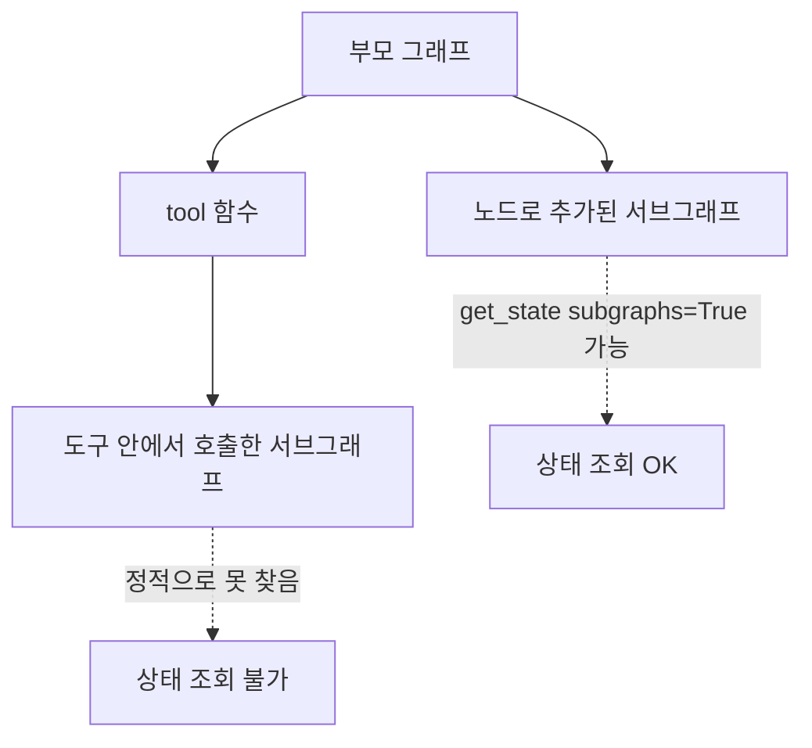

# 도구 안 서브그래프 한계

> LangGraph에서 서브그래프를 도구(tool) 함수 안에서 호출하면, 부모 그래프가 그 서브그래프를 미리 찾을 수 없어 `get_state(subgraphs=True)`로 하위 상태를 조회할 수 없다. 서브그래프를 노드로 추가하거나 노드 안에서 호출해야 조회된다.

## 쉽게 말하면
회사 조직도에 있는 부서는 감사팀이 찾아가 장부를 볼 수 있다. 그런데 직원이 개인적으로 외주 업체에 맡긴 일은 조직도에 없어서 감사팀이 그 장부를 찾을 길이 없다. 도구 안 서브그래프가 바로 "조직도에 없는 외주"다.

## 자세히
공식 문서의 핵심 문장(확인한 날: 2026-11-13):
- "Viewing subgraph state requires that LangGraph can statically discover the subgraph" — 서브그래프가 **노드로 추가**되었거나 **노드 안에서 호출**되어야 한다.
- "It does not work when a subgraph is called inside a tool function or other indirection" — 도구 함수나 간접 호출(예: 서브에이전트 패턴)에서는 안 된다.
- 체크포인트 조건: `checkpointer=False`(무상태)면 서브그래프 체크포인트가 저장되지 않아 상태가 없다. 호출 단위 영속성은 **중단(interrupt)된 동안에만** 그 호출의 상태를 볼 수 있다.
- 반대로 interrupt는 막히지 않는다: "Interrupts still propagate to the top-level graph regardless of nesting."
- 대처법:
  1. 서브에이전트를 도구로 감싸는 대신 **서브그래프를 노드로 연결**한다([서브그래프 상태 조회](#langgraph-subgraph-state)).
  2. 꼭 도구여야 하면, 도구가 필요한 중간 결과를 반환값이나 부모 상태 필드에 명시적으로 담아 올린다.
  3. 진단은 LangSmith 트레이스 등 관측 도구로 한다(주장: 가능한 대안일 뿐 이번에 검증하지 않음).
- 서브그래프 안에서 interrupt가 걸리면 부모 상태가 늦게 갱신된 것처럼 보이는 사례가 포럼에 보고되었다. 해결책으로 interrupt를 최상위로 옮기라는 답이 있었다(커뮤니티 의견).
- 도구 안 서브그래프 + 내부 interrupt + 부모 `get_state` 조합을 공식이 직접 보증하지는 않는다. 버전별로 직접 확인한다.

## 그림으로 보기


## 예시
```python
# 조회 가능: 노드로 연결
parent.add_node("research", research_subgraph)
snap = parent.get_state(config, subgraphs=True)

# 조회 불가: 도구 안에서 호출
@tool
def research(q: str):
    return research_subgraph.invoke({"q": q})
```

## 헷갈리는 것과 비교
| 개념 | 차이 |
| --- | --- |
| 노드로 추가한 서브그래프 | 정적 발견 가능, 하위 상태 조회 OK |
| 노드 안에서 호출 | 정적 발견 가능 |
| 도구 안에서 호출 | 발견 불가, 상태 조회 불가 |
| [interrupt](#langgraph-interrupt) | 중첩 깊이와 무관하게 최상위로 전파 |
| [get_state](#langgraph-get-state) | 부모 상태 조회, subgraphs 옵션으로 하위까지 |

## 더 읽을거리
- [Use subgraphs (LangGraph 공식 문서)](https://docs.langchain.com/oss/python/langgraph/use-subgraphs) — 정적 발견 조건과 영속성 모드
- [LangChain 포럼: Subgraph state variables not accessible](https://forum.langchain.com/t/subgraph-state-variables-not-accessible/774) — 사용자 사례(검색 결과로만 확인, 본문은 열어 보지 않음)
