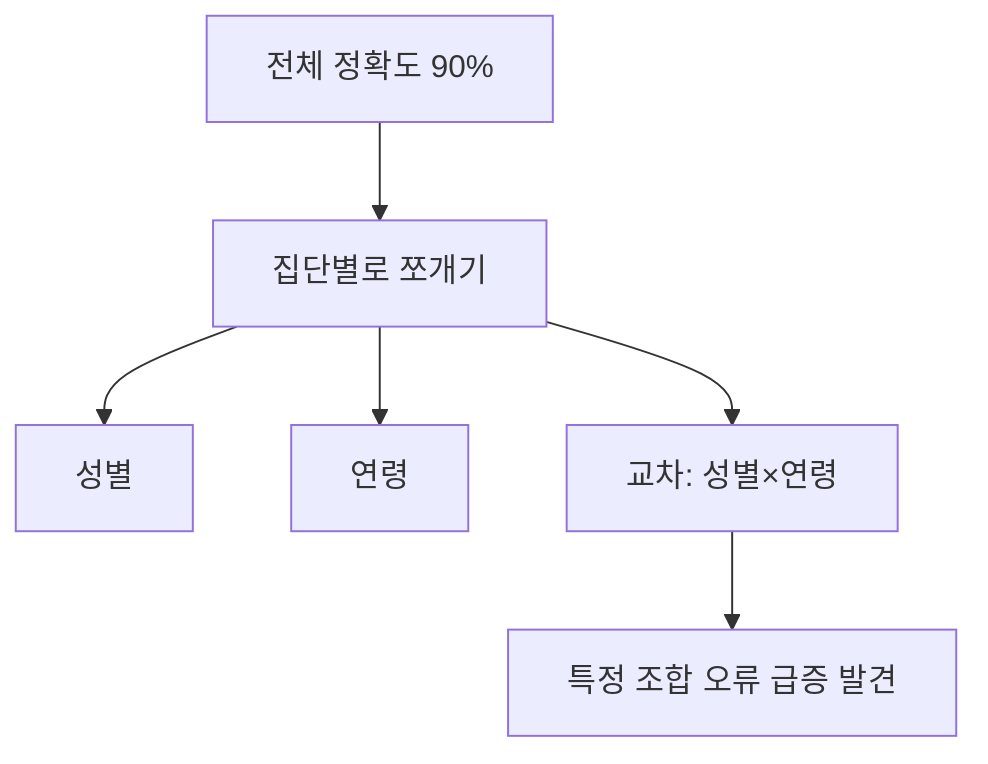

# 집단별 성능 보고

> 모델의 전체 평균 점수 하나가 아니라, 성별·연령·피부색·언어처럼 **집단별, 그리고 집단을 교차한 조합별**로 성능을 쪼개 보고하는 방식이다. 평균에 가려진 특정 집단의 높은 오류를 드러낸다.

## 쉽게 말하면
학급 평균이 80점이어도 한 반 학생들이 모두 만점이고 다른 반은 60점일 수 있다. 평균만 보면 못 보는 격차를 반별로 나눠 보는 것이다. 교차 보고는 "3학년 여학생" 같은 조합까지 보는 것이다.

## 자세히
- **출처(Mitchell 외, "Model Cards for Model Reporting", arXiv 1810.03993, FAT* '19, 직접 확인)**: 모델 카드에 **단일 요인(unitary)** 결과와 **교차(intersectional)** 결과를 보고하라고 제안한다("Quantitative Analyses" 절).
- **지표**: 분류기는 오탐률(FPR)·미탐률(FNR)·FDR·FOR을 집단별로 낸다. 논문은 집단 간 FNR 동등이 Equality of Opportunity, FNR·FPR 동등이 Equality of Odds에 해당한다고 연결한다.
- **논문의 예시**: ① 웃음 탐지(CelebA): 성별·나이로 쪼갠 결과 나이 든 남성의 FDR이 다른 집단보다 훨씬 높고, 남성 전체의 FNR도 더 높았다(95% 부트스트랩 신뢰구간, 임계값 0.5). 피부색은 데이터에 없어 포착하지 못한다고 한계로 적는다. ② 독성 댓글 탐지: 교차 템플릿 세트에서 Pinned AUC로 비교, 초기 버전이 "lesbian", "gay" 같은 용어에서 낮았고 편향 완화 버전과 대비.
- **Gender Shades와의 관계**: 논문은 Buolamwini & Gebru(2018)를 참고문헌으로 인용해 어두운 피부 여성에 오류가 몰리는 사례를 언급한다. 연구 방법론까지 설명하지는 않는다.
- **한계**: 집단 정의·라벨이 없으면 쪼갤 수 없고, 교차 조합이 늘면 표본이 적어져 신뢰구간이 넓어진다. 민감 속성 수집 자체가 프라이버시·법 문제일 수 있다. 같은 집단 간 성능 동등이 곧 공정성은 아니다.

## 그림으로 보기

## 예시
- 채용 이력서 분류 모델: 전체 정확도는 좋지만 특정 성별·경력 구간 조합에서 미탐률이 높은지 표로 확인.
- 교육 소재: 같은 데이터를 평균만 볼 때와 집단별로 쪼갤 때의 결론 차이를 비교하는 실습.

## 헷갈리는 것과 비교
| 개념 | 차이 |
|---|---|
| 전체 평균 지표 | 집단 격차를 숨김 |
| 단일 요인(unitary) 보고 | 한 속성씩 |
| 교차(intersectional) 보고 | 속성 조합 |
| [모델 카드](#model-cards) | 이 보고를 담는 문서 형식 |
| [시스템 카드](#system-cards) | 시스템 단위 설명 |

## 더 읽을거리
- [Model Cards for Model Reporting (arXiv 1810.03993)](https://arxiv.org/abs/1810.03993) — 원 논문 초록·4.7절 직접 확인.
