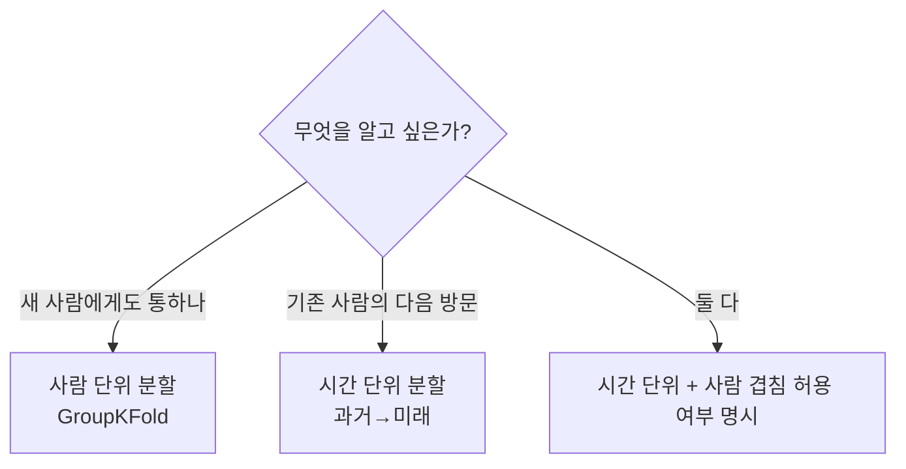
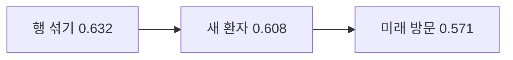

# 사람 단위 vs 시간 단위 분할

> 같은 사람을 여러 번 측정한 데이터에서는 "새로운 사람에게도 통하는가"(사람 단위 분할)와 "같은 사람의 앞으로의 방문을 맞히는가"(시간 단위 분할)가 서로 다른 질문이다. 질문에 맞는 분할을 골라야 점수가 의미를 가진다.

## 쉽게 말하면
학원이 "처음 온 학생도 잘 가르치는가"를 알고 싶으면 새 학생으로 시험해야 하고, "다니는 학생의 다음 시험 점수를 맞힐 수 있는가"를 알고 싶으면 그 학생의 과거로 미래를 맞혀야 한다. 둘을 섞어 평가하면 어느 질문에도 정직하게 답하지 못한다.

## 자세히
- **세 가지 분할과 질문(해석)**: ① 행을 무작위로 섞기 — 같은 사람의 이웃 방문이 학습에 들어가 두 질문 모두에 낙관적 ② 사람 단위(`GroupKFold`) — 새 환자에 대한 일반화 ③ 시간 단위(과거로 학습, 이후 방문으로 시험) — 기존 환자의 미래 예측. 필요한 경우 둘을 결합(새 환자의 최신 방문)한다.
- **직접 해 본 실험(합성 데이터: 환자 60명, 방문 12회씩, 환자 고유 특징 + 시간에 따라 증가하는 양성률, 랜덤 포레스트)**: 행 무작위 5겹 정확도 0.632, 사람 단위 `GroupKFold(5)` 0.608, 같은 환자의 이후 방문(방문 0~7로 학습, 8~11로 시험) 0.571이었다. 순서는 예상대로(섞기 > 새 환자 > 미래 방문)였지만 차이가 0.02~0.06으로 작고 한 번의 실험이라 확정적이지 않다. 이 합성 데이터는 신호 자체가 약해서 점수 차가 작다.
- **선택 지침(해석)**: ① 서비스가 신규 사용자에게 쓰일 거라면 사람 단위 ② 기존 사용자의 다음 행동을 예측한다면 시간 단위 ③ 둘 다라면 시간 단위 안에서 사람 겹침을 허용할지 명시해 보고 ④ 어떤 분할을 썼는지와 이유를 [분할 기록](#split-report-logging)에 남긴다.
- **관련 위험**: 시간 단위에서는 [미래 정보 누수](#future-information-leakage)와 [자기상관](#autocorrelation)을 조심한다. 사람 단위에서는 [ID 정규화](#id-normalization)와 [ID 누락률](#missing-id-rate-report)이 중요하다.

## 그림으로 보기

## 예시
- 당뇨 환자 월별 검사: 신규 환자 위험 예측은 환자 단위 분할, 기존 환자의 다음 달 악화 예측은 시간 단위 분할로 평가한다.
- 교육 활용: 같은 데이터에 세 분할을 적용해 점수 순서와 이유를 토론한다.

## 헷갈리는 것과 비교
| 개념 | 차이 |
| --- | --- |
| 사람 단위 분할 | 새로운 사람에 대한 일반화 |
| 시간 단위 분할 | 같은 사람의 미래 예측 |
| [샘플 단위 vs 그룹 단위 분할](#sample-vs-group-split) | 그룹 분할의 일반 원칙 |
| [시간을 그룹으로 쓰기](#time-as-group) | 연도 등 시간 구간 그룹 |

## 더 읽을거리
- [scikit-learn: Cross-validation iterators for grouped data](https://scikit-learn.org/stable/modules/cross_validation.html) — 그룹 분할과 시계열 분할
