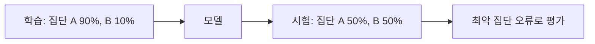
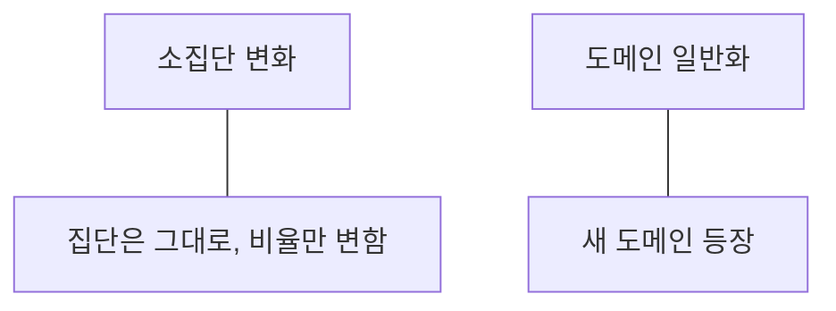

# 소집단 변화

> 학습과 시험에 같은 집단들이 나오지만 집단별 비율이 달라지는 분포 변화다. 평균이 아니라 가장 나쁜 집단의 오류로 평가한다.

## 쉽게 말하면
학교에서 같은 학생 유형이 있는데, 시험 날에는 평소 적었던 유형의 학생이 많이 오는 상황이다. 그 유형에서 약한 모델은 시험 날 점수가 크게 무너진다.

## 자세히
(WILDS arXiv 2012.07421 3.2절을 하위 에이전트가 원문으로 읽은 노트 기준.)
- **정의**: 시험 도메인이 학습 도메인에 포함(D_test ⊆ D_train)되지만 비율이 다르다(q_test ≠ q_train). 보통 **모든 시험 도메인 중 최대 오류(최악 집단)**를 최소화하는 것이 목표이며, 시험 때 도메인 정체는 관측되지 않는다. 그림 1 설명: "학습·시험 도메인이 겹치지만 상대 비율이 다르다".
- **WILDS 데이터셋**: CivilComments-WILDS(인구 집단 16개 도메인, 약 448,000건), Amazon-WILDS(사용자 2,586명 도메인)는 소집단 변화 쪽, FMoW(16개 연도 × 5개 지역)·PovertyMap은 도메인 일반화와 소집단 변화가 섞인 혼합형.
- **관련 방법**: Group DRO(집단별 최대 손실 최소화, Sagawa 외 2020).
- **의료의 유사 문제**: 라벨에 없는 하위 집단에서 성능이 무너지는 [숨은 계층화](#hidden-stratification).

## 그림으로 보기

## 예시
- 사내 고객 문의 모델이 평소 적었던 신규 제품 문의 비율이 늘 때 성능 저하 점검.
- 교육 활용: 집단별 비율을 바꿔 가며 평균과 최악 집단 정확도가 어떻게 달라지는지 계산.

## 헷갈리는 것과 비교
| 개념 | 차이 |
|---|---|
| 소집단 변화 | 같은 집단, 비율 변화 |
| [도메인 일반화](#domain-generalization) | 새 도메인(학습에 없음) |
| [최악 집단 정확도](#worst-group-accuracy) | 이 문제의 평가 지표 |

## 더 읽을거리
- [WILDS (arXiv 2012.07421)](https://arxiv.org/abs/2012.07421) — 3.2절.
