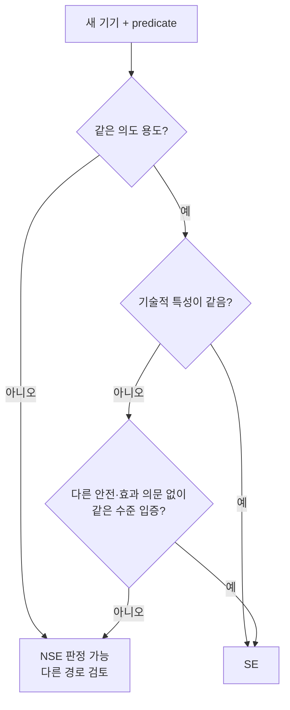

# 실질적 동등성(SE)

> FDA 510(k)에서 새 기기가 이미 합법적으로 시판 중인 predicate와 **같은 용도**이고, 기술적 특성이 같거나 달라도 **다른 안전·효과 의문을 일으키지 않으며 그만큼 안전하고 효과적**임을 보이는 기준. SE 판정을 받아야 판매할 수 있다.

## 쉽게 말하면
새 식당이 "저기 허가받은 식당과 같은 종류의 영업이고, 주방 설비가 달라도 위생 위험이 늘지 않는다"고 입증하는 것과 같다. 똑같을 필요는 없지만 새로운 위험 질문이 없어야 한다.

## 자세히
출처: 21 CFR 807.100(eCFR, 열어서 확인)과 FDA 510(k) 내용 안내 페이지(열어서 확인).
- **요건(807.100 요지)**: ① 의도한 용도가 predicate와 같다. ② 기술적 특성이 같거나, 다르면(재료·설계·에너지원의 큰 변화 포함) 데이터로 SE를 뒷받침하고 합법 시판 기기만큼 **안전하고 효과적**이며 predicate와 **다른 안전·효과 의문을 일으키지 않는다**.
- **비교 범위(FDA 안내)**: 용도, 설계, 사용·전달하는 에너지, 재료, 성능, 안전, 효과, 표시, 멸균 등 "이에 국한되지 않는" 항목.
- **용도 비교**: 적응증, 대상 환자군, 해부학적 부위, 사용 장소. 적응증이 다르면 표시대로 쓸 때 안전·효과에 영향 없는 이유를 설명해야 한다.
- **기술 차이**: 설계·재료·화학 조성·에너지원이 같으면 그렇게 쓰고, 다르면 비교를 설명하며 "기술 차이가 안전·효과에 불리한 영향을 주지 않음"을 보여야 한다.
- **증거**: 벤치 시험, 동물 시험, 임상 연구 등이 쓰일 수 있고, 대부분의 510(k) 기기는 임상 데이터가 필요하지 않다고 FDA가 안내한다.
- **AI 기기에서**: 검색한 2차 자료에 따르면 AI 기기의 대다수(약 97%라는 추정, 출처 불명)가 510(k)로 허가되는데, 알고리즘 기반 기기는 비교 가능한 predicate를 맞추기 어려울 수 있다는 지적이 있다(2차 자료, 미검증).
- 법률·규제 자문이 아니며 제출 전 FDA 안내와 전문가 확인이 필요하다.

## 그림으로 보기

## 예시
- 흉부 X선에서 폐결절을 표시하는 AI: predicate도 같은 용도의 결절 검출 소프트웨어이고, 알고리즘이 달라도 성능 시험으로 같은 수준임을 보임 → SE 주장.
- 용도가 "진단 보조"에서 "단독 진단"으로 바뀌면 용도가 달라 SE 주장이 어렵다.

## 헷갈리는 것과 비교
| 개념 | 차이 |
|---|---|
| [predicate 기기](#predicate-device) | 비교 대상 기기, SE는 비교 결과의 판단 |
| 동일성 | SE는 같을 필요 없고 새 안전 의문이 없으면 됨 |
| [predicate 사슬 문제](#predicate-creep) | 연쇄 비교로 원본과 멀어지는 우려 |
| [변경 관리 계획(PCCP)](#pccp) | 허가 후 AI 업데이트의 사전 승인 |

## 더 읽을거리
- [21 CFR 807.100 (eCFR)](https://www.ecfr.gov/current/title-21/chapter-I/subchapter-H/part-807/subpart-E/section-807.100) — SE 판정 기준 조문(열어서 확인)
- [Content of a 510(k) (FDA)](https://www.fda.gov/medical-devices/premarket-notification-510k/content-510k) — SE 비교 항목 안내(열어서 확인)
