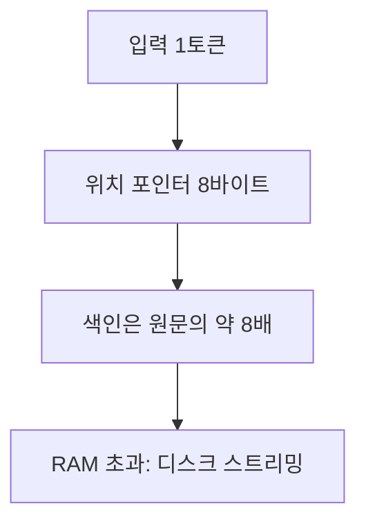

# 접미사 배열 메모리 비용

> 접미사 배열은 텍스트의 **모든 위치마다 정수 하나**를 저장하므로 원문보다 몇 배 큰 색인이 된다. 그래서 테라바이트급 말뭉치에서는 조각으로 나눠 병렬로 만들고, 색인 자체를 디스크에서 스트리밍해 쓴다.

## 쉽게 말하면
책 한 권의 "모든 글자 위치"를 가나다순 색인표로 만든다고 하자. 책이 100쪽이면 색인표가 800쪽이 되는 식이다. 책장(메모리)에 다 안 들어가니 책을 여러 묶음으로 나눠 색인을 만들고 합치며, 색인표는 창고(디스크)에 두고 필요한 부분만 꺼내 본다.

## 자세히
- **크기**: Lee 외(2021)는 접미사 배열이 "입력 토큰당 8바이트"만 필요하다고 쓴다(접미사 트리보다 10~100배 효율적, ar5iv 본문 확인). 350GB C4의 접미사 배열은 약 1.5TB로 **8배 공간 부담**이라고 명시한다.
- **계산(직접)**: numpy 정수 1천만 개는 int32 40MB, int64 80MB. 위치 포인터를 8바이트로 두면 입력 1GB당 색인 약 8GB, 350GB면 약 2.8TB. 구글 리서치 구현은 데이터 크기에 따라 포인터를 32비트(작은 테스트셋)·40비트·48비트로 줄여 쓴다고 README에 적는다(열어 확인). 40비트면 위 계산으로 350GB에 약 1.75TB. 이 두 계산은 이 글의 산술이며 논문 보고값(1.5TB)과 정의가 달라 같지 않다.
- **구성 방법**: 데이터를 K개 조각으로 나눠 SA-IS 알고리즘으로 조각별 접미사 배열을 병렬 구성하고 합친다. 논문은 K를 스레드 수로 두었다. 96코어·768GB 메모리 VM 한 대에서 Wiki-40B 영어 학습셋(약 4GB)은 2.3분(2.1 CPU시간), 350GB C4는 12시간 미만(약 1,000 CPU시간)이 걸렸고 "여전히 메모리 제약"이었다고 한다.
- **스트리밍**: 데이터셋 자체는 메모리에 둬야 위치 접근이 빠르지만 "접미사 배열 전체를 메모리에 올릴 필요는 없다"며 색인을 디스크에서 흘려 읽도록 구현했다.
- **README의 권장 사양**: C4(약 300GB) 처리에 96코어·600GB 이상 RAM·1TB 이상 디스크, 약 10GB 데이터는 RAM 16GB. 단일 스레드 구성은 큰 파일에 비현실적이라고 한다.
- 시사점(해석): 정확 중복 제거는 "알고리즘은 선형인데 메모리가 병목"이다. 소규모(수 GB)는 한 대로 충분하고, 그 이상은 조각 분할·디스크 스트리밍이 설계 전제다.

## 그림으로 보기

## 예시
- 사내 문서 20GB로 중복 제거를 할 때: 색인 약 160GB를 예상하고 디스크를 확보.
- 교육: "색인이 원문보다 커진다"는 점을 책 색인에 빗대어 설명.

## 헷갈리는 것과 비교
| 개념 | 차이 |
|---|---|
| [접미사 배열](#suffix-array) | 색인 자체 |
| [LCP 배열](#lcp-array) | 접미사 배열 위에 추가로 필요한 배열 |
| [MinHash](#minhash) | 서명만 저장해 색인이 작음, 근사 |
| [정확 부분문자열 제거](#exact-substring-dedup) | 이 색인의 응용 |

## 더 읽을거리
- [Deduplicating Training Data Makes Language Models Better](https://ar5iv.labs.arxiv.org/html/2107.06499) — 8바이트/토큰, 1.5TB, 12시간(열어 확인).
- [google-research/deduplicate-text-datasets](https://github.com/google-research/deduplicate-text-datasets) — 병렬 구성·권장 사양·포인터 크기(열어 확인).
