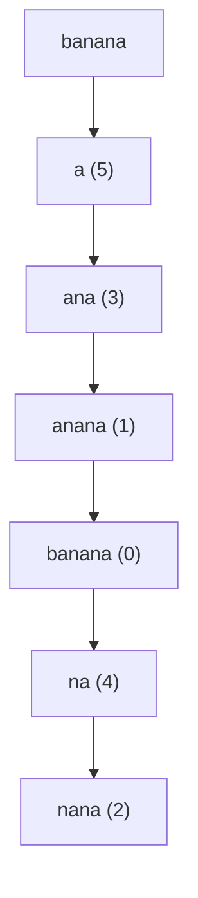

# 접미사 배열

> 문자열의 **모든 접미사를 사전순으로 정렬해 시작 위치만 저장한 색인**이다. 정렬하면 비슷하게 시작하는 접미사가 이웃하므로, 서로 이웃한 접미사의 공통 앞부분을 보면 문서들 사이에 반복되는 긴 부분 문자열을 빨리 찾을 수 있다.

## 쉽게 말하면
책의 모든 문장 끝부분을 한 줄씩 오려서 가나다순으로 늘어놓았다고 생각하자. 똑같은 구절이 두 번 나오면 그 구절로 시작하는 조각이 서로 붙어 있어 눈에 띈다. 책 전체를 처음부터 끝까지 서로 비교할 필요가 없다.

## 자세히
- 문자열 "banana"의 접미사를 정렬하면 a, ana, anana, banana, na, nana이고 시작 위치 배열(접미사 배열)은 [5, 3, 1, 0, 4, 2]다(직접 실행).
- 이웃 접미사끼리의 **공통 앞부분 길이(LCP)**는 [1, 3, 0, 0, 2]다. 가장 긴 값 3은 "ana"가 반복됨을 알려 준다.
- 쓰임: 학습 데이터에서 정확히 같은 긴 부분 문자열(예: 같은 문장 수십 토큰)이 여러 문서에 반복되는 위치를 찾는 [정확 부분문자열 중복 제거](#exact-substring-dedup). Lee 외(arXiv 2107.06499) 초록은 언어 모델 데이터셋에 긴 반복 부분 문자열이 많고, 중복을 제거하면 외운 문장의 출력이 약 10배 줄며, 검증 세트의 4% 넘게 학습과 겹친다고 보고한다(초록 확인; 접미사 배열·임계 길이 세부는 본문 미확인).
- 직접 실험: 4글자 알파벳 무작위 문자열 20만 자에서 60자 접두사 기준으로 접미사 정렬이 약 0.15초, 가장 긴 반복(60자 창 기준)은 16자. 순진한 정렬이라 큰 말뭉치용 구현(선형 시간 알고리즘, 디스크 기반)과는 다르다.
- 비용: 입력 길이 n에 대해 위치 배열이 n개 정수라 메모리가 많이 든다. 테라바이트 말뭉치는 조각으로 나눠 처리한다.

## 그림으로 보기

## 예시
- 학습 말뭉치에서 정확히 같은 50토큰 이상 구간을 모두 찾아 한 번만 남기는 정제.
- 교육: 색인(찾아보기)이 있으면 전체를 읽지 않고도 반복 구절을 찾는다는 비유.

## 헷갈리는 것과 비교
| 개념 | 차이 |
|---|---|
| 접미사 배열 | 정확히 같은 부분 문자열 탐지 |
| [MinHash·LSH](#minhash-lsh) | 조금 다른 근접 중복 탐지 |
| 정확 해시 | 문서 전체가 같을 때만 |

## 더 읽을거리
- [Deduplicating Training Data Makes Language Models Better (arXiv 2107.06499)](https://arxiv.org/abs/2107.06499) — 반복 부분 문자열과 암기·평가 오염 결과(초록 확인).
