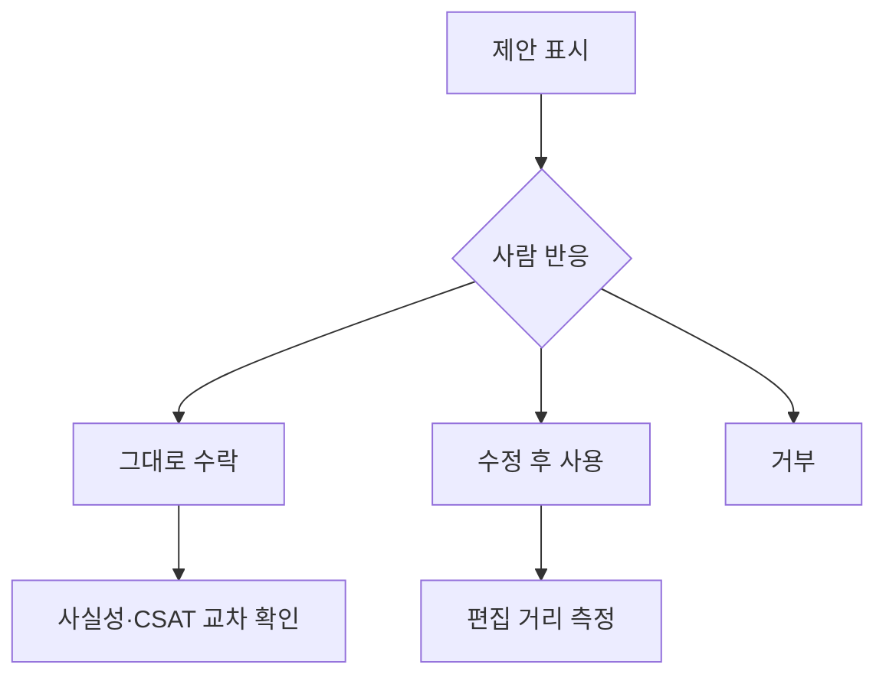

# 제안 수락률·수정률

> AI가 띄운 제안을 사람이 얼마나 받아들이고(수락률) 얼마나 고쳐 쓰는지(수정률) 재는 지표. 어시스트·코파일럿의 품질을 보는 기본 계기판.

## 쉽게 말하면
내비게이션이 알려 준 길을 운전자가 몇 번 따랐는지 세는 것과 같다. 많이 따랐다고 길이 맞았다는 보장은 없다. 그냥 믿고 따랐을 수도 있다.

## 자세히
- **수락률** = 수락된 제안 ÷ 보여준 제안. 한 번에 삽입·Tab 적용·가벼운 수정까지 수락으로 센다(벤더 가이드 기준).
- **수정률/편집 거리**: 제안과 최종본의 차이. 한 가이드는 40% 미만 변경이면 가벼운 수정, 60% 초과면 사실상 거부로 센다. 이 임계값은 관례일 뿐 표준이 아니다. Google Conversational Insights도 요약의 편집 거리를 정의하지만 알고리즘은 사용자가 정한다.
- **수락률의 한계**: 사용성은 보여 주지만 정확성은 아니다. "수정 없이 수락" 비율이 높은데 사실성 점수가 떨어지면 과신(자동화 편향) 신호다.
- **함께 볼 지표**: CSAT, QA 점수, 재문의율. 코딩 코파일럿의 업계 평균 수락률은 약 30%(Larridin 인용, 비공식).

## 그림으로 보기

## 예시
- 수락률 70%, 무수정 수락 60%, 사실성 점수 하락 → 상담사가 검토를 건너뛴다는 경고.
- 수정률이 높은 문의 유형 → 지식베이스 보강 대상.

## 헷갈리는 것과 비교
| 개념 | 차이 |
|---|---|
| 수락률 | 사람이 받았나 |
| 정확도 | 맞았나(별도 평가 필요) |
| [자동화 편향](#automation-bias) | 수락률이 높아지는 원인 중 하나 |

## 더 읽을거리
- [Google: Agent Assist 대화 데이터 지표](https://cloud.google.com/contact-center/insights/docs/agent-assist-metrics) — 편집 거리 정의
- [Typewise: AI suggestion KPI](https://www.typewise.app/blog/ai-suggestion-kpi) — 지표 설계(벤더)
