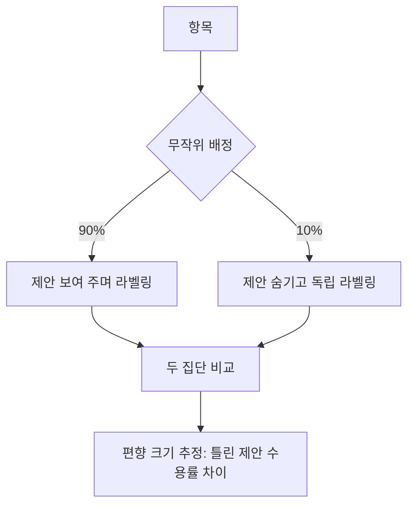
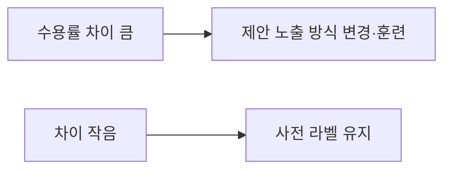

# 제안 비노출 대조 표본

> 모델 제안을 보여 주며 라벨링하는 흐름 안에서, 일부 항목은 제안을 **숨긴 채** 독립적으로 라벨링하게 해 두고 두 집단을 비교해 사람이 제안에 얼마나 끌리는지(자동화 편향)를 측정하는 품질 관리 방법이다.

## 쉽게 말하면
신약 시험에서 약을 먹은 집단과 가짜 약(대조군)을 비교하듯, 제안을 본 집단과 제안을 안 본 집단을 비교한다. 제안을 숨긴 소수 항목이 "제안이 없었다면 사람이 어떻게 판단했을까"의 기준선이 된다.

## 자세히
(근거는 Goddard 등의 체계적 고찰과 Beck 등의 실험 초록, 효과 측정은 직접 만든 시뮬레이션.)
- **필요성**: 자동 제안을 보면 사람이 틀린 제안도 받아들이는 편향이 생긴다. 틀린 제안이 승인되면 최종 라벨 정확도가 모델 정확도에 가깝게 끌려간다([주석 자동화 편향](#automation-bias-annotation)). 이를 알려면 "제안 없이 했다면"의 비교 기준이 필요하다.
- **설계(제안)**: ① 무작위로 5~10% 항목을 비노출군으로 지정(사람이 고르지 않게) ② 같은 라벨러에게 섞어 배정, 노출 여부는 알리지 않거나 UI에서 자연스럽게 ③ 두 집단의 정확도(골드 라벨이 있으면)와 "제안과의 일치율", 특히 **제안이 틀린 항목에서의 수용률**을 비교.
- **직접 시뮬레이션(4,000건, 모델 정확도 85%, 라벨러 단독 정확도 92%, 제안을 보면 40% 확률로 그냥 수용, 비노출 10%)**
  | 지표 | 제안 노출(3,606건) | 비노출(394건) |
  |---|---|---|
  | 최종 라벨 정확도 | 0.895 | 0.911 |
  | 제안과의 일치율 | 0.877 | 0.792 |
  | **제안이 틀렸을 때 수용률** | **0.441** | **0.088** |
  제안이 틀렸을 때 노출군이 44.1%나 그대로 수용한 반면 비노출군은 8.8%만 제안과 같은 오답을 냈다. 이 차이(약 35%p)가 자동화 편향의 크기 추정치다. 시뮬레이션의 가정 값이며 실제 값이 아니다.
- **효과의 한계**: 정확도 차이(0.895 vs 0.911)는 작아 보여도, 틀린 제안이 많은 영역에서는 커진다. 비노출 표본이 적으면 추정이 불안정하므로 신뢰구간을 같이 본다([윌슨 신뢰구간](#wilson-interval)).
- **비용(제안)**: 비노출 항목은 사전 라벨의 속도 이득을 포기하는 비용. 대신 사전 라벨링을 계속 써도 되는지 데이터로 판단할 수 있다. 라벨러별 비교는 [보정 문항](#calibration-items)과 합쳐서 운영.
- 윤리·운영: 라벨러에게 품질 점검 목적임을 사전에 알리되 어떤 항목인지는 알리지 않는 방식을 쓴다(제안).

## 그림으로 보기



## 예시
```python
import numpy as np
rng = np.random.default_rng(0)
hidden = rng.random(n) < 0.10            # 무작위 10% 비노출
wrong = suggestion != gold
accept_shown  = (final[~hidden & wrong] == suggestion[~hidden & wrong]).mean()
accept_hidden = (final[hidden & wrong]  == suggestion[hidden & wrong]).mean()
bias = accept_shown - accept_hidden
```
- 월간 보고: "사전 라벨 노출군/비노출군 정확도와 틀린 제안 수용률"을 대시보드로 공유.

## 헷갈리는 것과 비교
| 개념 | 차이 |
|---|---|
| 제안 비노출 대조 표본 | 일부는 제안 없이 독립 라벨링해 편향 측정 |
| [보정 문항](#calibration-items) | 공통 문서로 라벨러 간 일관성 점검 |
| [골드 문항](#worker-quality-gold-questions) | 정답을 알고 라벨러 정확도 측정 |
| A/B 테스트 | 두 처치를 무작위 배정해 비교(같은 구조) |

## 더 읽을거리
- [Automation bias: a systematic review (JAMIA 2012, PMC)](https://pmc.ncbi.nlm.nih.gov/articles/PMC3240751) — 자동화 편향의 빈도·완화(열어 확인).
- [Bias in the Loop (arXiv 2509.08514)](https://arxiv.org/abs/2509.08514) — 제안 품질·수정 부담 실험(초록 확인).
