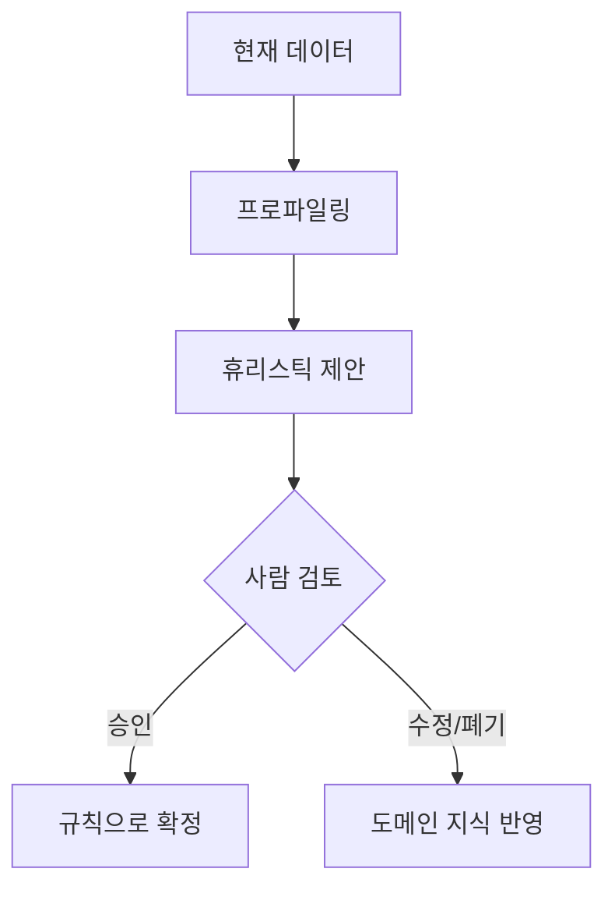
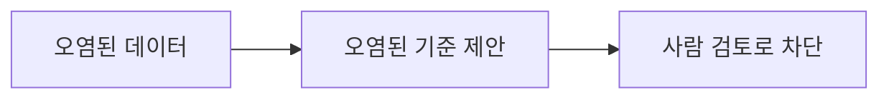

# 자동 제안 사람 검토

> 데이터 품질 도구가 **자동으로 제안한 검증 규칙을 사람이 반드시 검토**하는 절차다. 제안은 **지금 가진 데이터가 정적이고 올바르다는 가정**에서 만들어지므로, 데이터가 이미 오염돼 있거나 우연히 그런 모습이면 틀린 기준이 규칙이 된다.

## 쉽게 말하면
처음 보는 반의 출석부를 보고 AI가 "이 반 학생은 전부 3학년이니 3학년만 허용하세요"라는 규칙을 제안했는데, 실은 그날 우연히 3학년만 출석했을 수도 있다. 규칙으로 확정하기 전에 담임(도메인 전문가)이 확인해야 한다.

## 자세히
(Deequ 저장소의 제약 제안 예제 문서(`constraint_suggestion_example.md`)를 WebFetch로 직접 확인. Deequ를 직접 실행하지는 않았다. 예시의 임계 숫자(0.38, 0.53)는 문서 예시 데이터의 값이다.)
- **문서의 경고**: 제안은 **휴리스틱 규칙**에서 나오고 **데이터가 정적이며 올바르다고 가정**하므로 실제 배포 전에 **"항상 수동으로 검토해야 한다"**고 명시한다.
- **실행(문서)**: `ConstraintSuggestionRunner().onData(data).addConstraintRules(Rules.DEFAULT).run()`. 제안마다 설명(description)과 해당 Scala 코드(`codeForConstraint`)가 나온다.
- **예시 제안(문서, 4개 컬럼 `productName`·`totalNumber`·`status`·`valuable`, 일부 결측)**
  | 컬럼 | 제안 | 검토 포인트(해석) |
  |---|---|---|
  | `valuable` | 불리언 타입 검사, `hasCompleteness(_ >= 0.38)` | 0.38은 표본에서 관측한 하한. 실제 업무 기대치(예: 거의 100%)와 맞는가? |
  | `totalNumber` | Fractional 타입, `hasCompleteness(_ >= 0.53)`, `isNonNegative` | "음수 없음"은 표본에 음수가 **없었을 뿐**일 수 있음(환불·취소 등) |
  | `productName`, `status` | `isComplete`, `isContainedIn(관측값 목록)` | 관측된 값 목록이 **전체 허용값**인가, 아니면 표본에 나온 값뿐인가? |
- **검증 보조(문서)**: 큰 데이터에서는 `.useTrainTestSplitWithTestsetRatio(0.1)`로 **90%에서 제안을 만들고 나머지 10%로 평가**할 수 있다. 제안이 새 데이터에서도 통과하는지 확인하는 장치지만, 그래도 사람의 업무 지식 검토를 대체하지는 않는다(해석).
- **검토 체크리스트(제안)**: ① 현재 데이터가 대표적인가(기간·계절·소스) ② 관측 값 목록이 닫힌 집합인가 ③ 완전성 하한이 비즈니스 기대와 맞는가(소표본이면 신뢰구간 하한, [Wilson 구간](#wilson-completeness-bound)) ④ 과거에 이미 존재한 결함을 "정상"으로 굳히지 않았는가 ⑤ 승인 기록(누가·언제·근거)을 남긴다.
- **한계**: 이 노드는 문서의 설명과 예시에 근거하며, 실제로 오염된 데이터에서 어떤 제안이 나오는지는 시험하지 않았다.

## 그림으로 보기

## 예시
- `isContainedIn(["active","closed"])` 제안 → 실제로는 "pending"도 정상 상태임을 담당자가 확인해 목록을 수정.
- 교육 활동: 작은 표에서 자동 제안된 규칙 5개를 보고 "표본 우연으로 생긴 규칙"을 찾아 표시하기.

## 헷갈리는 것과 비교
| 개념 | 차이 |
|---|---|
| 자동 제안 | 현재 데이터에서 규칙 후보 생성 |
| 사람 검토 | 업무 지식으로 후보를 승인·수정 |
| [제약 자동 제안](#constraint-suggestion) | 이 검토 대상이 되는 기능 |
| [컬럼 프로파일](#column-profile) | 제안의 기반이 되는 통계 요약 |

## 더 읽을거리
- [Deequ constraint suggestion 예제](https://github.com/awslabs/deequ/blob/master/src/main/scala/com/amazon/deequ/examples/constraint_suggestion_example.md) — 제안 실행, 예시 출력, 수동 검토 경고, train/test 분할 평가(직접 확인).
