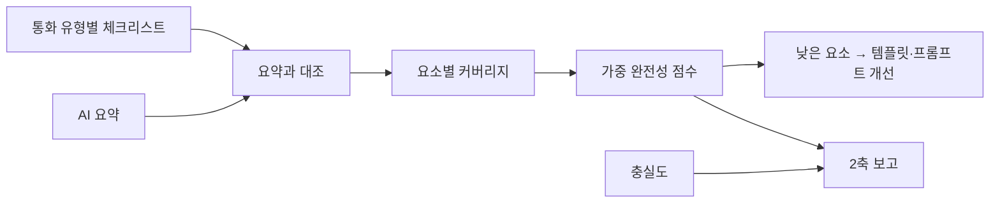

# 요약 완전성 (Summary Completeness)

> 요약이 상담의 **핵심 요소(고객 요청, 상담사 행동, 결정, 약속, 후속 조치, 위험 정보)를 얼마나 빠짐없이 덮었는가**를 요소별 커버리지로 나타낸 값. [요약 누락](#summary-omission)을 개별 건이 아니라 비율로 관리하는 방식이다.

## 쉽게 말하면
시험 답안이 "필수 채점 항목 5개 중 몇 개를 썼는가"로 채점되는 것과 같다. 쓴 문장이 맞는지가 아니라 필요한 항목을 다 썼는지를 본다.

## 자세히
출처: 이 노드의 틀은 [요약 누락](#summary-omission)에서 정리한 핵심 사실 체크리스트 접근이며, UCLA Health 보도자료가 전한 "AI 노트의 주된 부정확성은 누락"이라는 의사 보고에 기댄다(본문 확인, 2026-11-18). **지표 정의와 수치는 모두 제안·가상 값이다.**
- **정의(제안)**: 완전성 = 체크리스트 항목 중 요약이 포함한 항목 수 ÷ 전체 항목 수. 요소별(요청·행동·약속 등) 커버리지를 따로 낸다.
- **요소 예(제안)**: ①고객 요청 ②문제 원인·상황 ③상담사 조치 ④결정·결과 ⑤약속·마감일 ⑥후속 조치 담당 ⑦위험·취약 정보 ⑧고객 감정·불만 신호.
- **가중치(제안)**: 약속·위험 정보는 가중치를 크게(또는 별도 0건 목표), 부가 정보는 작게. 심각도 가중 방식은 [오류 수정과 스타일 수정 구분](#fix-vs-style-edit)의 곱수 아이디어를 빌릴 수 있다.
- **계산 예(가상)**: 통화 200건, 항목 8개. 요약이 포함한 항목 평균 6.4개 → 완전성 80%. 요소별로는 요청 98%, 상담사 조치 92%, 약속 61%, 위험 정보 55%라면 약속·위험 정보를 개선 대상으로 잡는다.
- **함정**: ①완전성만 높이려고 요약을 길게 하면 읽기 어려워진다(간결성과 균형) ②체크리스트가 요약 모델에 노출되면 시험을 위해 맞춘다(별도 비공개 평가셋 유지) ③항목 정의가 모호하면 평가자 간 불일치.
- **측정 운영(제안)**: 층화 표본, 두 명 독립 라벨링 후 일치도 확인, 모델·프롬프트 변경마다 재측정. 충실도([요약 충실도 점수](#summary-faithfulness-score))와 함께 2축으로 본다.
- **한계**: 항목 수가 통화 유형에 따라 다르고, 필요한 항목을 사람이 정해야 한다.

## 그림으로 보기


## 예시
```python
items = ["request", "cause", "action", "decision", "promise", "followup", "risk", "mood"]
covered = {i: summary_has(i) for i in items}
completeness = sum(covered.values()) / len(items)
```
교육 활용: 자사 통화 유형별로 "요약에 반드시 있어야 할 5가지"를 팀이 함께 정해 보는 실습.

## 헷갈리는 것과 비교
| 개념 | 차이 |
|---|---|
| 완전성 | 필요 항목을 덮은 비율 |
| 충실도 | 쓴 내용이 근거 있는지 |
| [요약 누락](#summary-omission) | 빠진 정보 문제 자체 |
| [ROUGE·BLEU의 한계](#rouge-bleu-limits) | 겹침 지표로는 누락·완전성을 못 잼 |

## 더 읽을거리
- [UCLA Health: AI 스크라이브 시험](https://www.uclahealth.org/news/release/ucla-study-finds-ai-scribes-may-reduce-documentation-time) — 누락이 주된 부정확성이라는 의사 보고
