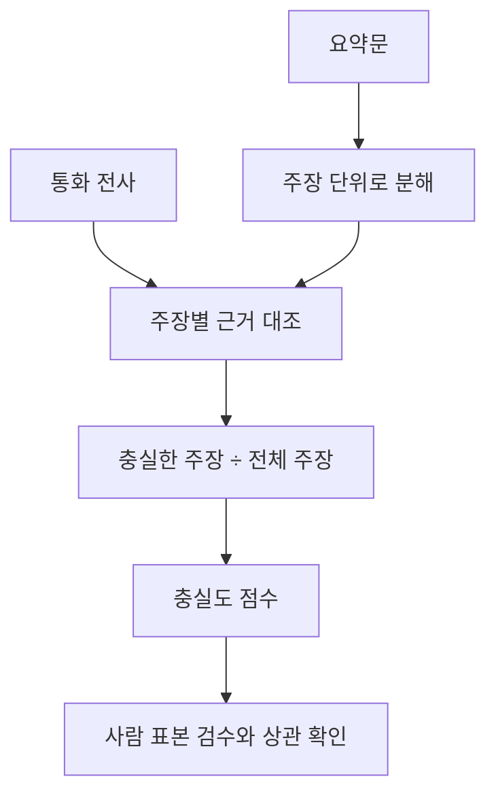

# 요약 충실도 점수 (Summary Faithfulness Score)

> 요약이 **원문(통화 전사)에 없는 내용을 지어내거나 왜곡하지 않았는지**를 점수로 나타낸 값. LLM에게 1~5점으로 매기게 하는 방식이 흔하지만, 단일 점수는 거칠어서 사실 단위로 쪼개 확인하는 방식과 사람 표본 검수를 함께 쓰는 편이 낫다는 연구들이 있다.

## 쉽게 말하면
선생님이 학생 요약문에 "충실함 4점"이라고 쓰는 것과, 문장마다 "이 문장은 본문에 근거가 있음/없음"을 표시하는 것의 차이다. 뒤쪽이 어디가 틀렸는지 알려 준다.

## 자세히
출처: 검색 결과 요약(2026-11-18): G-Eval(arXiv 2303.16634), FineSurE(arXiv 2407.00908), LLM 판정자 편향 연구(arXiv 2606.19544 등). **원문을 직접 열어 확인하지 못했고(웹 가져오기 도구 중단) 검색 요약에 의존한 글이라 confidence가 낮다.**
- **G-Eval 수치**: GPT-4 기반 G-Eval이 요약 과제에서 사람 판단과 스피어먼 상관 약 0.514라고 보고되며, 이는 뉴스 도메인·GPT-4·요약 수준의 2023년 결과다. 상담 통화 요약에 그대로 적용되는 값이 아니다.
- **1~5 정수 점수의 문제**: G-Eval 저자들은 정수 점수가 한 값에 몰려 분산이 낮아지고 인간 상관이 약해질 수 있다고 지적하며, 각 점수를 토큰 확률로 가중해 세밀한 값을 얻는 방법을 제안한다.
- **사실 단위 평가(FineSurE)**: 단일 리커트 점수는 요약 수준 평가일 뿐이라며, 충실도를 요약 문장·주장별 사실 확인(원문 대조)으로 쪼갠다. 예: 세 문장 중 하나만 사실이면 충실도 33%.
- **판정자 편향**: 위치 편향은 순서 바꿔 재평가·일치 검증으로 완화한다. 2026 연구는 재시험 일관성이 높아도 위치 편향이 클 수 있다고 한다(일관성 ≠ 타당성). 장황함 편향은 증거가 엇갈린다. 익숙한(낮은 퍼플렉서티) 요약을 사람보다 더 좋게 본다는 연구도 있다.
- **상담 적용(제안)**: ①요약을 주장(사실) 단위로 분해해 전사와 대조 ②숫자·이름·약속은 규칙 기반으로 별도 검사([숫자·고유명사 오인식](#number-entity-errors)) ③LLM 판정자는 사람 표본 검수와 상관을 확인한 뒤에만 쓴다 ④판정 프롬프트·모델 버전 고정 ⑤순서 바꿔 두 번 채점.
- **한계**: 점수는 임계값을 정하기 전까지 의미가 약하다. 사람 판단 자체의 일치도도 확인해야 한다.

## 그림으로 보기

## 예시
- 요약 5개 주장 중 4개가 전사에 근거 → 충실도 80%. 근거 없는 1개가 환불 금액이면 치명 오류로 별도 표시(심각도 가중, [오류 수정과 스타일 수정](#fix-vs-style-edit)).
- 교육 활용: LLM 판정자의 1~5점과 사람이 주장 단위로 센 충실도를 비교해 보는 실습.

## 헷갈리는 것과 비교
| 개념 | 차이 |
|---|---|
| 충실도 | 원문에 근거한가(환각 여부) |
| 관련성·유창성 | 핵심 포함·문장 품질 |
| [오류 계층 분리 감사](#error-layer-audit) | 오류의 발생 층 구분 |
| [원문 링크형 요약](#source-linked-summary) | 문장마다 근거 위치 연결 |

## 더 읽을거리
- [G-Eval (arXiv 2303.16634)](https://arxiv.org/abs/2303.16634) — LLM 평가자와 사람 상관(검색 결과로만 확인)
- [FineSurE (arXiv 2407.00908)](https://arxiv.org/html/2407.00908v3) — 사실 단위 충실도 평가(검색 결과로만 확인)
